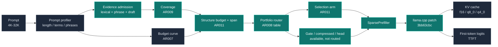

<p align="center">
  
</p>

<p align="center">
  
  
  
  
  
  
</p>

<h1 align="center">EdgePrefill</h1>

<p align="center">
  面向端侧长上下文大模型的分层稀疏 Prefill 引擎<br>
  <sub>Evidence-first / structure-bounded admission / 40-192x CPU prefill on llama.cpp</sub>
</p>

<p align="center">
  <a href="https://gitee.com/liu-xingyan04/edge-prefill">Gitee</a> /
  <a href="https://github.com/ShaneLiu04/edge-prefill">GitHub</a> /
  <a href="#头条结果">头条结果</a> /
  <a href="#架构">架构</a> /
  <a href="#快速开始">快速开始</a> /
  <a href="#复现-ar011">复现 AR011</a> /
  <a href="#实现状态">实现状态</a>
</p>

---

**EdgePrefill** 是一个以 llama.cpp/GGUF 为唯一推理后端的 C++17 研究工程，目标是在端侧单请求、4K-32K 长上下文、CPU 与轻量 GPU 的约束下降低首字延迟（TTFT）。从 AR001 到 AR011，它从块级稀疏、attention/head gather、压缩分支和图内页门控，逐步收敛到 **evidence-first + structure-bounded admission**：先证明哪些 token 有证据，再决定花多少结构预算，最后用实测路由选择执行臂。

> EdgePrefill is a C++17 research framework for long-context prefill acceleration on edge devices. It combines evidence-first admission, structure-bounded token budgets, phrase-aware and multi-fact coverage signals, compressed KV branches, and in-graph page gating on a pinned llama.cpp backend. Every number in `benchmarks/results/` comes from real GGUF inference with the command and environment recorded. No mock model, fake timing, or hard-coded quality score is used.

**当前状态：** 源码基线为 Gitee `cfb3415`（AR011），tags `ar004-v1.0` 到 `ar011-v1.0`（2026-10-28）。GitHub 仓库同步该快照。

## 头条结果

> **AR011 structure-bounded admission / Qwen2.5-1.5B-Instruct Q4_K_M / CPU 16 threads**
>
> 4K：146 tokens，755 ms，**40.4x**，q = 1.00
>
> 8K：188 tokens，1.03 s，**67.8x**，q = 1.00
>
> 16K：280 tokens，1.39 s，**124.5x**，q = 1.00
>
> 32K：525 tokens，2.33 s，**~192x**，q = 1.00
>
> Multi-needle 8K：247 tokens，1.17 s，**59.4x**，q = 1.00
>
> **GPU**：AR011 8K 选择逐例一致，45.2 ms vs CPU 1091.5 ms（**24x**）

AR011 的 32K 不再需要 in-graph gate：selection 以 525 tokens / 2.33 s 达到 q=1.00，而 AR011 矩阵中的 gate-p16 在同一质量下是 1,165 tokens / 5.95 s。AR010 先把 32K 从 gate 路径拉到 selection（198x / 2.26 s），AR011 再把 4K/8K/多针的 token 数分别削减 35% / 18% / 23%，并把 multi-fact hard 的 `q_min` 从 0.087 拉到 **0.571**。

**这不是“所有数据集都无懈可击”的结论。** Multi-fact easy 档是 0.836，hard 档 0.709，仍低于 0.85 目标；`q_min 0.571` 说明至少有一行仍明显失分。16K/32K 在 AR011 中没有进一步 token 收益（已到证据驱动下限），32K 的 dense 参照是 2-case 子集，GPU dense 未测。AR009 的旧 0.878 / 0.652 部分由 prior 归一化 bug 抬高，AR010 修正后为 0.836 / 0.667；完整说明见 [AR010 REPORT](benchmarks/results/ar010-evidence-first/REPORT.md) 与 [AR011 REPORT](benchmarks/results/ar011-structure-bounded/REPORT.md)。

## AR011 矩阵

同一 session、同一模型、同一 dense 参照；跨 session 的绝对毫秒不可比。

| 数据集 | Dense | AR010 | AR011 | gate-p16 |
| --- | ---: | --- | --- | --- |
| 4K | 30.5 s | 29.2x / 226 tok / 1046 ms | **40.4x / 146 tok / 755 ms** | 18.7x / 354 / 1631 ms |
| 8K | 69.7 s | 63.9x / 228 / 1091 ms | **67.8x / 188 / 1028 ms** | 23.0x / 628 / 3036 ms |
| 16K | 172.6 s | 119.5x / 280 / 1444 ms | **124.5x / 280 / 1387 ms** | 31.5x / 1128 / 5480 ms |
| 32K | 447 s* | ~188x / 525 / 2371 ms | **~192x / 525 / 2329 ms** | ~75x / 1165 / 5953 ms |
| Multi-needle 8K | 69.1 s | 38.6x / 321 / 1790 ms | **59.4x / 247 / 1165 ms** | 21.2x / 673 / 3266 ms |

\* 32K dense 是 2-case 子集（`max_new_tokens=8`），TTFT 是 prefill-only，不影响比值；AR010 自己 session 的 32K 为 2.26 s / 198x。

**路由：** 7/7 数据集都选择 `ar011`；AR008 的 gate 路径在 32K 上已被 AR010/AR011 的 selection 支配。`ar011_report.py --gate` 以 AR010 为基线，同时检查 quality、tokens 与 TTFT（5% 容差）；`--inject explen/len8k:ar010` 会正确 FAIL。

### Multi-fact 质量

| 数据集 | AR010 | AR011 |
| --- | --- | --- |
| multi-fact easy（6 facts / ask 3） | 0.836 / q_min 0.429 | 0.836 / q_min 0.429 |
| multi-fact hard（12 facts / ask 6） | 0.667 / q_min 0.087 | **0.709 / q_min 0.571** |

AR011 没有增加 hard 档的 token（445），而是把预算重新分给被漏掉的事实；`q_min` 从 0.087 到 0.571 是这次最明确的质量收益。Easy 档 0.836 持平；两档都仍低于 0.85 目标。

## AR011：结构锚点预算与证据预算分离

AR011 由两次审计触发：

1. **TTFT 已近似线性于准入 token 数。** 在这台 CPU 上约为 `selected / 155 token·s⁻¹`；剩余杠杆是“准入多少 token”，不是再换一个稀疏信号。
2. **结构锚点吃掉了预算。** 4K NIAH b=0.08 的预算是 314 token，实际准入 310 token / 10 块，其中 9 块是 mandatory（sink、recent、best-lexical ±2 窗口与 phrase pin）；`anchor_ratio=0.35` 约束的是一个已经被不可裁剪锚点花掉的预算。

AR011 的改法：

- **structure budget**：sink + recent 改成一个绝对 token allowance；`anchor_ratio` 只约束剩余 evidence 预算，而且只在锚点确实主导预算（`anchor_tokens > target/2`）时介入；16K/32K 不主导，因此不变。
- **span admission**：证据块裁剪到“证据峰所在的句子” token 段（按句边界扩展，至少 24 token；跨块答案不被切断）；`block_indices` 不变，只有 `token_indices` 变窄，准入口径与执行口径解耦。
- **multi-fact 硬门控**：多事实场景自动禁用 span 裁剪；实测 easy 0.836 -> 0.800、hard 0.669 -> 0.444、`q_min` -> 0，因为每个事实需要完整句子。
- **审计列**：`structure_tokens`、`evidence_tokens`、`span_tokens`、`uncovered_facts`，以及 `prior_gate` / `fill_priors` / `stop_reason` 等。

负面结果（均写入报告，默认关闭）：

- embedding（AR005）语义准入在 5 个数据集上质量零收益，扫描 +1.0-2.2 s；
- `coverage_reserve=1` 在 b=0.03 仅 +0.019，b=0.02 -0.007，b=0.04 0，默认关闭；
- `anchor_span_radius=1` 让 32K 从 461 token（-12%）换来 multi-fact easy -0.036 / hard -0.040，默认保持 ±2；
- span 用于多事实时 `q_min` 归零，硬门控禁用。

## AR010：evidence-first admission

AR010 的关键不是加信号，而是修一个预算审计暴露的 bug：

- `minmax()` 把 `*lo` 当成值用，但它其实是指向正在被覆盖的 vector 的迭代器；`diversity` 被归一化到 [0, 3.2]，`position` 到 [0, 1.157]，prior 可以单独产生准入。
- 32K b=0.05 的 1,553 个 token 中，62% 落在词法/短语零重叠的块上；选择器在“填满预算”，而不是“选择证据”。

修复后：

- `evidence = lexical + phrase + draft`，`prior = position + diversity`；
- `fused = evidence + sat(evidence) * prior`，`prior_gate=1` 时 prior 只能排序已有证据，不能创造准入；
- `fill_priors=0` 时证据耗尽即停止，预算按内容定大小，而不是固定配额；
- 审计 `evidence_blocks` / `stop_reason`（`budget` / `evidence-exhausted` / `no-signal` / `dense`）。

结果：

| 数据集 | 配额（AR009） | 内容定大小（AR010） |
| --- | --- | --- |
| 32K | 1,565 tok / q=0.611 / 7.28 s | **525 tok / q=1.000 / 2.26 s** |
| 16K | 792 / 3.68 s | **280 / 1.25 s** |
| 8K | 388 / 1.70 s | **228 / 1.04 s** |
| 4K | 322 / 1.49 s | **226 / 1.05 s** |
| Multi-needle | 321 / q=1.000 | 321 / q=1.000 |

32K 的 gate 路径（5.44 s / 1,165 tok）从“质量兜底”变成 Pareto 被支配；AR010 的 selection 以 2.26 s 达到 q=1.00。库默认仍保留 `fill_priors=1`（历史配额契约），内容定大小通过 portfolio/矩阵显式 opt-in。

## 怎么走到 AR011

| AR | 贡献 | 当前状态 |
| --- | --- | --- |
| AR001 | 块级选择、位置保持、分块 prefill、FFN skip、KV 精度 | 基础 |
| AR003/AR004 | head 自适应、压缩分支、GPU 12.78x | head 在 NIAH q=0；压缩分支仍是可选路径 |
| AR006 | 图内页门控、单次 gather | 32K 已被 AR010/AR011 selection 支配 |
| AR007 | 长度自适应预算曲线、结构锚点/MMR/span growing | 预算曲线仍在使用 |
| AR008 | 短语感知准入、组合路由 | 短语信号仍在使用；路由现在 7/7 选 ar011 |
| AR009 | 多事实覆盖 | AR010 修正 prior bug 后，easy/hard 为 0.836/0.667；AR011 hard 0.709 |
| AR010 | evidence/prior 分离、content-sized stop | 32K 不再需要 gate |
| AR011 | structure budget、span admission、hard q_min | 7/7 路由；4K/8K/MN token 下降 |

## GPU

AR011 的 8K 配置在 CPU 与 CUDA 上跑同一组选择：

```text
CPU  q=1.000 qmin=1.000 sel=[122,121,170,172] ttft=1091.5 ms
GPU  q=1.000 qmin=1.000 sel=[122,121,170,172] ttft=  45.2 ms   (24x)
```

准入在 host 侧，`selected_tokens` / `block_indices` 天然设备无关；GPU 只加速被准入 token 的 prefill。dense GPU 路径会被切成数百个 graph split，未纳入结论。AR004 的 GPU 16K 12.78x / q=1.00 仍是历史 GPU 头条；AR010/AR011 的 CPU 结果不外推到 GPU。

## 设计原则

| 原则 | 含义 |
| --- | --- |
| 端侧优先 | 单请求、4K-32K、CPU 内存带宽受限；GPU 结果单独标注 |
| 证据优先 | 先证明 token 有词法/短语/draft 证据，再让 prior 排序；prior 不能单独创造准入 |
| 结构有界 | sink/recent 用绝对 token allowance；`anchor_ratio` 只约束剩余证据预算 |
| 内容定大小 | 证据耗尽即停，不为了填满配额引入零证据块 |
| 质量地板 | 路由只选 mean+min quality 达标的组合；否则取最高质量 |
| 最小侵入 | 固定 llama.cpp commit，只维护 FFN skip 与 attention/gate gather 两个 patch |
| 证据可审计 | 每个数字都有 raw CSV、report、env JSON 与命令；跨 run 不混用分母 |
| 真实推理 | 禁止 mock 模型、伪造计时、硬编码质量分数；缺模型时测试显式 SKIP |

## 架构



### 三层决策

1. **证据层**：词法、短语、draft 组成 evidence；prior 只在 evidence 非零时起排序作用。`prior_gate=1`、`fill_priors=0` 是 AR010/AR011 主线；`fill_priors=1` 保留历史配额行为。
2. **结构层**：AR009 的 coverage 为每个请求事实保留锚点；AR011 的 structure budget 给 sink/recent 绝对 token allowance，span admission 把证据块裁到句子级 token 段（多事实场景自动禁用）。
3. **路由层**：portfolio 按质量地板选执行臂；当前 7/7 数据集选 ar011。AR008 的 gate/compressed/head 仍保留，但在 32K 上已被 selection 支配，作为可选路径存在。

## 关键机制

| 机制 | 实现要点 | 代码 |
| --- | --- | --- |
| Evidence/prior 分离（AR010） | `evidence=lexical+phrase+draft`；`fused=e+sat(e)*p`；`prior_gate=1` 时 prior 不能创造准入 | [src/selector.cpp](src/selector.cpp) |
| 内容定大小（AR010） | `fill_priors=0` 证据耗尽即停；`stop_reason` / `evidence_blocks` 审计 | [src/selector.cpp](src/selector.cpp) |
| 结构锚点预算（AR011） | sink/recent 绝对 token allowance；`anchor_ratio` 只约束剩余证据；`structure_tokens` 审计 | [src/selector.cpp](src/selector.cpp) |
| Span admission（AR011） | 证据峰所在句子的 token 段；跨块合并、24-token 下限；多事实自动禁用 | [src/selector.cpp](src/selector.cpp) |
| 多事实覆盖（AR009） | 稀有 sub-queries、每事实锚点、facility-location 增益、回声排除 | [src/selector.cpp](src/selector.cpp) |
| 短语感知准入（AR008） | 查询 bigram、单字符判别符保留、最高 IDF 锚点、跨块 bigram | [src/selector.cpp](src/selector.cpp) |
| 长度自适应预算（AR007） | `budget_curve.txt` 模型指纹；`budget_source=model/override/default/clamp` | [src/budget_curve.cpp](src/budget_curve.cpp) |
| 组合路由（AR008） | 质量地板、mean+min 双门槛、Pareto 门禁；当前路由全选 ar011 | [src/portfolio.cpp](src/portfolio.cpp) |
| 图内页门控（AR006） | K page 均值 + local window + 单次 gather；32K 已被 selection 支配 | [src/attention_sparsity.cpp](src/attention_sparsity.cpp) |
| 压缩分支 / head 矩阵 | 被丢块池化为 1 行 KV；per-head gather；可选路径 | [patches/llama-prefill-attn-top-k.patch](patches/llama-prefill-attn-top-k.patch) |
| 分块 / FFN / KV / 基准 | chunk_size=0 自动对齐；prefill-only FFN skip；raw CSV + env JSON | [src/chunk_scheduler.cpp](src/chunk_scheduler.cpp) |

## 研究映射

| 方向 | 核心思想 | 本仓库落地 | 实测证据 / 限制 |
| --- | --- | --- | --- |
| BM25 / 短语检索 | 词法证据与位置短语 | AR008 查询 bigram + IDF 锚点 + 跨块配对 | multi-needle q 0.333 -> 1.000；纯语义查询不适用 |
| Evidence-first admission | 先证据后先验 | AR010 evidence/prior 分离、content-sized stop | 32K q=1.000 / 525 tok；prior 不再创造准入 |
| Structure-bounded admission | 结构锚点必须有界 | AR011 absolute structure allowance + span trim | 4K -35% / 8K -18% / MN -23% tokens；hard q_min 0.087 -> 0.571 |
| Submodular facility location | 每个请求事实的覆盖增益 | AR009 sub-query anchors + facility-location gain | corrected easy 0.836 / hard 0.667; AR011 hard 0.709 |
| LongLLMLingua / MMR | 分段预算、结构锚点、近重复惩罚 | AR007 anchors / span growing / MMR | 4K/8K/16K q=1.00；32K 曲线 q=0.893 |
| RouteLLM / FrugalGPT | 按输入特征路由到成本/质量路径 | AR008 measured portfolio + Pareto gate | 7/7 route ar011; gate dominated at 32K |
| Quest / MoBA / NSA | 页级选择、分片门控、压缩上下文 | AR006/AR007 gate + AR004 compressed branch | 8K gate 9.4x；32K 已被 selection 支配 |
| MInference / SnapKV / PyramidKV | head 模式路由、按头预算、层先验 | AR003/AR004 head matrix | NIAH q=0；负结果已记录 |
| vLLM / Sarathi | 分块 prefill | `chunk_size=0` 对齐 `n_ubatch` | 128/512/auto ±5% |

更完整的三段式分析见 [docs/research.md](docs/research.md)（AR006 §8、AR007 §9、AR008 §10、AR009 §11、AR010 §12、AR011 §13）。

## 快速开始

### 环境要求

- Linux x86_64 或 WSL2（推荐 Ubuntu 22.04+）
- CMake 3.20+
- 支持 C++17 的编译器（归档环境：GCC 12.4 / 13.3）
- `bash`、`patch`、`git`、`curl` 或 `wget`
- 一块可用的 GGUF 模型；16K/32K 实验建议至少 16 GB 内存
- CUDA 构建需要 NVIDIA 驱动与 CUDA toolkit；归档 GPU 为 Quadro RTX 5000（Turing sm_75）

原生 Windows 不支持：CLI 使用 POSIX 头文件，构建流程依赖 `bash` 与 `patch`。请在 WSL2 中运行。

### 一键验证与复现

```bash
./repro.sh smoke    # 构建 + 下载/校验模型 + 单测 + AR005 smoke
./repro.sh ar010    # evidence-first 矩阵 + 路由 + Pareto 门禁
./repro.sh ar011    # 7 数据集 x 3 臂矩阵 + 不劣于 AR010 的门禁
```

`repro.sh` 支持 `smoke / matrix / full / budget / ar007 / ar008 / ar009 / ar010 / ar011`；每一步都会打印实际命令。已有模型时可加 `--skip-download`。AR011 的 dense 参照较慢（32K 为 2-case 子集），跑之前请留出时间。

### CPU 构建

```bash
cmake -S . -B build -DCMAKE_BUILD_TYPE=Release
cmake --build build -j
ctest --test-dir build --output-on-failure
```

首次 configure 会下载固定 commit 的 llama.cpp，并应用：

- `patches/llama-prefill-ffn-skip.patch`
- `patches/llama-prefill-attn-top-k.patch`

如果网络受限，可准备同 commit 的 llama.cpp 源码树后本地构建：

```bash
git clone https://github.com/ggml-org/llama.cpp.git /path/to/llama.cpp
cd /path/to/llama.cpp
git checkout 3bb63cbcbfb62056c84fe9e521b0f3d756d29c32
bash /path/to/edge-prefill/scripts/apply_llama_patch.sh

cd /path/to/edge-prefill
cmake -S . -B build \
  -DCMAKE_BUILD_TYPE=Release \
  -DEDGE_PREFILL_LLAMA_DIR=/path/to/llama.cpp
cmake --build build -j
```

### CUDA 构建

```bash
cmake -S . -B build-cuda \
  -DCMAKE_BUILD_TYPE=Release \
  -DEDGE_PREFILL_WITH_CUDA=ON \
  -DGGML_CUDA=ON \
  -DCMAKE_CUDA_ARCHITECTURES=75
cmake --build build-cuda -j
```

`75` 对应归档的 RTX 5000；请按实际 GPU 调整。AR011 的 GPU 一致性只在 8K 验证；dense GPU 路径因 graph split 未纳入结论。CUDA 结果请以 AR004 与 AR011 8K 归档为准。

### 模型与数据

```bash
bash scripts/download_model.sh --all
# models/qwen2.5-1.5b-instruct-q4_k_m.gguf     (main, AR011 主线)
# models/qwen2.5-0.5b-instruct-q4_k_m.gguf     (draft, optional AR005)
# models/bge-small-en-v1.5-q8_0.gguf           (embedding, optional AR005)
```

主模型 SHA256：`6a1a2eb6d15622bf3c96857206351ba97e1af16c30d7a74ee38970e434e9407e`。脚本会校验 SHA256，不匹配即拒绝。数据集随仓库分发：`benchmarks/data/explen/{len4k,len8k,len16k}`、`benchmarks/data/deep/{len32k,multineedle,multifact8k,multifact8k-hard}`；`repro.sh` 会检查 `index.tsv` 与 `manifest.json`。

## 复现 AR011

### 完整矩阵

```bash
./repro.sh ar011
```

它会跑 7 个数据集 x 3 个臂（AR010 / AR011 / gate-p16），生成 `matrix.csv/md`、`portfolio.json/txt`，并执行 `ar011_report.py --gate`：要求 routed 组合在 quality、tokens、TTFT 上不劣于 AR010（5% 容差），注入 `--inject explen/len8k:ar010` 必须 FAIL。完整结果见 [REPORT.md](benchmarks/results/ar011-structure-bounded/REPORT.md)。

### 单条 prompt

```bash
$BIN run \
  --model models/qwen2.5-1.5b-instruct-q4_k_m.gguf \
  --prompt-file benchmarks/data/smoke8k.txt \
  --budget-curve benchmarks/results/ar007-sweep/budget_curve.txt \
  --phrase-weight 0.5 \
  --coverage-weight 3 \
  --prior-gate 1 \
  --fill-priors 0 \
  --structure-budget 64 \
  --span-admission 1 \
  --max-new-tokens 32 \
  --threads 16
```

说明：

- `--prior-gate 1 --fill-priors 0` 是 AR010 的 evidence-first / content-sized 主线；
- `--structure-budget 64 --span-admission 1` 是 AR011 的 routed arm；多事实场景会自动禁用 span；
- `--coverage-weight 0` / `--phrase-weight 0` / `structure_budget=0` / `span_admission=0` 分别回到上一版行为；
- `--chunk-size` 不是当前 CLI 参数，分块大小写配置文件的 `chunk_size`；
- `bench` 的 gate/组合参数建议以配置文件为准；`run` 支持 CLI 覆盖。

## CLI 与配置

核心参数：

| 参数 | 含义 | 默认值 |
| --- | --- | --- |
| `--config` | `bench/eval` 配置文件 | 空 |
| `--model` | 主模型 GGUF | 空 |
| `--prompt` / `--prompt-file` | 单条 prompt / prompt 文件 | 空 |
| `--data-dir` / `--out` | 基准数据目录 / 输出目录 | 配置值 |
| `--mode` | `latency / balanced / quality / reuse / dense` | `balanced` |
| `--budget` | 进入 KV 的块比例（显式覆盖曲线） | 模式决定 |
| `--budget-curve` | AR007 长度-预算表；opt-in | 空 |
| `--anchor-ratio` | 证据预算的锚点比例 | 0.35 |
| `--anchor-stride-scale` | strided coverage 倍率 | 1.0 |
| `--mmr-lambda` / `--mmr-threshold` | MMR 惩罚 / 触发阈值 | 0.5 / 0.6 |
| `--phrase-weight` | AR008 短语权重；0 = AR007 | 0.5 |
| `--coverage-weight` | AR009 多事实覆盖权重；0 = AR008 | 3.0 |
| `--prior-gate` | 1 = prior 不能创造准入；0 = 旧加法融合 | 1.0 |
| `--fill-priors` | 0 = 证据耗尽即停；1 = 填满预算 | 1.0（路由用 0） |
| `--structure-budget` | sink/recent 绝对 token allowance；0 = AR010 | 0 |
| `--anchor-span-radius` | best-lexical 窗口半径；0 = 默认 ±2 | 0 |
| `--coverage-reserve` | 每事实保底；实测无稳定收益 | 0 |
| `--span-admission` | 1 = 句子级 span 准入；多事实自动禁用 | 0 |
| `--span-min-tokens` | span 最小 token 数 | 24 |
| `--portfolio` | AR008 执行组合表 | 空 |
| `--qg-bound` | `on/off`，AR006 图内页门控 | off |
| `--qg-sel-pages` | 每个 ubatch 的 top-k page 数 | 8 |
| `--qg-local-rows` | local window 行数；0 = ubatch 跨度 | 0 |
| `--attn-top-k` | attention gather 的 top-k block 数 | 0 |
| `--pool-branches` | `on/off`，压缩分支 | off |
| `--embedding-model` | 可选 bge-small，AR005 语义选择 | 空 |
| `--draft-model` | 可选 draft GGUF | 空 |
| `--head-adaptive` / `--head-profile` | head 自适应矩阵 / profile | off / 空 |
| `--kv-type` | `f16 / q8_0 / q4_0` | `f16` |
| `--skip-ffn` | prefill-only FFN 跳过 | 空 |
| `--threads` | CPU 线程数 | 物理核数 |
| `--ngl` / `--n-gpu-layers` | GPU offload 层数 | 0 |
| `--n-ctx` / `--n-ubatch` | 上下文长度 / 物理微批 | 自动 / 512 |
| `--max-new-tokens` | 贪心 decode 步数 | 32 |
| `--repeats` | 基准重复次数；未给时用配置值 | 配置值 |
| `--bench-skip-dense` | bench 只跑稀疏模式 | 关闭 |
| `--dump-plan` / `--dump-selection` | 输出审计 JSON | 空 |

配置文件常用键：

| 键 | 含义 | 默认值 |
| --- | --- | --- |
| `block_size` / `chunk_size` | 选择块 / 分块大小（0 = 自动） | 32 / 0 |
| `budget_curve` / `portfolio` | AR007 曲线 / AR008 组合表 | 空 |
| `phrase_weight` / `coverage_weight` | AR008 / AR009 权重 | 0.5 / 3.0 |
| `prior_gate` / `fill_priors` | AR010 evidence / content-sized | 1 / 1 |
| `structure_budget` / `span_admission` | AR011 结构预算 / span | 0 / 0 |
| `anchor_span_radius` / `coverage_reserve` | AR011 锚点半径 / 保底 | 0 / 0 |
| `qg_bound` / `qg_sel_pages` / `qg_local_rows` | AR006 gate 参数 | off / 8 / 0 |
| `prefix_cache` / `prefix_cache_bytes` | dense KV 快照缓存 | on / 256 MiB |

## 基准与证据

每次 `bench`/`eval` 运行会写出：

- `*_raw.csv`：逐样本指标，含 `ttft_ms / e2e_ms / prefill_tps / kv_bytes / quality / dense / selected_tokens / attn_top_k / repeats / score_source / semantic_score_ms / qg_source / budget_source / anchor_blocks / mmr_penalized / phrase_blocks / specific_terms / coverage_queries / evidence_blocks / stop_reason / structure_tokens / evidence_tokens / span_tokens / uncovered_facts / portfolio_choice / portfolio_reason`；
- `*_report.md`：人读汇总表；
- `*_env.json`：模型 SHA256、数据 SHA256、llama.cpp commit、CPU、线程、KV 类型、命令与时间戳。

主证据：

- [AR011 REPORT](benchmarks/results/ar011-structure-bounded/REPORT.md) 与 [matrix.md](benchmarks/results/ar011-structure-bounded/matrix.md) / [matrix.csv](benchmarks/results/ar011-structure-bounded/matrix.csv)：7 数据集 × 3 臂、路由表、注入自测；GPU 8K 24x；
- [AR010 REPORT](benchmarks/results/ar010-evidence-first/REPORT.md) 与 [matrix.md](benchmarks/results/ar010-evidence-first/matrix.md)：evidence/prior 修复、32K 198x、AR009 数字修正、GPU 4K/8K 一致性；
- [AR009 REPORT](benchmarks/results/ar009-multifact/REPORT.md)：多事实覆盖；旧 0.878/0.652 需与 AR010 修正节一起读；
- [AR008 portfolio](benchmarks/results/ar008-portfolio/REPORT.md) / [AR007 campaign](benchmarks/results/ar007-campaign/REPORT.md) / [AR006 campaign](benchmarks/results/ar006-campaign/REPORT.md) / [AR004 矩阵](benchmarks/results/ar004-t015-matrix/matrix.md)：历史路径与负结果；
- `ar011_report.py` / `ar010_report.py` / `check_expected_ar009.py` / `check_portfolio.py`：质量、token、TTFT 门禁；AR011 正常 7/7 PASS，注入 `len8k:ar010` 必须 FAIL；
- [docs/server-repro.md](docs/server-repro.md)：服务器复现与 GPU 说明。

质量约束：

- `budget=1.0`、`prior_gate=1`、`fill_priors=1`、`qg_bound=false`、`attn_top_k=0`、`skip_ffn=0` 时与 dense 数值等价（logits max abs diff < 1e-5）。
- AR006 arming 会清理其他稀疏路径，关闭后恢复 dense；`bound_gating_execution_and_restore` 验证逐位等价。
- 每个损失性配置都必须同时报告质量；没有质量数字的加速不进入推荐配置。
- 不允许 mock 模型、伪造计时或硬编码结果。

## 测试

无模型环境：

```bash
ctest --test-dir build --output-on-failure
# 真实模型用例显式 SKIP，不会伪造通过
```

提供真实 GGUF 后：

```bash
EDGE_PREFILL_TEST_MODEL=models/qwen2.5-1.5b-instruct-q4_k_m.gguf \
  ctest --test-dir build --output-on-failure
```

AR011 T013/T014 归档：无模型 163 PASS / 0 FAIL；真机 163 PASS / 0 FAIL；`-Wall -Wextra -Werror` 零警告；ASan 选择器用例干净；干净克隆 `ar011-v1.0` 构建 + `ctest` 100% + `ar011_report.py --gate` 7/7 PASS + 注入 `len8k:ar010` 自测 FAIL；无 mock。

## 项目结构

```text
edge-prefill/
├── CMakeLists.txt
├── README.md
├── repro.sh                     # smoke / matrix / full / budget / ar007..ar011
├── include/edge_prefill/        # 公共头文件
├── src/                         # planner / selector / portfolio / backend / benchmark / CLI
├── tests/                       # 单元 + 真实模型集成测试
├── patches/                     # 固定 llama.cpp commit 上的最小 patch
├── benchmarks/
│   ├── configs/                 # smoke 配置
│   ├── matrix/                  # budget / bound / multifact / portfolio 配置与 floor
│   ├── data/                    # 4K/8K/16K/32K/multi-needle/multi-fact 数据
│   ├── results/                 # raw CSV / report / env JSON / ar010 / ar011 矩阵
│   └── scripts/                 # 数据生成、矩阵、ar010/ar011 报告与门禁
├── scripts/                     # 下载/构建/实验编排/诊断归档
├── specs/archive/               # AR001-AR011 需求/设计/任务/ST 记录
├── docs/
│   ├── architecture.md
│   ├── experiments.md
│   ├── research.md              # SOTA 映射 + AR006 §8 ... AR011 §13
│   ├── server-repro.md          # 服务器/7B/14B/GPU 复现
│   └── assets/                  # 封面
└── third_party/                 # 构建期拉取，不入库
```

## 实现状态

| 阶段 | 状态 |
| --- | --- |
| AR001 块级稀疏、位置保持、分块 prefill、FFN skip、KV 精度 | 完成 |
| AR002 attention top-k、draft 语义打分、benchmark repeats/warmup | 完成 |
| AR003 head profile、`classify-heads`、per-head gather 矩阵 | 实现与测试完成；NIAH 质量 q=0，负结果已记录 |
| AR004 大 chunk、PPL 保留率、压缩分支、query 门控、head 路由、GPU、主矩阵、ST | 完成（T001-T018 passing）；tag `ar004-v1.0` |
| AR005 语义 2D 门控、bge-small embedding、server repro | 交付核心能力；tag `ar005-v1.0` |
| AR006 图内页门控、单次 gather、短提示旁路 | T001-T006 / T008 / T010-T013 passing；T007/T009 pending；tag `ar006-v1.0` |
| AR007 预算-质量曲线、结构锚点/MMR/span growing、页打分去拷贝 | T001-T008 / T010-T013 passing；T009 GPU 守护 pending；tag `ar007-v1.0` |
| AR008 短语感知准入、组合路由、Pareto 门禁 | T001-T014 passing；tag `ar008-v1.0` |
| AR009 多事实覆盖准入、sub-query anchors、facility-location 增益 | T001-T016 passing；tag `ar009-v1.0`；AR010 修正其 prior bug 影响 |
| AR010 evidence/prior 分离、content-sized stop、32K 去 gate | T001-T015 passing；tag `ar010-v1.0` |
| AR011 structure budget、span admission、hard q_min | T001-T014 passing；tag `ar011-v1.0` |
| Radix 跨请求前缀复用、按层 KV、自动调优 Pareto、多请求服务化 | 未实现，后续 AR |

**最新验收：** AR011 在 4K/8K/16K/32K/multi-needle 全部 routed 到 selection，q=1.00；4K/8K/多针 token 分别下降 35%/18%/23%，multi-fact hard `q_min` 0.087 -> 0.571；7/7 门禁 PASS，注入退化 FAIL；GPU 8K 与 CPU 选择逐例一致（24x 预填加速）。AR004 GPU 16K 12.78x / q=1.00 仍是历史 GPU 头条。

## 已知限制

- **Multi-fact 仍未到 0.85。** easy 0.836，hard 0.709 / q_min 0.571；hard 的 445 token 放不下 6 条答案句与格式；hard 档没有 dense 天花板（未测，不做相对 dense 声明）。
- **16K/32K 在 AR011 没有进一步 token 收益。** 280 / 525 tokens 已是证据驱动下限；32K dense 是 2-case 子集，AR011 的 ~192x 不是完整 dense 矩阵。
- **Content-sized admission 是 opt-in。** 库默认 `fill_priors=1` 保留历史配额契约；AR010/AR011 的收益通过矩阵/portfolio 显式启用。
- **Route 表是模型/数据集绑定的实测表。** 当前 7/7 选 ar011；换模型/数据集必须重测。AR006 gate 在 32K 已被 selection 支配，但作为可选路径保留。
- **负面结果默认关闭：** embedding 准入质量零收益且 +1.0-2.2 s 扫描；`coverage_reserve` 无稳定收益；`anchor_span_radius=1` 损害多事实；span 用于多事实会使 `q_min` 归零。
- **GPU 只验证了 8K 一致性。** dense GPU 路径 graph split 未纳入；AR004 GPU 12.78x 是非-FA 同图族历史结果，不能与 CPU 的 40-192x 直接横向比较。
- Head 路由 NIAH q=0；AR004 32K 选择级稀疏 60.96x 但 q=0.25。
- Attention gather 与 llama.cpp flash attention 不兼容；patch 不可用时回退块级稀疏。
- Prefix cache 当前用于 dense 路径；Radix 跨请求、按层 KV、自动调优尚未实现。
- 部分实验编排脚本保留作者绝对路径；`repro.sh` 与 `docs/server-repro.md` 是更可移植的入口。
- 仓库尚未附带开源许可证；如需复用代码，请先联系作者确认授权。

## 相关研究与致谢

EdgePrefill 借鉴了以下方向的公开思想，但实现保持端侧单请求约束，不直接移植服务端 kernel：

- **llama.cpp / GGUF**：端侧真实推理与模型格式基础。
- **BM25 / 短语检索**：词法证据、位置短语与 IDF 判别符；AR008 的 multi-needle 修复。
- **LongLLMLingua / MMR**：分段预算、结构锚点、span growing 与近重复惩罚；AR007 的准入层。
- **Submodular facility location / coverage maximization**：每个请求事实的覆盖增益；AR009 的 coverage。
- **RouteLLM / FrugalGPT**：按输入特征在成本/质量路径间路由；AR008 的 measured portfolio。
- **Quest / MoBA / NSA**：页级选择、分片门控与压缩上下文；AR006/AR007 的 gate 与 local window。
- **MInference / SnapKV / PyramidKV**：head 模式路由、按头 KV 预算与层先验。
- **vLLM / Sarathi-Serve**：分块 prefill 与长 prompt 调度。

感谢 llama.cpp、GGUF、Qwen、ModelScope / hf-mirror 与 bge-small 生态提供的开放基础设施。除固定 commit 上的最小 patch 外，本项目未复制第三方实现。

## 联系

- Gitee: [liu-xingyan04](https://gitee.com/liu-xingyan04)
- GitHub: [ShaneLiu04](https://github.com/ShaneLiu04)
- 问题与建议：欢迎提交 Issue 或 Pull Request。

---

<p align="center">
  <sub>Built with llama.cpp and GGUF. Speedups are paired with quality; negative results are kept in the repository.</sub>
</p>
