<p align="center">
  
</p>

<p align="center">
  
  
  
  
  
  
</p>

<h1 align="center">EdgePrefill</h1>

<p align="center">
  面向端侧长上下文大模型的分层稀疏 Prefill 引擎<br>
  <sub>Compact context / KV sized by the admitted span / 64K documents on 32K-trained models</sub>
</p>

<p align="center">
  <a href="https://gitee.com/liu-xingyan04/edge-prefill">Gitee</a> /
  <a href="https://github.com/ShaneLiu04/edge-prefill">GitHub</a> /
  <a href="#头条结果">头条结果</a> /
  <a href="#架构">架构</a> /
  <a href="#快速开始">快速开始</a> /
  <a href="#复现-ar013">复现 AR013</a> /
  <a href="#实现状态">实现状态</a>
</p>

---

**EdgePrefill** 是一个以 llama.cpp/GGUF 为唯一推理后端的 C++17 研究工程，目标是在端侧单请求、4K-64K 长上下文、CPU 与轻量 GPU 的约束下降低首字延迟（TTFT）与 KV 内存。AR001 到 AR011 把准入与稀疏执行做到 40-192x dense 加速；AR012 用句子级补全修复多事实的块边界截断；AR013 把 KV 从“按模型训练长度预留”改成“按实际准入 span 分配”，并用块级位置压缩让 32K 训练模型跑 64K 文档。

> EdgePrefill is a C++17 research framework for long-context prefill acceleration on edge devices. It combines evidence-first admission, structure-bounded token budgets, sentence-complete and multi-fact coverage signals, and compact-context KV allocation on a pinned llama.cpp backend. Every number in `benchmarks/results/` comes from real GGUF inference with the command and environment recorded. No mock model, fake timing, or hard-coded quality score is used.

**当前状态：** 源码基线为 Gitee `dee280b`（AR013），tags `ar004-v1.0` 到 `ar013-v1.0`（2026-10-29）。GitHub 仓库同步该快照。

## 头条结果

> **AR013 compact context / Qwen2.5-1.5B-Instruct Q4_K_M / CPU 16 threads**
>
> 4K KV：旧 bench 896 MiB -> **7 MiB**；32K -> **21 MiB**；64K 文档 -> **35 MiB**
>
> 64K 文档：在 **32K-trained 模型**上运行，q = **1.00**，TTFT 6.44 s
>
> Multi-fact：q 0.887 -> **0.975**；hard 档 0.739 -> **0.746**
>
> TTFT：相对 AR012 聚合 **0.96x**（测量噪声内）；AR011 的 **40-192x vs dense** 速度基线保持
>
> **GPU**：AR013 的 selection/span/quality 与 CPU 逐例一致；AR004 的 GPU 16K 12.78x 仍是历史 GPU 头条

AR013 解决的是“准入已经把 token 数降了 27x，但 KV 仍按模型训练长度预留”的矛盾：4K prompt 的旧 bench 预留 896 MiB，实际只写了 3.5 MB。修复后 4K 用 7 MiB，32K 用 21 MiB，64K 文档用 35 MiB；64K 文档在 32K-trained 模型上通过块级位置压缩运行，q=1.00。

**这不是一个纯速度优化。** AR013 相对 AR012 的聚合 TTFT 是 0.96x（4K 更快，16K/32K 略慢，整体在噪声带内），真正的收益是 **KV 内存下降 43-128x** 和 **上下文长度从 32K 扩到 64K**。位置压缩是 opt-in 的；`budget=1.0` 且关闭压缩时仍与 dense 数值等价。

## AR013 结果

同一 session；`TTFT` 为 5 次最小值，绝对毫秒跨 session 不可比。

| Dataset | AR012 q | AR013 q | KV AR012 | KV AR013 | TTFT AR012 -> AR013 |
| --- | ---: | ---: | ---: | ---: | ---: |
| 4K | 1.000 | 1.000 | 112 MiB | **7 MiB** | 3311 -> **2163 ms** |
| 8K | 1.000 | 1.000 | 217 MiB | **7 MiB** | 1131 -> 1100 ms |
| 16K | 1.000 | 1.000 | 430 MiB | **14 MiB** | 1641 -> 1789 ms |
| 32K | 1.000 | 1.000 | 854 MiB | **21 MiB** | 2980 -> 3073 ms |
| Multi-needle | 1.000 | 1.000 | 217 MiB | **14 MiB** | 1551 -> 1518 ms |
| Multi-fact | 0.887 | **0.975** | 238 MiB | **21 MiB** | 3131 -> 3156 ms |
| Multi-fact hard | 0.739 | **0.746** | 244 MiB | **21 MiB** | 2482 -> 2603 ms |
| **64K document** | cannot run | **1.000** | — | **35 MiB** | — -> 6436 ms |
| All vs pre-AR013 bench | | | **896 MiB** | **7-21 MiB** | noise-neutral (aggregate 0.96x) |

口径说明：

- 896 MiB 是旧 bench 固定预留 `n_ctx_train` 的 KV；112 MiB 是 AR012 在 4K 下的实际值；7 MiB 是 AR013。两种比较都保留：**896 -> 7**（旧 bench 到 AR013）与 **112 -> 7**（AR012 到 AR013）。
- 64K 文档是 32K-trained 模型上的超训练长度输入；AR012 无法运行，AR013 通过 `position_compaction` 启用。
- Multi-fact 的提升不是准入变化：`facts_in_context` 在 AR012/AR013 都是 1.000 / 0.990，模型答得更好是因为证据块不再被数千个 filler position 隔开。

## AR012：sentence-complete admission

AR011 的多事实弱点是块边界：一个答案句被 32-token 块切开，块级“全选或全不选”只准入半句。AR012 用 `--dump-selected-text` 把准入文本落盘后定位到：

```text
... for vault six is TEAL-LYNX-8   |   853
```

句子补全把证据所在句完整拉入；如果句子跨到未选块，跨块关闭也把该块拉入。它只在多事实场景启用（单事实只增 token、质量不变），`--sentence-trim` 实测有损（4K/32K 1.000 -> 0.827）因此 **不路由**。

| Setup | multi-fact easy | multi-fact hard | q_min hard | tokens easy/hard | facts_in_context easy/hard |
| --- | ---: | ---: | ---: | ---: | ---: |
| AR011 | 0.836 | 0.709 | 0.571 | 431 / 445 | 0.875 / 0.760 |
| **AR012** | **0.887** | **0.739** | **0.621** | 509 / 513 | **1.000 / 0.990** |
| AR011 = AR012 | 4K / 8K / 16K / 32K / multi-needle | 1.000 | 1.000 | unchanged | n/a |

单事实族与 AR011 逐位一致；`facts_in_context` 是确定性审计（`check_facts_admission.py`），不依赖模型分数噪声。`./repro.sh ar012` 跑 4 臂矩阵、落盘准入文本、生成路由表，并用“质量不降、token 只允许为质量增长”的规则对 AR011 做门禁。

## AR013：compact context

AR013 有两个机制，都是 opt-in：

1. **Context sized by the span**（`LlamaBackend::ensure_context`）：bench 不再固定预留 `n_ctx_train`；每个 case 按它将写入的最高 position 增长 context。显式 `--n-ctx` 太小是硬错误，不做静默截断。
2. **Block position compaction**（`--position-compaction`）：准入后把保留块之间的空隙折叠，块内偏移逐位保留；事实和值之间的距离保持模型训练时的距离，只有被丢弃的 filler 不再占 KV cell。gather indices 仍是原始 prompt 坐标，在 decode 前映射到行号。

位置压缩让 64K 文档在 32K-trained 模型上可运行：证据块被压缩进 32K 的 position 空间，块内距离不变。64K 的 q=1.00 / 35 MiB / 6.44 s 来自真实模型运行；64K 上下文本身不提交（1.6 MB 合成文本），`repro.sh ar013` 用固定 seed 重新生成，`benchmarks/data/explen/len64k/` 保留 index 与 manifest SHA256。

AR013 的 22 项门禁同时检查：质量不降、TTFT 不超测量噪声、KV 低于 per-dataset ceiling、64K 能力可用；两种注入降级（no-compaction、lost-capability）都必须 FAIL。

## 速度基线（AR011 / AR010）

AR013 没有改变 AR011 的稀疏选择，只是改变了 KV 的分配方式。AR011 的 dense 对照速度基线仍然是：

| 4K | 8K | 16K | 32K | Multi-needle |
| ---: | ---: | ---: | ---: | ---: |
| **40.4x** | **67.8x** | **124.5x** | **~192x** | **59.4x** |

对应 tokens：146 / 188 / 280 / 525 / 247，q=1.00。AR011 相对 AR010 把 4K/8K/多针的 token 分别削减 35%/18%/23%，并把 multi-fact hard 的 `q_min` 从 0.087 拉到 0.571。AR013 在这些选择之上把 KV 降到 7-21 MiB，聚合 TTFT 0.96x（噪声内）。

README 不再把 AR008 的 gate 12.8x 当作 32K 头条：AR010 的 evidence-first selection 已经以 525 tokens / 2.26 s 达到 q=1.00，AR011/AR013 继续沿这条路径，AR008 gate 在 32K 上已是历史可选路径。

## 怎么走到 AR013

| AR | 贡献 | 当前状态 |
| --- | --- | --- |
| AR001 | 块级选择、位置保持、分块 prefill、FFN skip、KV 精度 | 基础 |
| AR003/AR004 | head 自适应、压缩分支、GPU 12.78x | head NIAH q=0；压缩分支可选 |
| AR006 | 图内页门控、单次 gather | 32K 已被 selection 支配 |
| AR007 | 长度自适应预算曲线、锚点/MMR/span growing | 仍在使用 |
| AR008 | 短语感知准入、组合路由 | 短语仍在使用；路由全选 ar013 路线 |
| AR009 | 多事实覆盖 | 由 AR010 修正 prior bug 后继续使用 |
| AR010 | evidence/prior 分离、content-sized stop | 32K 去 gate |
| AR011 | structure budget、span admission、hard q_min | 40-192x 速度基线 |
| AR012 | sentence-complete admission | 多事实 easy/hard 0.887/0.739 |
| AR013 | ensure_context、position compaction、64K | KV 896 -> 7-21 MiB；64K q1.0 |

## GPU

AR013 的 CUDA 运行与 CPU 逐例一致（selection/span/quality）；准入在 host 侧，GPU 只加速被准入 token 的 prefill。dense GPU 路径因 graph split 未纳入结论。AR004 的 GPU 16K 12.78x / q=1.00 仍是历史 GPU 头条；AR010-AR013 的 CPU 结果不外推到 GPU。

## 设计原则

| 原则 | 含义 |
| --- | --- |
| 端侧优先 | 单请求、4K-64K、CPU 内存带宽受限；GPU 结果单独标注 |
| 证据优先 | 先证明 token 有词法/短语/draft 证据，再让 prior 排序；prior 不能单独创造准入 |
| 长度有界 | 准入 token 数与 KV span 都按内容增长，不按模型训练长度预留 |
| 质量地板 | 路由只选 mean+min quality 达标的组合；否则取最高质量 |
| 最小侵入 | 固定 llama.cpp commit，只维护 FFN skip 与 attention/gate gather 两个 patch |
| 证据可审计 | 每个数字都有 raw CSV、report、env JSON 与命令；跨 run 不混用分母 |
| 真实推理 | 禁止 mock 模型、伪造计时、硬编码质量分数；缺模型时测试显式 SKIP |

## 架构

```mermaid
flowchart LR
    P["Prompt<br/>4K-64K"] --> PR["Prompt profiler<br/>length / terms / phrases"]
    PR --> EV["Evidence admission<br/>lexical + phrase + draft"]
    PR --> BC["Budget curve<br/>AR007"]
    EV --> COV["Coverage<br/>AR009"]
    COV --> SB["Structure budget + span<br/>AR011"]
    SB --> SC["Sentence completion<br/>AR012"]
    BC --> SC
    SC --> CC["Compact context<br/>AR013: ensure_context + position compaction"]
    CC --> R["Portfolio router<br/>AR008 table"]
    R --> S["Selection arm<br/>AR013"]
    R --> G["Gate / compressed / head<br/>available, not routed"]
    S --> E["SparsePrefiller"]
    G --> E
    E --> L["llama.cpp patch<br/>3bb63cbc"]
    L --> K["KV cache<br/>sized by admitted span"]
    L --> O["First-token logits<br/>TTFT"]

    classDef edge fill:#0F766E,stroke:#2DD4BF,color:#F8FAFC;
    classDef io fill:#1E293B,stroke:#475569,color:#E2E8F0;
    class EV,COV,SB,SC,CC,R,S,G,E,L edge;
    class P,PR,BC,K,O io;
```



### 四层决策

1. **证据层**：词法、短语、draft 组成 evidence；prior 只在 evidence 非零时排序。`prior_gate=1`、`fill_priors=0` 是 AR010/AR011 主线。
2. **覆盖率**：AR009 的 sub-query anchors 为每个事实保留证据；AR011 的结构预算把 sink/recent 与 evidence 分开。
3. **句子层**：AR012 把证据所在句完整拉入，跨块答案不被 32-token 边界切断；多事实启用，单事实保持不变。
4. **紧凑层**：AR013 按实际准入 span 增长 context，并用 position compaction 折叠块间空隙；块内偏移保持，gather 坐标映射到行号。

## 关键机制

| 机制 | 实现要点 | 代码 |
| --- | --- | --- |
| Compact context（AR013） | `ensure_context` 按最高写入 position 增长；显式 n_ctx 太小硬错误；KV 7-35 MiB | [src/backend.cpp](src/backend.cpp) |
| Position compaction（AR013） | 折叠块间空隙、保留块内偏移；gather 原始坐标映射到行号 | [src/sparse_prefill.cpp](src/sparse_prefill.cpp) |
| Sentence completion（AR012） | 证据句完整拉入、跨块关闭；多事实启用；trim 不路由 | [src/selector.cpp](src/selector.cpp) |
| Evidence/prior 分离（AR010） | `evidence=lexical+phrase+draft`；`fused=e+sat(e)*p`；prior 不创造准入 | [src/selector.cpp](src/selector.cpp) |
| 结构锚点预算（AR011） | sink/recent 绝对 token allowance；`anchor_ratio` 只约束剩余证据 | [src/selector.cpp](src/selector.cpp) |
| Span admission（AR011） | 证据峰所在句子的 token 段；跨块合并、24-token 下限；多事实禁用 | [src/selector.cpp](src/selector.cpp) |
| 多事实覆盖（AR009） | 稀有 sub-queries、每事实锚点、facility-location 增益 | [src/selector.cpp](src/selector.cpp) |
| 短语感知准入（AR008） | 查询 bigram、单字符判别符、最高 IDF 锚点、跨块 bigram | [src/selector.cpp](src/selector.cpp) |
| 长度自适应预算（AR007） | `budget_curve.txt` 模型指纹；`budget_source=model/override/default/clamp` | [src/budget_curve.cpp](src/budget_curve.cpp) |
| 组合路由（AR008） | 质量地板、mean+min 双门槛、Pareto 门禁；当前路线全选 AR013 | [src/portfolio.cpp](src/portfolio.cpp) |
| 稀疏执行 | 块级选择、attention/head gather、压缩分支；可选路径 | [src/attention_sparsity.cpp](src/attention_sparsity.cpp) |

## 研究映射

| 方向 | 核心思想 | 本仓库落地 | 实测证据 / 限制 |
| --- | --- | --- | --- |
| Evidence-first admission | 先证据后先验 | AR010 evidence/prior 分离、content-sized stop | 32K q=1.000 / 525 tok；prior 不创造准入 |
| Compact context / KV management | KV 只按实际使用分配 | AR013 ensure_context + span-sized KV | 896 -> 7 MiB (4K) / 21 MiB (32K)；64K 35 MiB |
| Position compaction | 折叠无关空隙，保留局部距离 | AR013 block-level compaction；块内偏移不变 | 64K on 32K model q=1.000；opt-in |
| Sentence-complete admission | 以句子为最小证据单元 | AR012 句边界扩展 + 跨块关闭 | multi-fact 0.887/0.739；facts 1.000/0.990 |
| BM25 / 短语检索 | 词法证据与位置短语 | AR008 查询 bigram + IDF 锚点 + 跨块配对 | multi-needle q 0.333 -> 1.000 |
| Submodular facility location | 每个请求事实的覆盖增益 | AR009 sub-query anchors + facility-location gain | easy 0.887 / hard 0.739 (AR012) |
| LongLLMLingua / MMR | 分段预算、结构锚点、近重复惩罚 | AR007 anchors / span growing / MMR | 4K/8K/16K q=1.00；32K 曲线 q=0.893 |
| RouteLLM / FrugalGPT | 按输入特征路由到成本/质量路径 | AR008 measured portfolio + Pareto gate | 当前全部走 AR013 路线 |
| Quest / MoBA / NSA | 页级选择、分片门控、压缩上下文 | AR006/AR007 gate + AR004 compressed branch | 8K gate 9.4x；32K 已被 selection 支配 |
| MInference / SnapKV / PyramidKV | head 模式路由、按头预算、层先验 | AR003/AR004 head matrix | NIAH q=0；负结果已记录 |
| vLLM / PagedAttention | 分页 KV 与内存管理 | AR013 的 span-sized KV / 位置压缩 | 不是 PagedAttention 实现；KV 下降来自准入 span |

更完整的三段式分析见 [docs/research.md](docs/research.md)（AR006 §8 到 AR013 §15）；组合清单见 [docs/portfolio.md](docs/portfolio.md)。

## 快速开始

### 环境要求

- Linux x86_64 或 WSL2（推荐 Ubuntu 22.04+）
- CMake 3.20+
- 支持 C++17 的编译器（归档环境：GCC 12.4 / 13.3）
- `bash`、`patch`、`git`、`curl` 或 `wget`
- 一块可用的 GGUF 模型；16K/32K/64K 实验建议至少 16 GB 内存
- CUDA 构建需要 NVIDIA 驱动与 CUDA toolkit；归档 GPU 为 Quadro RTX 5000（Turing sm_75）

原生 Windows 不支持：CLI 使用 POSIX 头文件，构建流程依赖 `bash` 与 `patch`。请在 WSL2 中运行。

### 一键验证与复现

```bash
./repro.sh smoke    # 构建 + 下载/校验模型 + 单测 + AR005 smoke
./repro.sh ar012    # sentence-complete 矩阵 + facts 审计 + 门禁
./repro.sh ar013    # 8 数据集矩阵 + KV/延迟/64K 能力门禁
```

`repro.sh` 支持 `smoke / matrix / full / budget / ar007..ar013`；每一步都会打印实际命令。已有模型时可加 `--skip-download`。AR013 的 64K 上下文不提交（1.6 MB），`repro.sh ar013` 会用固定 seed 重新生成 `benchmarks/data/explen/len64k`。

### CPU 构建

```bash
cmake -S . -B build -DCMAKE_BUILD_TYPE=Release
cmake --build build -j
ctest --test-dir build --output-on-failure
```

首次 configure 会下载固定 commit 的 llama.cpp，并应用：

- `patches/llama-prefill-ffn-skip.patch`
- `patches/llama-prefill-attn-top-k.patch`

如果网络受限，可准备同 commit 的 llama.cpp 源码树后本地构建：

```bash
git clone https://github.com/ggml-org/llama.cpp.git /path/to/llama.cpp
cd /path/to/llama.cpp
git checkout 3bb63cbcbfb62056c84fe9e521b0f3d756d29c32
bash /path/to/edge-prefill/scripts/apply_llama_patch.sh

cd /path/to/edge-prefill
cmake -S . -B build \
  -DCMAKE_BUILD_TYPE=Release \
  -DEDGE_PREFILL_LLAMA_DIR=/path/to/llama.cpp
cmake --build build -j
```

### CUDA 构建

```bash
cmake -S . -B build-cuda \
  -DCMAKE_BUILD_TYPE=Release \
  -DEDGE_PREFILL_WITH_CUDA=ON \
  -DGGML_CUDA=ON \
  -DCMAKE_CUDA_ARCHITECTURES=75
cmake --build build-cuda -j
```

`75` 对应归档的 RTX 5000；请按实际 GPU 调整。AR013 的 CUDA 只验证了 selection/span/quality 逐例一致；dense GPU 路径因 graph split 未纳入结论。

### 模型与数据

```bash
bash scripts/download_model.sh --all
# models/qwen2.5-1.5b-instruct-q4_k_m.gguf     (main, AR013 主线)
# models/qwen2.5-0.5b-instruct-q4_k_m.gguf     (draft, optional AR005)
# models/bge-small-en-v1.5-q8_0.gguf           (embedding, optional AR005)
```

主模型 SHA256：`6a1a2eb6d15622bf3c96857206351ba97e1af16c30d7a74ee38970e434e9407e`。脚本会校验 SHA256，不匹配即拒绝。数据集随仓库分发：`benchmarks/data/explen/{len4k,len8k,len16k}`、`benchmarks/data/deep/{len32k,multineedle,multifact8k,multifact8k-hard}`；64K 文档由 `repro.sh ar013` 生成，`benchmarks/data/explen/len64k/` 保留 index 与 manifest SHA256。

## 复现 AR013

```bash
./repro.sh ar013
```

它会生成 64K 数据、跑 8 数据集矩阵（AR012 / AR013 / 无压缩对照）、写 `matrix.csv/md`，并执行 22 项门禁：质量不降、TTFT 不超噪声、KV 低于 per-dataset ceiling、64K 能力可用；两种注入（`len4k:no-compaction`、`len64k:no-capability`）必须 FAIL。完整结果见 [REPORT.md](benchmarks/results/ar013-compact-context/REPORT.md)。

### 单条 prompt

```bash
$BIN run \
  --model models/qwen2.5-1.5b-instruct-q4_k_m.gguf \
  --prompt-file benchmarks/data/smoke8k.txt \
  --budget-curve benchmarks/results/ar007-sweep/budget_curve.txt \
  --phrase-weight 0.5 \
  --coverage-weight 3 \
  --prior-gate 1 \
  --fill-priors 0 \
  --structure-budget 64 \
  --span-admission 1 \
  --sentence-completion on \
  --position-compaction on \
  --max-new-tokens 32 \
  --threads 16
```

说明：

- `--sentence-completion on` 是 AR012 的句子补全；多事实启用，单事实保持 AR011 行为；
- `--position-compaction on` 是 AR013 的块级位置压缩；关闭且 `budget=1.0` 时仍与 dense 数值等价；
- `--n-ctx` 默认按 span 增长；显式给太小会硬错误，不做静默截断；
- `--chunk-size` 不是当前 CLI 参数，分块大小写配置文件的 `chunk_size`；
- `bench` 的 gate/组合参数建议以配置文件为准；`run` 支持 CLI 覆盖。

## CLI 与配置

核心参数：

| 参数 | 含义 | 默认值 |
| --- | --- | --- |
| `--config` | `bench/eval` 配置文件 | 空 |
| `--model` | 主模型 GGUF | 空 |
| `--prompt` / `--prompt-file` | 单条 prompt / prompt 文件 | 空 |
| `--data-dir` / `--out` | 基准数据目录 / 输出目录 | 配置值 |
| `--mode` | `latency / balanced / quality / reuse / dense` | `balanced` |
| `--budget` | 进入 KV 的块比例（显式覆盖曲线） | 模式决定 |
| `--budget-curve` | AR007 长度-预算表；opt-in | 空 |
| `--anchor-ratio` | 证据预算的锚点比例 | 0.35 |
| `--anchor-stride-scale` | strided coverage 倍率 | 1.0 |
| `--mmr-lambda` / `--mmr-threshold` | MMR 惩罚 / 触发阈值 | 0.5 / 0.6 |
| `--phrase-weight` | AR008 短语权重；0 = AR007 | 0.5 |
| `--coverage-weight` | AR009 多事实覆盖权重；0 = AR008 | 3.0 |
| `--prior-gate` | 1 = prior 不能创造准入；0 = 旧加法融合 | 1.0 |
| `--fill-priors` | 0 = 证据耗尽即停；1 = 填满预算 | 1.0（路由用 0） |
| `--structure-budget` | sink/recent 绝对 token allowance；0 = AR010 | 0 |
| `--anchor-span-radius` | best-lexical 窗口半径；0 = 默认 ±2 | 0 |
| `--coverage-reserve` | 每事实保底；实测无稳定收益 | 0 |
| `--span-admission` | 1 = 句子级 span 准入；多事实自动禁用 | 0 |
| `--span-min-tokens` | span 最小 token 数 | 24 |
| `--sentence-completion` | AR012 句子补全；多事实启用 | off |
| `--sentence-trim` | AR012 句子后裁剪；有损，不路由 | off |
| `--span-max-tokens` | AR012 单 span 上限 | 128 |
| `--position-compaction` | AR013 块间位置压缩 | off |
| `--n-ctx` | 上下文大小；默认按 span 增长，太小硬错误 | 自动 |
| `--portfolio` | AR008 执行组合表 | 空 |
| `--qg-bound` | `on/off`，AR006 图内页门控 | off |
| `--qg-sel-pages` | 每个 ubatch 的 top-k page 数 | 8 |
| `--qg-local-rows` | local window 行数 | 0 |
| `--attn-top-k` | attention gather 的 top-k block 数 | 0 |
| `--pool-branches` | `on/off`，压缩分支 | off |
| `--embedding-model` | 可选 bge-small，AR005 语义选择 | 空 |
| `--draft-model` | 可选 draft GGUF | 空 |
| `--head-adaptive` / `--head-profile` | head 自适应矩阵 / profile | off / 空 |
| `--kv-type` | `f16 / q8_0 / q4_0` | `f16` |
| `--skip-ffn` | prefill-only FFN 跳过 | 空 |
| `--threads` | CPU 线程数 | 物理核数 |
| `--ngl` / `--n-gpu-layers` | GPU offload 层数 | 0 |
| `--n-ubatch` | 物理微批 | 512 |
| `--max-new-tokens` | 贪心 decode 步数 | 32 |
| `--repeats` | 基准重复次数；未给时用配置值 | 配置值 |
| `--bench-skip-dense` | bench 只跑稀疏模式 | 关闭 |
| `--dump-plan` / `--dump-selection` / `--dump-selected-text` | 输出审计 JSON / 准入文本 | 空 |

配置文件常用键：

| 键 | 含义 | 默认值 |
| --- | --- | --- |
| `block_size` / `chunk_size` | 选择块 / 分块大小（0 = 自动） | 32 / 0 |
| `budget_curve` / `portfolio` | AR007 曲线 / AR008 组合表 | 空 |
| `phrase_weight` / `coverage_weight` | AR008 / AR009 权重 | 0.5 / 3.0 |
| `prior_gate` / `fill_priors` | AR010 evidence / content-sized | 1 / 1 |
| `structure_budget` / `span_admission` | AR011 结构预算 / span | 0 / 0 |
| `sentence_completion` / `position_compaction` | AR012 / AR013 开关 | off / off |
| `qg_bound` / `qg_sel_pages` / `qg_local_rows` | AR006 gate 参数 | off / 8 / 0 |

## 基准与证据

每次 `bench`/`eval` 运行会写出：

- `*_raw.csv`：逐样本指标，含 `ttft_ms / e2e_ms / prefill_tps / kv_bytes / quality / selected_tokens / repeats / score_source / budget_source / anchor_blocks / phrase_blocks / coverage_queries / evidence_blocks / stop_reason / structure_tokens / evidence_tokens / span_tokens / uncovered_facts / portfolio_choice` 等；
- `*_report.md`：人读汇总表；
- `*_env.json`：模型 SHA256、数据 SHA256、llama.cpp commit、CPU、线程、KV 类型、命令与时间戳。

主证据：

- [AR013 REPORT](benchmarks/results/ar013-compact-context/REPORT.md) 与 [matrix.md](benchmarks/results/ar013-compact-context/matrix.md)：KV/延迟/64K 能力矩阵与 22 项门禁；
- [AR012 REPORT](benchmarks/results/ar012-sentence-complete/REPORT.md) 与 [facts_admission.csv](benchmarks/results/ar012-sentence-complete/facts_admission.csv)：句子补全、facts_in_context 与 no-free-cost 门禁；
- [AR011 REPORT](benchmarks/results/ar011-structure-bounded/REPORT.md)：40-192x 速度基线、structure/span 与 hard q_min；
- [AR010 REPORT](benchmarks/results/ar010-evidence-first/REPORT.md)：evidence/prior 修复、32K 去 gate、AR009 数字修正；
- [docs/portfolio.md](docs/portfolio.md)：AR001-AR012 的组合清单（哪些进入默认、哪些可选、哪些负结果）；
- `ar013_report.py` / `ar012_report.py` / `ar011_report.py` / `ar010_report.py`：真实推理门禁；AR013 正常 22/22 PASS，两种注入 FAIL；
- [docs/server-repro.md](docs/server-repro.md)：服务器复现与 GPU 说明。

质量约束：

- `budget=1.0`、`position_compaction=false`、`prior_gate=1`、`fill_priors=1`、`qg_bound=false`、`attn_top_k=0`、`skip_ffn=0` 时与 dense 数值等价（logits max abs diff < 1e-5）。
- AR013 的位置压缩是 opt-in；关闭时保持原始 position，开启时块内偏移不变、块间空隙折叠。
- 每个损失性配置都必须同时报告质量；没有质量数字的加速不进入推荐配置。
- 不允许 mock 模型、伪造计时或硬编码结果。

## 测试

无模型环境：

```bash
ctest --test-dir build --output-on-failure
# 真实模型用例显式 SKIP，不会伪造通过
```

提供真实 GGUF 后：

```bash
EDGE_PREFILL_TEST_MODEL=models/qwen2.5-1.5b-instruct-q4_k_m.gguf \
  ctest --test-dir build --output-on-failure
```

AR013 归档：无模型 209 PASS / 0 FAIL；真机 209 PASS / 0 FAIL；`-Wall -Wextra -Werror` 零警告；干净克隆 `ar013-v1.0` 构建 + `ctest` 100% + `./repro.sh ar013` 门禁 22/22 PASS + 两种注入 FAIL；CUDA 的 selection/span/quality 与 CPU 逐例一致；无 mock。

## 项目结构

```text
edge-prefill/
├── CMakeLists.txt
├── README.md
├── repro.sh                     # smoke / matrix / full / budget / ar007..ar013
├── include/edge_prefill/        # 公共头文件
├── src/                         # planner / selector / backend / benchmark / CLI
├── tests/                       # 单元 + 真实模型集成测试
├── patches/                     # 固定 llama.cpp commit 上的最小 patch
├── benchmarks/
│   ├── configs/                 # smoke 配置
│   ├── matrix/                  # budget / bound / multifact / portfolio 配置与 floor
│   ├── data/                    # 4K/8K/16K/32K/multi-needle/multi-fact/64K index
│   ├── results/                 # raw CSV / report / env JSON / ar010..ar013 矩阵
│   └── scripts/                 # 数据生成、矩阵、ar010..ar013 报告与门禁
├── scripts/                     # 下载/构建/实验编排/诊断归档
├── specs/archive/               # AR001-AR013 需求/设计/任务/ST 记录
├── docs/
│   ├── architecture.md
│   ├── experiments.md
│   ├── research.md              # SOTA 映射 + AR006 §8 ... AR013 §15
│   ├── portfolio.md             # AR001-AR012 组合清单
│   ├── server-repro.md          # 服务器/7B/14B/GPU 复现
│   └── assets/                  # 封面
└── third_party/                 # 构建期拉取，不入库
```

## 实现状态

| 阶段 | 状态 |
| --- | --- |
| AR001 块级稀疏、位置保持、分块 prefill、FFN skip、KV 精度 | 完成 |
| AR002 attention top-k、draft 语义打分、benchmark repeats/warmup | 完成 |
| AR003 head profile、`classify-heads`、per-head gather 矩阵 | 实现与测试完成；NIAH q=0，负结果已记录 |
| AR004 大 chunk、PPL 保留率、压缩分支、query 门控、head 路由、GPU、主矩阵、ST | 完成；tag `ar004-v1.0` |
| AR005 语义 2D 门控、bge-small embedding、server repro | 交付核心能力；tag `ar005-v1.0` |
| AR006 图内页门控、单次 gather、短提示旁路 | 完成（T007/T009 记录为后续）；tag `ar006-v1.0` |
| AR007 预算-质量曲线、结构锚点/MMR/span growing、页打分去拷贝 | 完成；tag `ar007-v1.0` |
| AR008 短语感知准入、组合路由、Pareto 门禁 | 完成；tag `ar008-v1.0` |
| AR009 多事实覆盖准入、sub-query anchors、facility-location 增益 | 完成；tag `ar009-v1.0`；AR010 修正 prior bug 影响 |
| AR010 evidence/prior 分离、content-sized stop、32K 去 gate | 完成；tag `ar010-v1.0` |
| AR011 structure budget、span admission、hard q_min | 完成；tag `ar011-v1.0` |
| AR012 sentence-complete admission、facts audit | 完成；tag `ar012-v1.0` |
| AR013 ensure_context、position compaction、64K 文档 | 完成；tag `ar013-v1.0` |
| Radix 跨请求前缀复用、按层 KV、自动调优 Pareto、多请求服务化 | 未实现，后续 AR |

**最新验收：** AR013 在 4K/8K/16K/32K/multi-needle 全部 q=1.00，KV 从旧 bench 的 896 MiB 降到 7-21 MiB；multi-fact 0.887/0.739 提升到 0.975/0.746；64K 文档在 32K-trained 模型上 q=1.00、35 MiB、6.44 s；相对 AR012 聚合 TTFT 0.96x（噪声内），40-192x vs dense 的速度基线保持。22 项门禁 PASS，两种注入 FAIL；AR004 GPU 16K 12.78x 仍是历史 GPU 头条。

## 已知限制

- **AR013 不是纯速度提升。** 相对 AR012 聚合 TTFT 0.96x，16K/32K 略慢，4K 更快；收益主要是 KV 896 -> 7-21 MiB、64K 文档能力。不要把它当作新的 TTFT 加速纪录。
- **896 MiB 与 112 MiB 是两种口径。** 896 MiB 是旧 bench 固定 `n_ctx_train` 预留；112 MiB 是 AR012 在 4K 下的实际 KV；AR013 是 7 MiB。README 同时保留两种比较，避免混淆。
- **64K 上下文不提交。** 1.6 MB 合成文本由 `repro.sh ar013` 重新生成；`benchmarks/data/explen/len64k/` 保留 index 与 manifest SHA256。没有 full 64K dense 基线（AR012 无法运行）。
- **Multi-fact hard 仍低于 0.85。** AR013 hard 0.746，easy 0.975；hard 的 445/513 token 预算和 6 条答案句仍是瓶颈。
- **位置压缩是 opt-in 且是近似。** 关闭时与 dense 等价；开启时块内偏移保持、块间空隙折叠。不能把开启后的 logits 当作 dense 等价。
- **GPU 只验证一致性。** AR013 的 CUDA selection/span/quality 与 CPU 逐例一致；dense GPU 因 graph split 未测；AR004 GPU 12.78x 是非-FA 同图族历史结果。
- Head 路由 NIAH q=0；AR004 32K 选择级稀疏 60.96x 但 q=0.25。
- Attention gather 与 llama.cpp flash attention 不兼容；patch 不可用时回退块级稀疏。
- Prefix cache 当前用于 dense 路径；Radix 跨请求、按层 KV、自动调优尚未实现。
- 部分实验编排脚本保留作者绝对路径；`repro.sh` 与 `docs/server-repro.md` 是更可移植的入口。
- 仓库尚未附带开源许可证；如需复用代码，请先联系作者确认授权。

## 相关研究与致谢

EdgePrefill 借鉴了以下方向的公开思想，但实现保持端侧单请求约束，不直接移植服务端 kernel：

- **llama.cpp / GGUF**：端侧真实推理与模型格式基础。
- **BM25 / 短语检索**：词法证据、位置短语与 IDF 判别符；AR008 的 multi-needle 修复。
- **LongLLMLingua / MMR**：分段预算、结构锚点、span growing 与近重复惩罚；AR007 的准入层。
- **Submodular facility location / coverage maximization**：每个请求事实的覆盖增益；AR009 的 coverage。
- **RouteLLM / FrugalGPT**：按输入特征在成本/质量路径间路由；AR008 的 measured portfolio。
- **Quest / MoBA / NSA**：页级选择、分片门控与压缩上下文；AR006/AR007 的 gate 与 local window。
- **MInference / SnapKV / PyramidKV**：head 模式路由、按头 KV 预算与层先验。
- **vLLM / PagedAttention / KV cache management**：KV 内存与长上下文管理；AR013 的 span-sized KV 与位置压缩是端侧简化实现。
- **vLLM / Sarathi-Serve**：分块 prefill 与长 prompt 调度。

感谢 llama.cpp、GGUF、Qwen、ModelScope / hf-mirror 与 bge-small 生态提供的开放基础设施。除固定 commit 上的最小 patch 外，本项目未复制第三方实现。

## 联系

- Gitee: [liu-xingyan04](https://gitee.com/liu-xingyan04)
- GitHub: [ShaneLiu04](https://github.com/ShaneLiu04)
- 问题与建议：欢迎提交 Issue 或 Pull Request。

---

<p align="center">
  <sub>Built with llama.cpp and GGUF. Speedups are paired with quality; negative results are kept in the repository.</sub>
</p>
