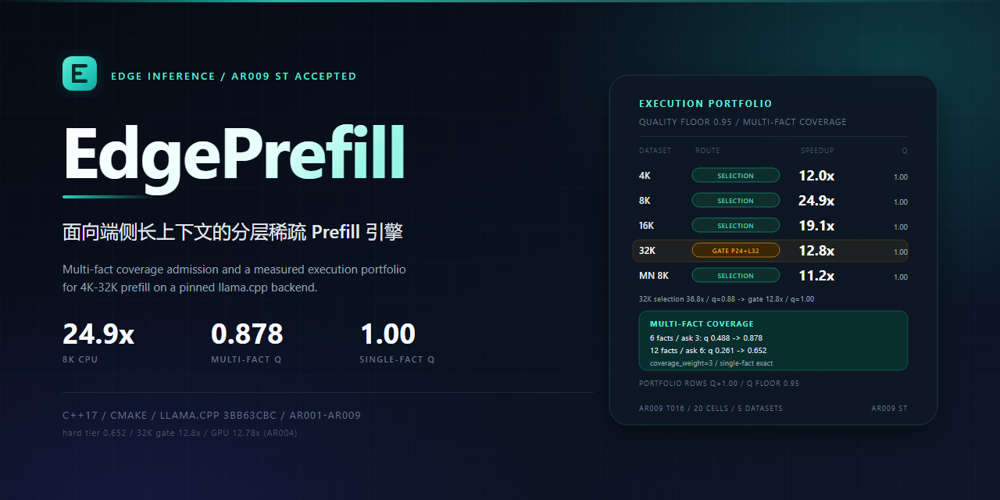
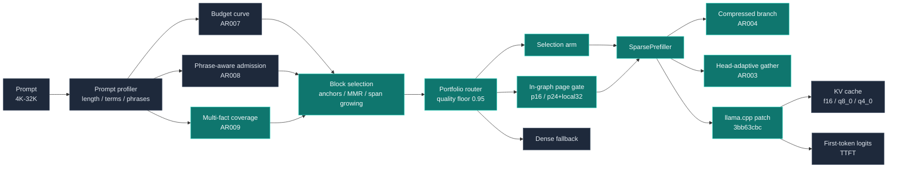

<p align="center">
  
</p>

<p align="center">
  
  
  
  
  
  
</p>

<h1 align="center">EdgePrefill</h1>

<p align="center">
  面向端侧长上下文大模型的分层稀疏 Prefill 引擎<br>
  <sub>Multi-fact coverage / phrase-aware admission / measured execution portfolio / in-graph page gating on llama.cpp</sub>
</p>

<p align="center">
  <a href="https://gitee.com/liu-xingyan04/edge-prefill">Gitee</a> /
  <a href="https://github.com/ShaneLiu04/edge-prefill">GitHub</a> /
  <a href="#头条结果">头条结果</a> /
  <a href="#架构">架构</a> /
  <a href="#快速开始">快速开始</a> /
  <a href="#复现-ar008">复现</a> /
  <a href="#实现状态">实现状态</a>
</p>

---

**EdgePrefill** 是一个以 llama.cpp/GGUF 为唯一推理后端的 C++17 研究工程，目标是在端侧单请求、4K-32K 长上下文、CPU 与轻量 GPU 的约束下降低首字延迟（TTFT）。从 AR001 到 AR009，它依次叠加了块级选择、attention/head 级 gather、NSA 式压缩分支、图内页门控、长度自适应预算、短语感知准入、实测组合路由与多事实覆盖准入；每一种优化都可以关闭、可以审计、可以用原始 CSV 复核。

> EdgePrefill is a C++17 research framework for long-context prefill acceleration on edge devices. It combines multi-fact coverage admission, phrase-aware admission, a measured execution portfolio, compressed KV branches, head-adaptive gather, and in-graph page gating on a pinned llama.cpp backend. Every number in `benchmarks/results/` comes from real GGUF inference with the command and environment recorded. No mock model, fake timing, or hard-coded quality score is used.

**当前状态：** 源码基线为 Gitee `a344344`（AR009 v1.0），tags `ar004-v1.0` / `ar005-v1.0` / `ar006-v1.0` / `ar007-v1.0` / `ar008-v1.0` / `ar009-v1.0`（2026-10-27）。GitHub 仓库同步该快照。

## 头条结果

> **AR008 execution portfolio / Qwen2.5-1.5B-Instruct Q4_K_M / CPU 16 threads**
>
> 4K：5.5 s，**12.0x**，q = 1.00
>
> 8K：5.7 s，**24.9x**，q = 1.00
>
> 16K：15.9 s，**19.1x**，q = 1.00
>
> 32K：路由到 gate-p24-local32，66.8 s，**12.8x**，q = 1.00
>
> Multi-needle 8K：8.2 s，**11.2x**，q = 1.00
>
> **AR009 multi-fact coverage**：6 facts / ask 3，q 0.488 -> **0.878**；12 facts / ask 6，q 0.261 -> **0.652**（5% budget）；single-fact 选择与 AR008 逐位一致
>
> **GPU**：AR004 16K attn-24 + compressed branch：159.3 s -> 12.5 s，**12.78x**，q = 1.00

AR008 的核心是**短语感知准入**与**实测组合路由**：前者把 multi-needle 的判别符从“单个数字被过滤”修成“位置短语 + 最高 IDF 锚点 + 跨块 bigram”，在 5% 预算下把 q 从 0.333 拉到 1.000；后者在 `selection / gate-p16 / gate-p24-local32 / dense` 中按质量地板 0.95 选择最快路径，4K/8K/16K/multi-needle 走 selection，32K 走 in-graph gate。

AR009 补上 AR008 的单事实盲点：一问多事实时，top-1 选择会把整个预算花在最强匹配上。AR009 提取稀有 query terms 作为 sub-queries，为每个事实保留锚点，并用 submodular facility-location 增益填充；`coverage_weight=3` 是默认值，`0` 时逐位回到 AR008。easy 档 0.488 -> 0.878，hard 档 0.261 -> 0.652；单事实族保持逐位一致。

**这不是“所有路径都最快”的结论。** 32K 的 q=1.00 是用延迟换来的：selection 本身 23.1 s（36.8x）但 q=0.875，低于 0.95 地板；gate 66.8 s（12.8x）才把质量拉回 1.00。8K/16K 的 gate 比 selection 慢 4-6 倍，所以固定“always gate”会丢掉 AR007 的速度收益；portfolio 的价值正在于不这么做。AR009 的 hard 档 0.652 仍低于 0.85 目标，瓶颈是 445 token 预算放不下 6 条答案句，而不是事实没有被准入（`coverage_queries=6.5/6`）。

## AR008 组合矩阵（AR009 单事实兼容）

同一 session、同一模型、同一 dense 参照；`Dense` 是矩阵内实测值。跨 session 的绝对毫秒不可比，判定只用同一 session 的比值。AR009 的 `coverage_weight=3` 对 4K/16K/multi-needle 与 AR008 选择逐位一致；32K selection q 从 0.875 变为 0.893，仍低于 0.95，路由仍走 gate。

| 数据集 | Dense | selection | gate-p16 | gate-p24-local32 | 路由 |
| --- | ---: | --- | --- | --- | --- |
| 4K | 66.3 s | **5.5 s / 12.0x / q=1.00** | 18.5 s / 3.6x / q=1.00 | 14.5 s / 4.6x / q=1.00 | selection |
| 8K | 141.9 s | **5.7 s / 24.9x / q=1.00** | 25.7 s / 5.5x / q=1.00 | 25.1 s / 5.6x / q=1.00 | selection |
| 16K | 302.7 s | **15.9 s / 19.1x / q=1.00** | 57.3 s / 5.3x / q=1.00 | 60.1 s / 5.0x / q=1.00 | selection |
| 32K | 852.1 s | 23.1 s / 36.8x / q=0.875 | 63.8 s / 13.4x / q=0.25 | **66.8 s / 12.8x / q=1.00** | gate-p24-local32 |
| Multi-needle 8K | 92.0 s | **8.2 s / 11.2x / q=1.00** | 38.2 s / 2.4x / q=1.00 | 16.7 s / 5.5x / q=1.00 | selection |

路由规则：**选择 mean 与 min quality 都达到 0.95 的最快组合；没有满足的组合时取质量最高者。** 因此 4/5 个数据集走 selection，只有 32K 走 gate。`check_portfolio.py` 验证 routed 组合不劣于同 session 的最佳固定组合（5/5 PASS），并能在注入更慢的 16K gate 臂时正确 FAIL。

### 如何读这些数字

- **Portfolio 是模型与数据集绑定的实测表。** `benchmarks/matrix/portfolio/portfolio.txt` 记录 model SHA256、质量地板与路由键；它是 opt-in 的，没有表时行为回到固定 selection。换模型/数据集后必须用 `./repro.sh ar008` 重新测量，不能手填。
- **32K 的 12.8x 是质量地板的代价。** 若只看速度，selection 的 36.8x 更快，但 q=0.875 不满足 0.95；gate 用 2.9x 的 TTFT 换来 q=1.00。两条都保留，用户可按任务选。
- **8K/16K 的 gate 不是更快的选择。** 在相同 q=1.00 下，gate 比 selection 慢 4-6 倍；AR008 的贡献是让路由自动避开这个错误，而不是宣称 gate 全面领先。
- **AR008/AR009 的 selection 是 lexical 的。** 原始 `raw.csv` 记录 `score_source=lexical`、`semantic_score_ms=0`；portfolio、短语准入与 coverage 都不需要 embedding 模型。AR005 的 embedding 2D 路径仍可用，但不是这条主线的依赖。
- **AR007 曲线是速度上界，不是安全默认。** 同一 AR007 session 中 b=0.05 可达 8K 29.1x / 16K 38.5x / 32K 55.2x，但 32K q=0.893、multi-needle q=0.333；AR008 的 portfolio 用质量地板把这些风险挡在默认路径之外。
- **AR009 coverage 只作用于多事实查询。** 单事实族（4K/16K/multi-needle）与 AR008 逐位一致；`coverage_weight=0` 时完全回到 AR008。hard 档 0.652 低于 0.85 目标，`coverage_queries=6.5/6` 说明事实已进上下文，缺的是 445 token 的答案预算。

## AR008：短语感知准入与组合路由

### 根因：单个数字被过滤

`deep/multineedle` 的三条 sibling facts 只差一个数字：

- `The secret passcode for vault 4 is ...`
- `The secret passcode for vault 5 is ...`
- `The secret passcode for vault 6 is ...`

旧选择器的查询词过滤条件是 `len >= 2`，单个数字被丢掉，三块词法得分相同，答案退化为“先到先得”。AR008 把相邻查询词对（`vault 5`、`chapter 7`、`case 42`）作为 positional phrase 准入，保留单字符判别符，并处理“needle 从块 b 跨到 b+1”的 bigram；锚点选最高 IDF 的短语，而不是块内短语总分（`for vault` 同时出现在三个 sibling blocks，会误导锚定）。

### 同预算、同机器、只改一个信号

| 准入 | budget | quality | 说明 |
| --- | ---: | ---: | --- |
| AR007 selection，`phrase_weight=0` | 0.05 | **0.333（2/6）** | 数字判别符被过滤 |
| AR008 selection，`phrase_weight=0.5` | 0.05 | **1.000（6/6）** | 位置短语 + 最高 IDF 锚点 + 跨块 bigram |

PHA 的延迟开销在 8K 为 -1.8%、16K 为 +1.7%（均在 ±2% 目标内）；单针 4K/8K/16K 质量保持 1.000。`phrase_weight=0` 时与 AR007 逐位等价，`phrase_blocks=0` 的空信号场景回退到 `default`，不宣称提升。

## AR009：多事实覆盖准入

### 盲点：AR008 是单事实最优

AR008 的 multi-needle 每行只问一个事实，top-1 选择看起来完美。新的 `gen_multifact.py` 家族每行问多个事实：

| 数据集 | 植入事实 | 每行提问 | 行数 |
| --- | ---: | ---: | ---: |
| `deep/multifact8k` | 6 | 3 | 16 |
| `deep/multifact8k-hard` | 12 | 6 | 16 |

在 `budget=0.05` 下，选择约 14 个块（443 token）；3-6 个事实各需一个块，预算并不是瓶颈。AR008 的问题是把整个预算花在单个最强词法匹配上，easy/hard 只覆盖 0.488 / 0.261 的事实；`coverage_queries=0` 是审计信号。

### 机制：每个事实都要被支付

AR009 在 AR008 的选择器上加了一层覆盖式准入：

- 抽取稀有 query terms 作为 sub-queries（去重、按 IDF 降序、上限 8）；
- 每个 sub-query 有一个锚点，打分用 `idf_p + lexical[b]`，避免兄弟 IDF 叠加把所有锚点指向同一块；
- 填充分数加入 submodular facility-location 增益 `sum_p max(0, idf_p - covered_p)`，已覆盖的事实自动归零；
- 排除命中至少一半 sub-queries 的“问题回声”块（chat template 的末块会匹配所有 sub-query）；
- `--coverage-weight` 默认 3.0，`0` 时不构建覆盖结构，逐位回到 AR008；
- `coverage_queries` 写入 raw.csv，防止“功能没接线”这类静默失败；
- 顺带修复 AR008 的 `per_pos` 越界：短语 spill 用 `flat_seq` 当 token 下标，ASan 抓到 heap-buffer-overflow，现用 `flat_tok` 词到 token 映射。

### 实测：同预算、同机器、只改覆盖信号

| 数据集 | coverage_weight | q mean | q min | facts covered | TTFT |
| --- | ---: | ---: | ---: | ---: | ---: |
| `deep/multifact8k` | 0（AR008） | 0.488 | 0.429 | 0.00 / 3 | 2767 ms |
| `deep/multifact8k` | 3（AR009） | **0.878** | 0.706 | 3.25 / 3 | 2927 ms |
| `deep/multifact8k-hard` | 0（AR008） | 0.261 | 0.261 | 0.00 / 6 | 2642 ms |
| `deep/multifact8k-hard` | 3（AR009） | **0.652** | 0.429 | 6.50 / 6 | 3218 ms |

非回归：

- 4K / 16K / multi-needle 在 `coverage_weight=3` 下与 AR008 选择逐位一致，q 保持 1.000；
- 32K 的 q 从 0.875 升到 0.893，TTFT 15.4 s -> 17.5 s（在同一 VM 的噪声带内），仍低于 0.95，portfolio 继续路由到 gate；
- `coverage_weight=0` 与 AR008 逐位等价，`coverage_queries=0`。

代价与限制：

- easy 档 TTFT +5.8%，hard 档 +21.8%；六个 sub-queries 意味着六个锚点与更多块，这正是覆盖的代价；
- easy 档 dense 子集 q=0.975，AR009 0.878 / 0.975 = **90% 的 dense 质量，5% 的 token**；
- hard 档 0.652 **低于 0.85 的 SRS 目标**：`coverage_queries=6.5/6` 说明事实已进入上下文，缺口是 445 token 放不下 6 条答案句和格式，不是准入漏事实；hard 档没有 dense 天花板（未测，不做“相对 dense”声明）；
- 覆盖增益目前只作用于 selection 级；AR006 图内页路径尚未消费它；GPU 未验证；两个档位是生成数据，不是用户流量。

`./repro.sh ar009` 会重新生成两档数据、跑消融并过 `check_expected_ar009.py`（2/2 PASS；把 `cw=3` 改写成 AR008 值会触发负向自测 FAIL）。完整报告见 [REPORT.md](benchmarks/results/ar009-multifact/REPORT.md)。

## AR007：长度自适应预算与页打分去拷贝

AR007 的预算不是常数，而是按长度实测的曲线。`benchmarks/results/ar007-sweep/budget_curve.txt` 记录模型 SHA256 与每个长度的预算：

| 长度 | 预算 | 选择信号 | 说明 |
| --- | ---: | --- | --- |
| 4K | 0.08 | lexical | 4K 在 b=0.05 时 q=0.500，0.08 才到 q=1.000 |
| 8K | 0.05 | lexical | q=1.000，约为 dense 的 29.1x |
| 16K | 0.05 | lexical | q=1.000，约为 dense 的 38.5x |
| 32K | 0.05 | lexical | q=0.893（min 0.571），floor-missed，交给 portfolio 的 gate 分支 |

预算-质量曲线是**非单调**的：16K 在 b=0.25 时 q=0.356，而 b=0.05 时 q=1.000。更多预算会把名额花在比例锚点与 stride 块上，反而挤掉词法证据。因此 AR007 的规则是“在速度容差内取最便宜的地板达成点”，而不是从小到大加预算。

AR007 同时加入：

- 结构锚点：sink、last block、query-word anchors、strided coverage；
- span growing：相邻块 +0.5，避免答案跨块边界时被切断；
- 增量 MMR：对近重复块做 Jaccard 惩罚，减少重复文本挤占预算；
- 页打分去拷贝：`mul_mat(k_view, q_last)` + page sum 取代 `cont(permute(k))`，32K gate 从 67.9 s 降到 25.4 s（idle）/ 31.4 s（loaded），降幅约 56%-63%，q 保持 1.00。

AR007 的 32K 最佳质量路径仍是 in-graph gate；AR008 的路由表把这条路径绑定到 32K，而不再让用户手选。

## GPU 结果（AR004）

| 配置 | Dense | Sparse | 加速 | q |
| --- | ---: | ---: | ---: | ---: |
| 16K attn-24 + compressed branch | 159.3 s | 12.5 s | **12.78x** | 1.00 |
| 16K attn-24（无 pool） | 159.2 s | 11.0 s | **14.42x** | 1.00 |
| 32K 极端选择稀疏（~13% token） | 787.1 s | 12.9 s | **60.96x** | 0.25 |
| 16K head-adaptive | 158.9 s | 13.8 s | 11.56x | 0.00 |

GPU 环境为 Quadro RTX 5000。12.78x / 14.42x 的分母是同一次 run 的非-FA dense；若以历史 GPU-FA dense 41.6 s 为参照，16K attn-24 的跨基线加速约为 3.8x。AR007 的 GPU 守护（T009）仍待办，AR008/AR009 的 portfolio/coverage 也没有 GPU 实测；因此 GPU 头条继续沿用 AR004，不把 CPU 的 AR009 结果外推到 GPU。

## 为什么需要 EdgePrefill

- 端侧 prefill 是 batch=1、4K-32K 的长请求，首字延迟直接决定交互体验。
- CPU/NPU 的算力与内存带宽有限，服务端 GPU 稀疏 kernel 的索引开销和形状假设往往不成立。
- 稀疏 prefill 必然有损；只报告加速、不报告质量，结论不可用。
- 端侧部署需要可关闭的开关、可复现的命令与可审计的中间结果，而不是不可解释的黑盒。

EdgePrefill 的选择是：**保留 llama.cpp 作为唯一真实执行后端，用最小、可审查的 patch 增加运行时稀疏能力；所有损失性优化都必须同时给出质量指标与原始证据。**

## 设计原则

| 原则 | 含义 |
| --- | --- |
| 端侧优先 | 以单请求、4K-32K、CPU 内存带宽受限为第一目标；GPU 结果单独标注 |
| 最小侵入 | 固定 llama.cpp commit，只维护 FFN skip 与 attention/gate gather 两个 patch |
| 先准入再路由 | 短语感知、多事实覆盖与长度预算先决定“看什么”，portfolio 再决定“走哪条执行路径” |
| 多事实覆盖 | AR009 用稀有 sub-queries + 每事实锚点 + facility-location 增益；coverage_weight=3，0 = AR008 |
| 质量地板 | 路由只选 mean+min quality 达到 0.95 的组合；否则取最高质量 |
| 图内优先 | AR006/AR007 把页打分与预算读取放到 graph/planner 内，减少 host 侧选择与拷贝 |
| 位置语义不变 | 未选 token 不进入计算与 KV，但选中 token 保留原始 position，维持 RoPE 与因果性 |
| 证据优先 | 每个数字都有 raw CSV、report、env JSON 与命令；跨 run 不混用分母 |
| 真实推理 | 禁止 mock 模型、伪造计时、硬编码质量分数；缺模型时测试显式 SKIP |

## 架构



### 三层决策

1. **准入层**：prompt profiler 统计长度、specific terms、phrase hits 与词法集中度；AR007 的预算曲线给每个长度一个实测预算，AR008 的短语感知选择器决定哪些块进入 KV，AR009 的 coverage 为每个请求事实保留锚点。默认 `phrase_weight=0.5`、`coverage_weight=3.0`；任一权重置 0 时逐位回到上一版。
2. **路由层**：portfolio router 读 `portfolio.txt`（含 model SHA256、floor、数据集/长度键），在 selection / gate-p16 / gate-p24-local32 / dense 中选择质量达标的最快组合；没有表或指纹不匹配时回退 selection。路由是 opt-in 的。
3. **执行层**：selection 走块级稀疏 + 可选压缩分支/head 矩阵；gate 走图内页均值 + local window + 单次 gather；chunked prefill、FFN skip、KV 精度与审计字段都在同一路径上。`budget=1.0` 且所有开关关闭时与 dense 数值等价。

## 关键机制

| 机制 | 实现要点 | 代码 |
| --- | --- | --- |
| 短语感知准入（AR008） | 查询相邻词 bigram、单字符判别符保留、最高 IDF 短语锚点、跨块 bigram；`phrase_weight=0` 回退 AR007 | [src/selector.cpp](src/selector.cpp) |
| 多事实覆盖（AR009） | 稀有 sub-queries、每事实锚点、submodular facility-location 增益、回声排除；`coverage_weight=3`，0 = AR008 | [src/selector.cpp](src/selector.cpp) |
| 长度自适应预算（AR007） | `budget_curve.txt` 按长度给预算，带 model SHA256 指纹；planner 输出 `budget_source=model/override/default/clamp` | [src/budget_curve.cpp](src/budget_curve.cpp) |
| 结构锚点 / MMR / span growing（AR007） | sink/last/query-word/stride anchors；相邻块 +0.5；近重复块 Jaccard 惩罚 | [src/selector.cpp](src/selector.cpp) |
| 组合路由（AR008） | 质量地板 0.95，mean+min 双门槛；selection / gate-p16 / gate-p24-local32 / dense；指纹校验与安全回退 | [src/portfolio.cpp](src/portfolio.cpp) |
| 图内页门控（AR006/AR007） | 每 ubatch/层 K page 均值，`q · mean(K_page)`，top-k pages + local window，一次 gather；页打分去拷贝 | [src/attention_sparsity.cpp](src/attention_sparsity.cpp) |
| 压缩分支（AR004 / NSA 式） | 被丢完整块 mean-pool 为 1 行 KV；块内最大位置保证因果；4K/8K q 0.44 -> 1.00 | [patches/llama-prefill-attn-top-k.patch](patches/llama-prefill-attn-top-k.patch) |
| Head 级自适应（AR003） | `classify-heads` 离线 profile；ranked pool + 每头 top-k 矩阵；retrieval head 保持 dense | [src/head_profile.cpp](src/head_profile.cpp) |
| 大 chunk 调度（AR004） | `chunk_size=0` 自动对齐 `n_ubatch`；每个 chunk 单次 llama_decode | [src/chunk_scheduler.cpp](src/chunk_scheduler.cpp) |
| 位置保持稀疏执行 | 原始 position 进入 `llama_decode`；未选 token 不产生 KV；dense 路径零回归 | [src/sparse_prefill.cpp](src/sparse_prefill.cpp) |
| Prefill-only FFN 跳过 | 运行时 layer mask；仅 prefill 生效，decode 全量；属于有损优化 | [src/ffn_skip.cpp](src/ffn_skip.cpp) |
| 真实基准与报告 | NIAH / QA / PPL；dense 对照；raw CSV + report + env JSON | [src/benchmark.cpp](src/benchmark.cpp) |

## 研究映射

| 方向 | 核心思想 | 本仓库落地 | 实测证据 / 限制 |
| --- | --- | --- | --- |
| BM25 / 短语检索 | 位置短语与 IDF 判别符提升检索区分度 | AR008 查询 bigram + 最高 IDF 锚点 + 跨块配对 | multi-needle q 0.333 -> 1.000 at b=0.05；纯语义查询不适用 |
| LongLLMLingua | 分段预算与结构化压缩 | AR007 结构锚点、span growing、MMR | 4K/8K/16K q=1.00；32K 曲线 q=0.893 |
| Submodular facility location | 每个请求事实的覆盖增益 | AR009 sub-query anchors + facility-location gain | easy 0.488 -> 0.878；hard 0.261 -> 0.652（hard 低于 0.85 目标） |
| RouteLLM / FrugalGPT | 按输入特征路由到不同成本路径 | AR008 measured portfolio，质量地板 0.95 | 5/5 Pareto PASS；32K 用 gate 换质量 |
| Quest | 页级 query 相关选择；精确上界打分 | AR006 页均值门控；Quest 精确上界实测后否决 | 8K 9.4x / 16K 6.8x；精确上界 16K q=0 |
| MoBA | query 分片共享块级门控 | AR006 图内 per-ubatch 门控 + local window | 多针在 AR006 上 3.8x / q=0.83；AR008 短语修复后 selection q=1.00 |
| NSA | 压缩上下文 + 选中 token + 滑窗 | AR004 压缩分支；AR006 local window | 4K/8K q 0.44 -> 1.00；32K 不救回 |
| MInference / SnapKV / PyramidKV | head 模式路由、按头 KV 预算、层先验 | head 矩阵 + 模式路由 + 金字塔先验 | 执行与审计通过；NIAH q=0，需任务内校准 |
| vLLM / Sarathi | 分块 prefill 与调度 | `chunk_size=0` 对齐 `n_ubatch` | 128/512/auto ±5%；2.5x 收割本质是 bug 修复 |

更完整的三段式分析见 [docs/research.md](docs/research.md)（AR006 §8、AR007 §9、AR008 §10、AR009 §11）；AR008 的组合矩阵与路由见 [REPORT.md](benchmarks/results/ar008-portfolio/REPORT.md)，AR009 的多事实消融见 [REPORT.md](benchmarks/results/ar009-multifact/REPORT.md)。

## 快速开始

### 环境要求

- Linux x86_64 或 WSL2（推荐 Ubuntu 22.04+）
- CMake 3.20+
- 支持 C++17 的编译器（归档环境：GCC 12.4 / 13.3）
- `bash`、`patch`、`git`、`curl` 或 `wget`
- 一块可用的 GGUF 模型；16K/32K 实验建议至少 16 GB 内存
- CUDA 构建需要 NVIDIA 驱动与 CUDA toolkit；归档 GPU 为 Quadro RTX 5000（Turing sm_75）

原生 Windows 不支持：CLI 使用 POSIX 头文件，构建流程依赖 `bash` 与 `patch`。请在 WSL2 中运行。

### 一键验证与复现

```bash
./repro.sh smoke    # 构建 + 下载/校验模型 + 单测 + AR005 smoke
./repro.sh ar008    # 20 格组合矩阵 + portfolio 路由 + Pareto 门禁（dense 较慢）
./repro.sh ar009    # 生成多事实两档 + 覆盖消融 + AR009 门禁（selection-level，较快）
```

`repro.sh` 支持 `smoke / matrix / full / budget / ar007 / ar008 / ar009`；每一步都会打印实际命令。已有模型时可加 `--skip-download`。完整 AR008 会测量 dense 参照，32K 单点可能需要数分钟；AR009 只跑 selection-level 消融，速度更快。

### CPU 构建

```bash
cmake -S . -B build -DCMAKE_BUILD_TYPE=Release
cmake --build build -j
ctest --test-dir build --output-on-failure
```

首次 configure 会下载固定 commit 的 llama.cpp，并应用：

- `patches/llama-prefill-ffn-skip.patch`
- `patches/llama-prefill-attn-top-k.patch`

如果网络受限，可准备同 commit 的 llama.cpp 源码树后本地构建：

```bash
git clone https://github.com/ggml-org/llama.cpp.git /path/to/llama.cpp
cd /path/to/llama.cpp
git checkout 3bb63cbcbfb62056c84fe9e521b0f3d756d29c32
bash /path/to/edge-prefill/scripts/apply_llama_patch.sh

cd /path/to/edge-prefill
cmake -S . -B build \
  -DCMAKE_BUILD_TYPE=Release \
  -DEDGE_PREFILL_LLAMA_DIR=/path/to/llama.cpp
cmake --build build -j
```

### CUDA 构建

```bash
cmake -S . -B build-cuda \
  -DCMAKE_BUILD_TYPE=Release \
  -DEDGE_PREFILL_WITH_CUDA=ON \
  -DGGML_CUDA=ON \
  -DCMAKE_CUDA_ARCHITECTURES=75
cmake --build build-cuda -j
```

`75` 对应归档的 RTX 5000；请按实际 GPU 调整。如果 CUDA 12 拒绝 GCC 13，参考 [scripts/build_cuda.sh](scripts/build_cuda.sh) 使用 gcc-12 与本地 llama.cpp 源码树。AR007/AR008/AR009 的页打分、portfolio 与 coverage 尚无 GPU 实测，CUDA 结果请以 AR004 归档为准。

### 模型与数据

```bash
bash scripts/download_model.sh --all
# models/qwen2.5-1.5b-instruct-q4_k_m.gguf     (main, AR009 主线)
# models/qwen2.5-0.5b-instruct-q4_k_m.gguf     (draft, optional AR005)
# models/bge-small-en-v1.5-q8_0.gguf           (embedding, optional AR005 qg-2d)
```

主模型 SHA256：`6a1a2eb6d15622bf3c96857206351ba97e1af16c30d7a74ee38970e434e9407e`。脚本会校验 SHA256，不匹配即拒绝。数据集随仓库分发：`benchmarks/data/explen/{len4k,len8k,len16k}`、`benchmarks/data/deep/{len32k,multineedle}`；`repro.sh` 会检查 `index.tsv` 与 `manifest.json`。

## 复现 AR008

### 16K selection（固定臂）

```bash
BIN=build/edge-prefill
MODEL=models/qwen2.5-1.5b-instruct-q4_k_m.gguf
D=benchmarks/data/explen/len16k

$BIN bench --config benchmarks/matrix/portfolio/selection.conf \
  --model $MODEL --data-dir $D \
  --out /tmp/r16k-selection --bench-skip-dense --repeats 1
```

### 32K gate-p24-local32（固定臂）

```bash
$BIN bench --config benchmarks/matrix/portfolio/gate-p24-local32.conf \
  --model $MODEL --data-dir benchmarks/data/deep/len32k \
  --out /tmp/r32k-gate --bench-skip-dense --repeats 1
```

### 路由表与 Pareto 门禁

完整的 20 格矩阵、`portfolio.txt` 与注入自测需要用：

```bash
./repro.sh ar008
```

或手工：

```bash
python3 benchmarks/scripts/portfolio_matrix.py \
  --bin build/edge-prefill --model models/qwen2.5-1.5b-instruct-q4_k_m.gguf \
  --out benchmarks/results/ar008-portfolio
python3 benchmarks/scripts/check_portfolio.py \
  benchmarks/results/ar008-portfolio/matrix.csv \
  benchmarks/results/ar008-portfolio/portfolio.json
```

说明：

- `portfolio.txt` 是模型/数据集绑定的实测表；换模型或数据集后必须重测，不能手改。显式 `qg_bound` 的优先级高于表；缺表/指纹不符时回退 selection。
- AR008/AR009 的 selection 与 gate 配置都是 `embedding_model=` 空，raw.csv 记录 `score_source=lexical`、`semantic_score_ms=0`；这条主线不需要 embedding。
- 固定臂的 `repeats=3` 在配置里；若要与归档的 campaign 单次测量对齐，可加 `--repeats 1`。CLI `--repeats` 会覆盖配置值。

### AR009 多事实覆盖

```bash
./repro.sh ar009
```

它会重新生成 `deep/multifact8k` 与 `deep/multifact8k-hard`，跑 `coverage_weight=0/3` 消融，并执行 `check_expected_ar009.py`。正常 2/2 PASS；把 `cw=3` 行改写成 AR008 值会触发负向自测 FAIL。完整结果见 [REPORT.md](benchmarks/results/ar009-multifact/REPORT.md)。

手动运行（等价）：

```bash
python3 benchmarks/scripts/gen_multifact.py \
  --out benchmarks/data/deep/multifact8k \
  --words 7500 --cases 8 --facts 6 --asked 3 --rows-per-context 2 --seed 41
python3 benchmarks/scripts/gen_multifact.py \
  --out benchmarks/data/deep/multifact8k-hard \
  --words 7500 --cases 8 --facts 12 --asked 6 --rows-per-context 2 --seed 43
python3 benchmarks/scripts/ar009_ablation.py \
  --bin build/edge-prefill \
  --model models/qwen2.5-1.5b-instruct-q4_k_m.gguf \
  --out benchmarks/results/ar009-multifact --force
python3 benchmarks/scripts/check_expected_ar009.py \
  benchmarks/results/ar009-multifact benchmarks/matrix/multifact/expected_ar009.csv
```

### 单条 prompt

```bash
$BIN run \
  --model $MODEL \
  --prompt-file benchmarks/data/smoke8k.txt \
  --budget-curve benchmarks/results/ar007-sweep/budget_curve.txt \
  --phrase-weight 0.5 \
  --coverage-weight 3 \
  --max-new-tokens 32 \
  --threads 16
```

`budget_curve` 与 `portfolio` 都是 opt-in：不传曲线时使用默认预算，不传表时只走 selection。要显式验证 gate 分支，可在配置或命令行加 `--qg-bound on --qg-sel-pages 24 --qg-local-rows 32`；要启用手工路由表，加 `--portfolio benchmarks/matrix/portfolio/portfolio.txt`。

## CLI 与配置

核心参数：

| 参数 | 含义 | 默认值 |
| --- | --- | --- |
| `--config` | `bench/eval` 配置文件 | 空 |
| `--model` | 主模型 GGUF | 空 |
| `--prompt` / `--prompt-file` | 单条 prompt / prompt 文件 | 空 |
| `--data-dir` / `--out` | 基准数据目录 / 输出目录 | 配置值 |
| `--mode` | `latency / balanced / quality / reuse / dense` | `balanced` |
| `--budget` | 进入 KV 的块比例（显式覆盖曲线） | 模式决定 |
| `--budget-curve` | AR007 长度-预算表；opt-in | 空 |
| `--anchor-ratio` | 锚点预算占块目标的比例 | 0.35 |
| `--anchor-stride-scale` | strided coverage 锚点倍率 | 1.0 |
| `--mmr-lambda` | 近重复块 MMR 惩罚 | 0.5 |
| `--mmr-threshold` | MMR 触发的 Jaccard 阈值 | 0.6 |
| `--phrase-weight` | AR008 位置短语权重；0 = AR007 行为 | 0.5 |
| `--coverage-weight` | AR009 多事实覆盖权重；0 = AR008 选择 | 3.0 |
| `--portfolio` | AR008 执行组合表 | 空 |
| `--attn-top-k` | attention gather 的 top-k block 数；0 关闭 | 0 |
| `--pool-branches` | `on/off`，NSA 式压缩分支 | off |
| `--qg-bound` | `on/off`，AR006 图内页门控 | off |
| `--qg-sel-pages` | 每个 ubatch 的 top-k page 数 | 8 |
| `--qg-local-rows` | local window 行数；0 = ubatch 跨度 | 0 |
| `--qg-pool-pages` | 折入 gated 分支的 pool page 数 | 0 |
| `--embedding-model` | 可选 bge-small，激活 AR005 语义选择 | 空 |
| `--draft-model` | 可选 draft GGUF，用于块级语义打分 | 空 |
| `--query-gating` | `on/off`，AR004 MoBA 式 query 分片门控 | off |
| `--head-adaptive` | `on/off`，per-head gather 矩阵 | off |
| `--head-profile` | `classify-heads` 生成的 profile JSON | 空 |
| `--head-top-k` | 非 retrieval head 的行数 | 0 |
| `--head-pattern-routing` | MInference 风格四类 head 预算 | off |
| `--pyramid-prior` | PyramidKV 层先验 | off |
| `--kv-type` | `f16 / q8_0 / q4_0` | `f16` |
| `--skip-ffn` | prefill-only FFN 跳过，如 `25%` 或 `4-10` | 空 |
| `--threads` | CPU 线程数 | 物理核数 |
| `--ngl` / `--n-gpu-layers` | GPU offload 层数，99 = 全量 | 0 |
| `--n-ctx` / `--n-ubatch` | 上下文长度 / 物理微批 | 自动 / 512 |
| `--max-new-tokens` | 贪心 decode 步数 | 32 |
| `--repeats` | 基准计时重复次数；未给时用配置值 | 配置值 |
| `--bench-skip-dense` | bench 只跑稀疏模式，dense 参照单独测 | 关闭 |
| `--dump-plan` / `--dump-selection` | 输出 Plan / Selection JSON | 空 |
| `--chat` / `--verbose` | chat template / debug 日志 | 关闭 |

配置文件常用键：

| 键 | 含义 | 默认值 |
| --- | --- | --- |
| `block_size` | 选择块大小 | 32 |
| `chunk_size` | `0` = 自动对齐 `n_ubatch` | 0 |
| `sink_blocks` / `recent_blocks` | 必留首块 / 最近块数 | 1 / 2 |
| `coverage_stride` | 覆盖率锚点步长 | 8 |
| `budget_curve` / `portfolio` | AR007 曲线 / AR008 组合表 | 空 |
| `phrase_weight` | AR008 短语权重 | 0.5 |
| `coverage_weight` | AR009 多事实覆盖权重 | 3.0 |
| `qg_bound` / `qg_sel_pages` / `qg_local_rows` | AR006 图内页门控参数 | off / 8 / 0 |
| `embedding_model` | AR005 语义选择模型路径 | 空 |
| `prefix_cache` / `prefix_cache_bytes` | dense 路径 KV 快照缓存与容量 | on / 256 MiB |
| `ffn_skip` / `chunking` | 是否允许 FFN skip / 分块 | on / on |

`block_size` 与 `chunk_size` 没有对应的 CLI flag，请写进配置文件；`--chunk-size` 在旧文档中出现过，但当前 CLI 不解析该参数。`bench` 的 gate/组合参数建议以配置文件为准；`run` 支持 CLI 覆盖。

## 基准与证据

每次 `bench`/`eval` 运行会写出：

- `*_raw.csv`：逐样本指标，含 `ttft_ms / e2e_ms / prefill_tps / kv_bytes / quality / dense / selected_tokens / attn_top_k / repeats / ppl_dense / ppl_sparse / query_gating / qg_groups / score_source / semantic_score_ms / draft_score_ms / qg_source / budget_source / anchor_blocks / mmr_penalized / phrase_blocks / specific_terms / coverage_queries / portfolio_choice / portfolio_reason`；
- `*_report.md`：人读汇总表；
- `*_env.json`：模型 SHA256、数据 SHA256、llama.cpp commit、CPU、线程、KV 类型、命令与时间戳。

主证据：

- [AR009 multi-fact REPORT](benchmarks/results/ar009-multifact/REPORT.md) 与 [ablation.md](benchmarks/results/ar009-multifact/ablation.md)：多事实覆盖对比、facts covered、dense easy 参考与诚实限制；
- [AR008 portfolio REPORT](benchmarks/results/ar008-portfolio/REPORT.md) 与 [matrix.md](benchmarks/results/ar008-portfolio/matrix.md) / [matrix.csv](benchmarks/results/ar008-portfolio/matrix.csv)：20 格组合矩阵、路由表、注入自测；
- [AR007 campaign REPORT](benchmarks/results/ar007-campaign/REPORT.md) 与 [budget_curve.txt](benchmarks/results/ar007-sweep/budget_curve.txt)：预算-质量曲线、非单调性、32K 页打分降幅；
- [AR006 campaign REPORT](benchmarks/results/ar006-campaign/REPORT.md)：图内页门控的 8K/16K/32K/多针基线；
- [AR004 主矩阵](benchmarks/results/ar004-t015-matrix/matrix.md)：GPU/CPU 长度矩阵与 `figures/ar004_fig1..7`；
- `benchmarks/scripts/check_portfolio.py` / `check_expected_ar007.py` / `check_expected_ar009.py` / `check_expected_ar006.py`：机器无关的质量/加速门禁；AR008 portfolio 正常 5/5 PASS，AR009 coverage 正常 2/2 PASS，二者的负向自测都会 FAIL；
- [docs/server-repro.md](docs/server-repro.md)：服务器复现、7B/14B 模板与 GPU 注意事项（AR009 在 §9）。

质量约束：

- `budget=1.0`、`qg_bound=false`、`query_gating=false`、`attn_top_k=0`、`skip_ffn=0` 时与 dense 数值等价（logits max abs diff < 1e-5）。
- AR006 arming 会清理其他稀疏路径，关闭后恢复 dense；`bound_gating_execution_and_restore` 验证逐位等价。
- 每个损失性配置都必须同时报告质量；没有质量数字的加速不进入推荐配置。
- 不允许 mock 模型、伪造计时或硬编码结果。

## 测试

无模型环境：

```bash
ctest --test-dir build --output-on-failure
# 真实模型用例显式 SKIP，不会伪造通过
```

提供真实 GGUF 后：

```bash
EDGE_PREFILL_TEST_MODEL=models/qwen2.5-1.5b-instruct-q4_k_m.gguf \
  ctest --test-dir build --output-on-failure
```

AR009 T015/T016 归档：无模型 155 PASS / 0 FAIL；真机 155 PASS / 0 FAIL；CPU 与 CUDA 双目标在 `-Wall -Wextra -Werror` 下零警告；ASan 覆盖用例干净；干净克隆 `ar009-v1.0` 构建 + `ctest` 100% + portfolio 门禁 5/5 + coverage 门禁 2/2 + 负向自测 FAIL；无 mock。

## 项目结构

```text
edge-prefill/
├── CMakeLists.txt
├── README.md
├── repro.sh                     # smoke / matrix / full / budget / ar007 / ar008 / ar009
├── include/edge_prefill/        # 公共头文件
├── src/                         # planner / selector / portfolio / backend / benchmark / CLI
├── tests/                       # 单元 + 真实模型集成测试
├── patches/                     # 固定 llama.cpp commit 上的最小 patch
├── benchmarks/
│   ├── configs/                 # smoke 配置
│   ├── matrix/
│   │   ├── budget/              # AR007 曲线/固定预算配置
│   │   ├── bound/               # AR006 gate 配置
│   │   ├── multifact/           # AR009 expected 门禁
│   │   └── portfolio/           # AR008 selection/gate/portfolio 表
│   ├── data/                    # 4K/8K/16K/32K/multi-needle/multi-fact 数据
│   ├── results/                 # raw CSV / report / env JSON / 主矩阵 / 图
│   └── scripts/                 # 数据生成、矩阵汇总、coverage 门禁、绘图
├── scripts/                     # 下载/构建/实验编排/诊断归档
├── specs/archive/               # AR001-AR009 需求/设计/任务/ST 记录
├── docs/
│   ├── architecture.md
│   ├── experiments.md
│   ├── research.md              # SOTA 三段式映射 + AR006 §8 / AR007 §9 / AR008 §10 / AR009 §11
│   ├── server-repro.md          # 服务器/7B/14B/GPU 复现（AR009 §9）
│   └── assets/                  # 封面
└── third_party/                 # 构建期拉取，不入库
```

## 实现状态

| 阶段 | 状态 |
| --- | --- |
| AR001 块级稀疏、位置保持、分块 prefill、FFN skip、KV 精度 | 完成 |
| AR002 attention top-k、draft 语义打分、benchmark repeats/warmup | 完成 |
| AR003 head profile、`classify-heads`、per-head gather 矩阵 | 实现与测试完成；NIAH 质量需任务内校准（q=0，负结果已记录） |
| AR004 大 chunk、PPL 保留率、压缩分支、query 门控、head 路由、GPU、主矩阵、ST | 完成（T001-T018 passing）；tag `ar004-v1.0` |
| AR005 语义 2D 门控、bge-small embedding、server repro、模型下载扩展 | 交付核心能力；tag `ar005-v1.0` |
| AR006 图内查询感知页门控、单次 gather、短提示旁路、campaign、诚实记录 | T001-T006 / T008 / T010-T013 passing；T007/T009 pending；tag `ar006-v1.0` |
| AR007 预算-质量曲线、结构锚点/MMR/span growing、页打分去拷贝 | T001-T008 / T010-T013 passing；T009 GPU 守护 pending；tag `ar007-v1.0` |
| AR008 短语感知准入、组合路由、Pareto 门禁、诚实验收 | T001-T014 passing；tag `ar008-v1.0` |
| AR009 多事实覆盖准入、sub-query anchors、facility-location 增益、coverage 门禁 | T001-T016 passing；tag `ar009-v1.0` |
| Radix 跨请求前缀复用、按层 KV、自动调优 Pareto、多请求服务化 | 未实现，后续 AR |

**最新验收：** AR009 把多事实 easy/hard 档从 0.488/0.261 提升到 0.878/0.652（b=0.05）；单事实 4K/16K/multi-needle 与 AR008 逐位一致，32K 0.875 -> 0.893；coverage 门禁 2/2 PASS，负向自测 FAIL。AR008 portfolio 在 4K/8K/16K/multi-needle 走 selection（12.0x / 24.9x / 19.1x / 11.2x，q=1.00），32K 走 gate-p24-local32（12.8x，q=1.00）。AR004 GPU 16K 12.78x / q=1.00 仍是 GPU 头条。

## 已知限制

- **Portfolio 是模型/数据集绑定的实测表。** 它带 model SHA256、floor 与路由键，是 opt-in 的；换模型/数据集后必须重测。显式 `qg_bound` 优先于表，缺表/指纹不符时回退 selection。
- **32K 的质量地板不是免费的。** selection 36.8x 但 q=0.875；gate 12.8x 才把 q 拉回 1.00，代价约 2.9x TTFT。两条都保留，用户可按任务取舍。
- **8K/16K 的 gate 不是更快路径。** 同 q=1.00 下 gate 比 selection 慢 4-6 倍；固定 always-gate 会丢掉 AR007/AR008/AR009 的速度收益。
- **短语信号只对有判别短语的查询有效。** 纯语义/改写查询没有数据证明提升；`phrase_blocks=0` 时走 `default`，不做提升声明。
- **AR009 hard 档 0.652 低于 0.85 目标。** `coverage_queries=6.5/6` 说明事实已进入上下文，缺口是 445 token 放不下 6 条答案句与格式；hard 档没有 dense 天花板（未测，不做相对 dense 声明）。覆盖目前只作用于 selection 级，AR006 图内页路径尚未消费；两个档位是生成数据，不是用户流量。
- **AR007 曲线非单调且不是安全默认。** 16K b=0.05 q=1.000 vs b=0.25 q=0.356；32K 曲线 q=0.893，multi-needle 曲线 q=0.333；默认路径用 portfolio/gate/coverage 兜底。
- **GPU 未验证。** AR007 T009 仍 pending，AR008 portfolio 与 AR009 coverage 没有 CUDA 实测；GPU 头条来自 AR004，且 dense 是非-FA 同图族对照；以 GPU-FA 为参照时 16K attn-24 约 3.8x。
- **Head 路由与 32K AR004 极端稀疏是负结果。** Head 路由 NIAH q=0；AR004 32K 选择级稀疏 60.96x 但 q=0.25。
- Attention gather 与 llama.cpp flash attention 不兼容；patch 不可用时回退块级稀疏。
- Prefix cache 当前用于 dense 路径的 state 快照；Radix 跨请求/多轮复用、按层 KV、自动调优尚未实现。
- 部分实验编排脚本保留了作者环境的绝对路径；`repro.sh` 与 `docs/server-repro.md` 是更可移植的入口。
- 仓库尚未附带开源许可证；如需复用代码，请先联系作者确认授权。

## 相关研究与致谢

EdgePrefill 借鉴了以下方向的公开思想，但实现保持端侧单请求约束，不直接移植服务端 kernel：

- **llama.cpp / GGUF**：端侧真实推理与模型格式基础。
- **BM25 / 短语检索**：位置短语与 IDF 判别符；AR008 的 multi-needle 根因修复。
- **LongLLMLingua / MMR**：分段预算、结构锚点与近重复惩罚；AR007 的准入层。
- **Submodular facility location / coverage maximization**：每个请求事实的覆盖增益；AR009 的 sub-query anchors 与 `coverage_weight`。
- **RouteLLM / FrugalGPT**：按输入特征在成本/质量路径间路由；AR008 的 measured portfolio。
- **Quest / MoBA / NSA**：页级 query 选择、query 分片门控与压缩上下文；AR006/AR007 的 gate 与 local window。
- **MInference / SnapKV / PyramidKV**：head 模式路由、按头 KV 预算与层先验。
- **vLLM / Sarathi-Serve**：分块 prefill 与长 prompt 调度。

感谢 llama.cpp、GGUF、Qwen、ModelScope / hf-mirror 与 bge-small 生态提供的开放基础设施。除固定 commit 上的最小 patch 外，本项目未复制第三方实现。

## 联系

- Gitee: [liu-xingyan04](https://gitee.com/liu-xingyan04)
- GitHub: [ShaneLiu04](https://github.com/ShaneLiu04)
- 问题与建议：欢迎提交 Issue 或 Pull Request。

---

<p align="center">
  <sub>Built with llama.cpp and GGUF. Speedups are paired with quality; negative results are kept in the repository.</sub>
</p>
