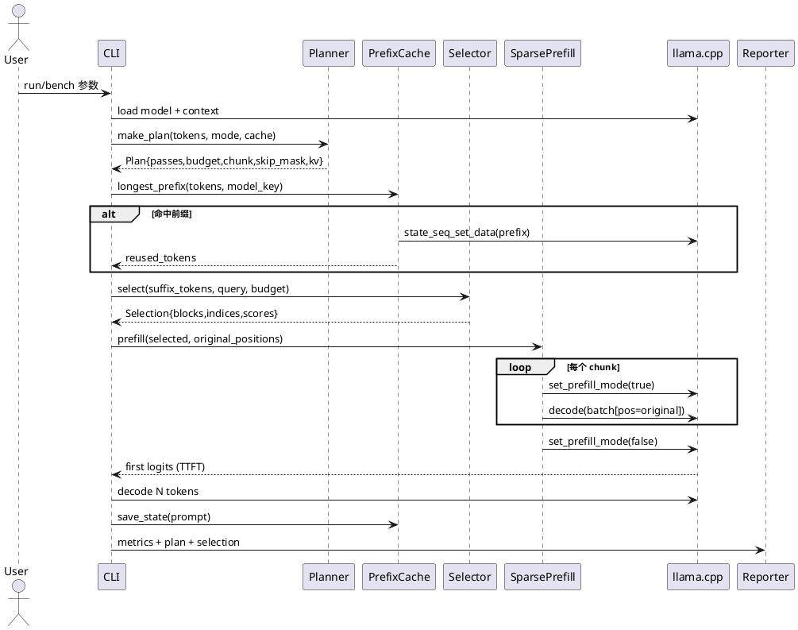
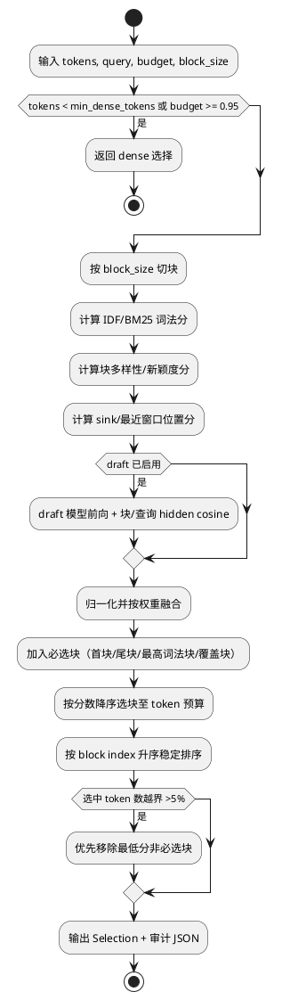
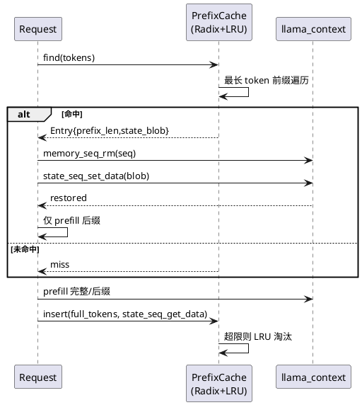
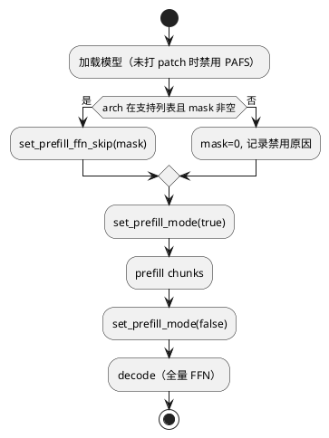
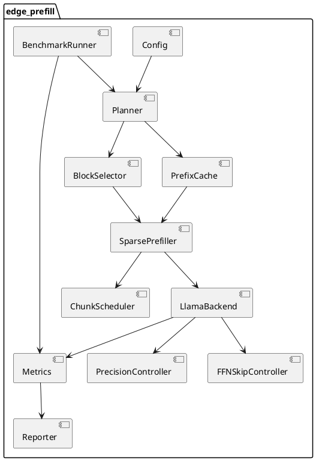
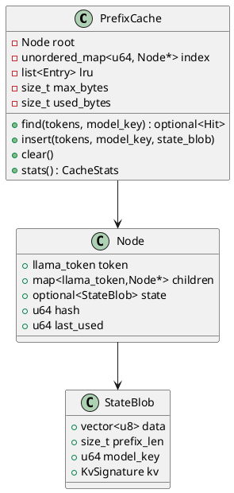
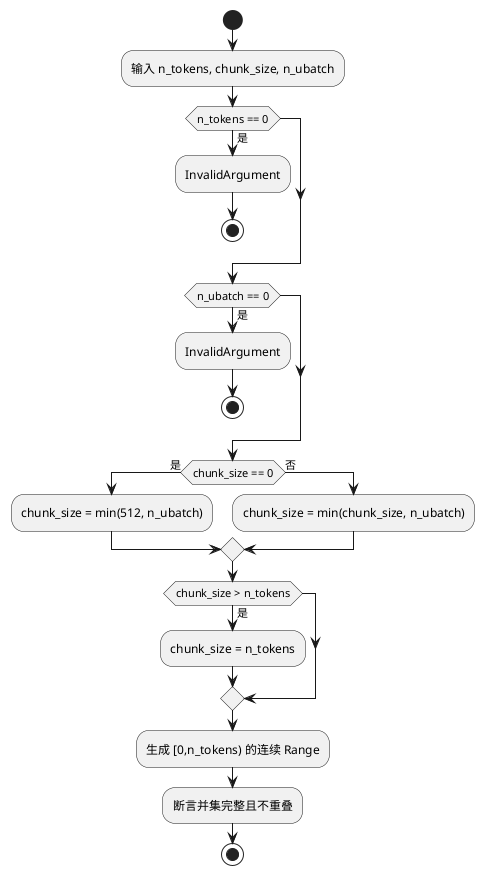
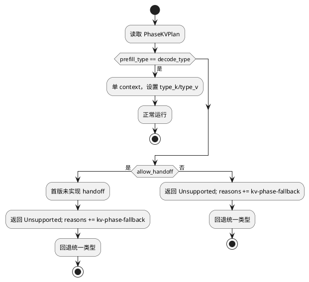
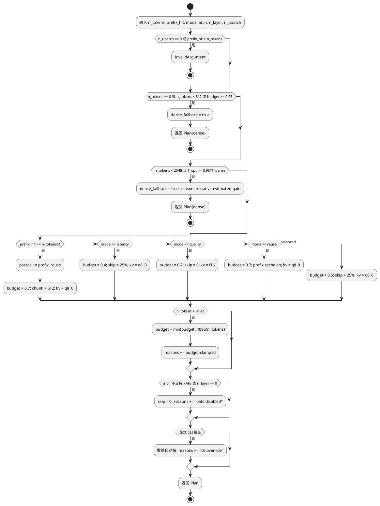

# AR001 详细设计：EdgePrefill 端侧 Prefill 架构

| 组件名称 | edge-prefill（EdgePrefill） |
| --- | --- |
| AR 系统流水号 | AR001 |
| AR 描述 | 在 llama.cpp/GGUF 真实后端上，以位置保持块稀疏、查询感知选择、前缀 KV 复用、分块 prefill、prefill-only FFN 跳过和相位感知 KV 精度组合降低端侧 8K prompt TTFT，同时保持任务质量 |
| 关联 srs.md | ./srs.md |
| 日期 | 2026-10-20 |
| 状态 | Draft |

> 说明：用户已授权自动化推进（“每一步无需我确认”），因此本文按 HarnessX 自动化模式直接进入设计门控；设计门控通过后立即开发。

---

# 1 AR概述

EdgePrefill 是一个 **C++17、后端真实、策略可组合** 的 prefill 优化框架。首版唯一推理后端为
llama.cpp（固定 commit + 最小可审查 patch），模型格式为 GGUF。框架不做任何 mock：
所有质量、延迟、内存数字都来自真实 llama.cpp 推理；所有基准数据可由脚本下载并校验。

## 1.1 核心创新

1. **位置保持的块稀疏 Prefill（Position-Preserving Block Sparsity, PPBS）**
   以 token block 为单位选择上下文，未选 block **不进入计算、不写 KV**；选中 token 保留
   原始 position id，因此 RoPE 与因果语义与 dense 一致。它不是“加 mask 仍算全量”，而是
   真实减少 prefill token 数与 KV 写入量。

2. **查询感知的多信号块重要性（Query-Aware Multi-Signal Selection, QAMS）**
   同时使用 IDF/BM25 词法相关、块内多样性、sink/最近窗口位置先验、可选 draft 语义信号；
   预算硬约束、必选块、确定性 tie-break、可导出审计 JSON。解决单一启发式在不同层/任务
   上方差过大的问题（借鉴 CLAA 的跨层聚合思想，在无 attention 暴露条件下用多信号集成）。

3. **Prefill-only FFN 跳过（Phase-Asymmetric FFN Skip, PAFS）**
   在 llama.cpp `build_ffn` 增加运行时开关：prefill 阶段按层 mask 返回零 FFN 输出（保留
   residual 与该层 attention/KV），decode 阶段恢复全量。单模型、单 context、无 KV handoff，
   避免双模型内存代价。mask=0 与上游逐位等价。

4. **统一的预算规划器（Budgeted Prefill Planner, BPP）**
   把前缀复用、块稀疏、分块、FFN 跳过、KV 精度纳入同一质量-延迟预算，按 prompt 长度、
   缓存命中、硬件和模式选择组合，并输出可审计计划；短 prompt 自动 dense 回退，避免负收益。

5. **可复现的真实基准（Real Prefill Benchmark, RPB）**
   NIAH、真实抽取式 QA、WikiText 困惑度三任务；同模型/同线程/同 KV 类型 dense 对照；
   预注册质量口径、warmup/重复、原始 CSV、环境与校验和，支持服务器大规模复现。

## 1.2 与已有工作的差异化

| 工作 | 机制 | 端侧短板 | EdgePrefill 的处理 |
| --- | --- | --- | --- |
| MInference / FlashPrefill | GPU 稀疏 kernel + 在线索引 | 短中上下文索引开销、依赖 GPU kernel | 不写 kernel，直接减少参与 prefill 的 token/块；4K/8K 可回退 dense |
| FastKV / CLAA / POP | 层间 token 选择/深层剪枝 | 需要模型内部 attention 或改结构 | 用多信号选择 + 可选 draft；FFN 跳过只动 prefill |
| Sarathi-Serve | 分块调度 | 面向服务吞吐，单请求收益有限 | 分块作为内存/延迟控制与复用基础，不单独宣称加速 |
| vLLM Prefix Cache | 前缀复用 | 端侧框架缺失 | 真实 KV state 快照 + Radix/LRU，二次请求 ≥5x |
| Mix-Quant / TileMix | 低精度 prefill | 依赖 FP4/INT8 kernel | 先用 llama.cpp KV q8_0/q4_0 做真实精度-质量实验 |

---

# 2 动态行为

## 2.1 单请求 Prefill 主流程



## 2.2 块选择流程



## 2.3 前缀 KV 复用



## 2.4 PAFS 开关生命周期



---

# 3 功能点分解

| 序号 | 功能点名称 | 功能点描述 | 对应 FR |
| --- | --- | --- | --- |
| 1 | GGUF 后端封装 | 模型/上下文/分词/batch/KV/计时/错误码 | FR-1 |
| 2 | 多信号块选择器 | 词法、多样性、位置、可选 draft；预算与必选块 | FR-2 |
| 3 | 位置保持稀疏 prefill | 原始 pos 的稀疏 batch；chunk 执行；dense 等价 | FR-3 |
| 4 | 前缀 KV 缓存 | Radix 最长前缀 + state 快照 + LRU | FR-4 |
| 5 | 自适应分块 | chunk 大小规划、逐 chunk 计时、语义一致 | FR-5 |
| 6 | Prefill-only FFN 跳过 | patch、mask、arch 校验、decode 恢复 | FR-6 |
| 7 | KV 精度控制 | f16/q8_0/q4_0；内存与质量报告；相位计划 | FR-7 |
| 8 | 预算规划器 | latency/balanced/quality/reuse；dense 回退 | FR-8 |
| 9 | 基准与报告 | NIAH/QA/PPL；dense 对照；CSV/Markdown | FR-9 |
| 10 | 复现与交付 | README/脚本/校验和/CI/Gitee | FR-10 |
| 11 | CLI 与配置 | run/bench/eval/inspect/plan；conf 解析 | FR-1,8,9,10 |
| 12 | 审计与可观测性 | plan/selection JSON、环境信息、原始数据 | FR-2,8,9 |

---

# 4 实现设计

## 4.1 功能实现思路

### 4.1.1 方案对比

## 方案 A：纯 llama.cpp 公共 API 组合（无 patch）

**思路：** 只做 token 选择、位置保持 sparse prefill、前缀缓存、chunk、KV 类型；不碰
llama.cpp 内部。
**优点：** 构建最简单、上游兼容性最好、风险低。
**缺点：** 无法实现 prefill-only FFN 跳过；稀疏只到 token 层；创新深度不足。
**适合场景：** 快速验证 token 选择与前缀复用。
**NFR 影响：** 可能达到 2x，但质量与加速余量有限，不满足“全机理”要求。

## 方案 B：llama.cpp 公共 API + 最小 FFN patch + 多信号选择（推荐）

**思路：** 方案 A + 一个只改 `build_ffn` 的运行时 patch；块稀疏通过“不计算未选块”实现；
前缀复用用 state 快照；KV 精度用 context 参数。
**优点：** 真实减少 prefill 计算与 KV；单模型单 context；patch 小且可审计；全部机制可组合；
端侧内存代价低；能覆盖五类机制。
**缺点：** 需要维护固定 commit 的 patch；PAFS 有损；块选择质量依赖任务。
**适合场景：** 端侧 CPU/NPU 单请求低延迟；研究+工程落地。
**NFR 影响：** 50% 块保留 + 25% FFN 跳过理论 prefill 计算约 0.5×0.84≈0.42，具备 ≥2x 空间；
质量需通过实验校准。

## 方案 C：自研 GGUF 推理引擎 + 自定义稀疏 kernel

**思路：** 直接基于 ggml 写 graph，完全控制 attention/FFN/KV。
**优点：** 可实现真正块稀疏 kernel、层跳过、混合精度，创新空间最大。
**缺点：** 工作量与正确性风险极高；首版无法保证多模型兼容；交付周期不可控。
**适合场景：** 后续 AR 的 kernel 专项。
**NFR 影响：** 潜在收益最高，但首版可靠性与可复现性不达标，不推荐。

### 4.1.2 推荐

**推荐方案 B。** 理由：它在“真实可运行、端侧内存可接受、五类机制完整、可复现”四个约束下
取得最佳平衡；patch 只有一个函数入口，dense 等价可验证；后续可在同一接口下替换为方案 C
的 kernel。

### 4.1.3 关键设计决策

| 决策 | 选择 | 理由 |
| --- | --- | --- |
| 稀疏粒度 | 32-token block（可配 16/32/64） | 与 llama.cpp ubatch/缓存行对齐；索引开销低；预算误差 <1% |
| 位置处理 | 保留原始 pos | RoPE/因果语义不变；decode 可直接复用 |
| 质量信号 | 词法+多样性+位置(+draft) | 无需暴露 attention；端侧 CPU 开销 <1% prefill |
| FFN 跳过 | 运行时 mask + `build_ffn` 零输出 | 单模型；保留 attention/KV；decode 全量 |
| 前缀缓存 | KV state 快照 + Radix/LRU | 精确复用；无需改 llama.cpp |
| KV 精度 | context type_k/type_v | 官方支持；q8_0 真实省内存 |
| 数据格式 | key=value conf + JSON 输出 | 零第三方依赖；易审计 |
| 测试 | CTest + 真实 GGUF；无模型时 skip | 不 mock；CI 可分层 |

### 4.1.4 模块影响矩阵

| 范围 | 文件/模块 | 变更类型 | 说明 | 对应任务 |
| --- | --- | --- | --- | --- |
| 新增 | `CMakeLists.txt`, `cmake/*` | 新增 | 构建、警告、llama.cpp 集成 | T001/T002 |
| 新增 | `include/edge_prefill/*.h` | 新增 | 公共接口（见 §4.3），含 `log.h` | T004–T013 |
| 新增 | `src/*.cpp` | 新增 | 实现（见 §4.4.1），含 `log.cpp` | T004–T014 |
| 新增 | `third_party/llama.cpp` | 子模块 | 固定上游 commit | T002 |
| 修改（上游 patch） | `third_party/llama.cpp/include/llama.h` | patch | 新增 3 个 API 声明 | T003 |
| 修改（上游 patch） | `third_party/llama.cpp/src/llama-cparams.h` | patch | 新增 prefill 模式/FFN mask 字段 | T003 |
| 修改（上游 patch） | `third_party/llama.cpp/src/llama-context.cpp` | patch | 实现 API、写入 cparams | T003 |
| 修改（上游 patch） | `third_party/llama.cpp/src/llama-graph.cpp` | patch | `build_ffn` 零输出分支 | T003 |
| 新增 | `patches/llama-prefill-ffn-skip.patch` | 新增 | 可审查 patch | T003 |
| 新增 | `tests/*` | 新增 | UT/IT/E2E | T015 |
| 新增 | `benchmarks/*`, `scripts/*` | 新增 | 数据、配置、复现、结果 | T012/T013/T016–T018 |
| 新增 | `docs/*`, `README.md`, `AGENTS.md` | 新增 | 架构、实验、复现 | T018 |
| 同步 | `specs/component-detail-design/组件_spec.md` | 更新 | 组件级契约 | 本设计 |

**影响边界：** 除 llama.cpp 的 4 个文件外，不改动上游其他代码；所有优化通过公共 API 或
本仓库代码完成。`eval` 子命令的行为在 §4.3.10 与 §6.2 CLI 用例中定义；脚本目录统一为
根 `scripts/`（数据生成脚本在 `benchmarks/scripts/`，仅用于数据准备，不参与运行时）。

## 4.2 功能实现设计

### 4.2.1 总体流水线



### 4.2.2 块选择算法

**输入：** `tokens[]`、`query`、`budget ∈ (0,1)`、`block_size`、`weights`、可选 `DraftScorer`。

**步骤：**

1. 若 `tokens.size() < min_dense_tokens`（默认 512）或 `budget >= 0.95`，返回 dense。
2. 切块：`n_blocks = ceil(n_tokens / block_size)`；最后一块可短。
3. 词法分：
   - 查询词集合 `Q`：对 query 分词，转小写，去掉标点/空白 token；保留长度≥2 的 token。
   - 对每块，`tf(q)` 为词 q 的出现次数；`df(q)` 为包含 q 的块数；
     `idf(q)=log((n_blocks+1)/(df(q)+1))+1`；
     `lex(b)=Σ_{q∈Q∩b} idf(q) / sqrt(len(b))`。
   - 若 `Q` 为空（PPL 模式），`lex(b)=0`。
4. 多样性分：
   - 对 token 文本做 FNV-1a 哈希到 64 维单位向量 `h(t)`；
   - 块质心 `c_b = normalize(mean h(t))`；全局质心 `g`；
   - `div(b)=0.5*(1-cos(c_b,g))+0.5*(1-mean_{t∈b} cos(h(t),c_b))`。
   - 目的：保留信息密度高、非重复的块。
5. 位置分：
   - `sink=1.0` 给前 `sink_blocks`（默认 1）；
   - `recent=1.0` 给后 `recent_blocks`（默认 2）；
   - 中间块 `pos(b)=exp(-distance_to_nearest_mandatory / max(1,n_blocks/4))`；
   - 归一化。
6. 可选 draft 分：
   - 用 draft GGUF 对完整 prompt 做一次 forward（`embeddings=true`）；
   - `DraftScorer::score` 返回 per-token hidden 相似度；
   - 块分 `s(b)=mean_{t∈b} score[t]`；`draft(b)=minmax(s(b))` 归一化到 [0,1]。
   - 该定义与 per-token 接口一致，避免“块均值 hidden cosine”无法由标量还原的问题。
   - 该 pass 成本单独计时，默认 `balanced` 关闭，`quality` 可开。
7. 融合：`score(b)=Σ w_s * norm_s(b)`，权重默认
   `lex=0.45, div=0.15, pos=0.20, draft=0.20`；draft 未启用时按比例重分配。
8. 必选块集合 `M`：首块、尾块、最高 lex 块、每 `coverage_stride`（默认 8）块中最高分块。
9. 选择：按 `(-score, block_index)` 排序，依次加入直到
   `selected_tokens >= ceil(budget*n_tokens)`；必选块先加入。
10. 校验：若 `selected_tokens > target*1.05`，从最低分非必选块开始移除；若仍超限，
    对最后加入的块做 token 级截断（保留该块内位置均匀的 token）。
11. 输出 `Selection`：`blocks[]`、`token_indices[]`（升序）、`scores[]`、`signals`、
    `mandatory[]`、`reason`。

**复杂度：** O(n_tokens * |Q|) 词法 + O(n_tokens*64) 哈希；8K 下 <1ms（单核，实测目标）。
**确定性：** 无随机数；哈希固定；排序 tie-break 用 block index。

### 4.2.3 位置保持稀疏 Prefill

```plantuml
@startuml
start
:selected = sorted token indices;
:chunks = split(selected, chunk_size);
for (chunk in chunks)
  :batch = llama_batch_init(chunk.size(), 0, 1);
  for (j, idx in chunk)
    batch.token[j] = tokens[idx];
    batch.pos[j] = idx;            ' 原始位置
    batch.n_seq_id[j] = 1;
    batch.seq_id[j][0] = 0;
    batch.logits[j] = (is_last_chunk && j==last) ? 1 : 0;
  :llama_set_prefill_mode(ctx,true);
  :llama_decode(ctx,batch);
  :record chunk time/tokens;
  :llama_batch_free(batch);
end
:llama_set_prefill_mode(ctx,false);
:first_token_logits = llama_get_logits_ith(ctx,-1);
stop
@enduml
```

**约束（按顺序校验）：**
1. 每个 `pos` 必须在 `[0, n_ctx)` 且严格递增/不重复；否则 `InvalidArgument`。
2. 全部 pos 合法后，若 `max(pos) + max_new_tokens >= n_ctx`，则 `ContextInit`
   （提示增大 n_ctx）。
- 该顺序保证 IT-BE-04c（pos=999999）返回 `InvalidArgument`，容量不足返回 `ContextInit`。
- `llama_memory_seq_pos_max` 用作 KV 上界校验。
- 对 `llama_decode` 返回值非 0 立即中止并报 `E_PREFILL`。

### 4.2.4 前缀 KV 缓存

**数据结构：**



**流程：**
- `find`：从 root 沿 token 走，记录最后一个有 `state` 的节点；返回其 `prefix_len` 与 blob。
- 命中后：`llama_memory_seq_rm(ctx, 0, -1, -1)`；`llama_state_seq_set_data(ctx, 0, data, size)`；
  校验返回值 == size，否则 `E_CACHE` 并回退 dense 重算。
- `insert`：对完整 prompt 调用 `llama_state_seq_get_size/get_data`；写入对应节点；
  超过 `max_bytes` 按 LRU 淘汰（至少保留最近一条）。
- `model_key`：模型文件大小 + 修改时间 + 前 1MiB SHA256 + `n_ctx` + `type_k/type_v`；
  任一变化则缓存整体失效。
- 线程安全：`std::mutex` 保护；首版单请求，但接口可并发。

### 4.2.5 分块调度

- `chunk_size` 决策：
  - 若用户指定 >0，使用 `min(user, n_ubatch, remaining)`；
  - 否则 `min(512, n_ubatch)`；若 `n_ctx <= 4096` 用 256。
- 每 chunk 记录 `tokens`、`elapsed_us`、`kv_pos_max`。
- 与一次性 prefill 的等价性：同一 token 序列、同一 pos、同一 KV 类型；chunk 边界只影响
  graph 批大小，不影响数学结果（浮点累加顺序可能极微差异，容差 1e-5）。
- 若 chunk 执行失败，保留已写入 KV 的位置信息，返回错误；调用方清理 seq 后回退。



### 4.2.6 Prefill-only FFN 跳过（patch 设计）

**Patch 目标（固定上游 commit）：**

1. `include/llama.h`
   ```c
   LLAMA_API void llama_set_prefill_mode(struct llama_context * ctx, bool prefill);
   LLAMA_API void llama_set_prefill_ffn_skip(struct llama_context * ctx, uint64_t layer_mask);
   LLAMA_API uint64_t llama_get_prefill_ffn_skip(const struct llama_context * ctx);
   ```
2. `src/llama-cparams.h`：新增
   ```cpp
   bool     prefill_mode = false;
   uint64_t prefill_ffn_skip_mask = 0;
   ```
3. `src/llama-context.cpp`：在 context 构造时把上述字段写入 `cparams`；实现三个 API，
   对 `ctx/model` 做空指针检查；mask 超出 `n_layer` 的位直接忽略并返回实际 mask。
4. `src/llama-graph.cpp::build_ffn` 入口：
   ```cpp
   if (cparams.prefill_mode &&
       il >= 0 && il < int(cparams.n_layer) && il < 64 &&
       (cparams.prefill_ffn_skip_mask & (uint64_t(1) << il))) {
       return ggml_scale(ctx0, cur, 0.0f); // 零 FFN 输出，保留 residual
   }
   ```
   `cur` 与 FFN 输出形状一致；调用方 `cur = ggml_add(cur, ffn_out)`，因此等价于 residual。
   `build_ffn` 的 MoE 变体不在首版支持范围；启用前校验 `general.architecture` 为
   `llama`/`qwen2`/`qwen3` 等 dense 架构。

**等价性：** mask=0 时不进入分支，graph 与上游完全一致。
**开关生命周期：** `SparsePrefiller` 在 prefill 前 `set_prefill_mode(true)`，首 token 后
`false`；异常路径用 RAII guard 保证恢复。
**安全边界：** 若 patch 未应用，`ffn_skip` 功能在编译期检测宏 `EDGE_PREFILL_HAS_FFN_SKIP`
不存在时禁用并报 `Unsupported`，不影响其他功能。mask 用 `uint64_t` 表示，故
`n_layer > 64` 的模型显式返回 `Unsupported`（首版目标 Qwen2.5/Llama ≤32 层）。

### 4.2.7 KV 精度与相位计划

- `KVPrecision { F16, Q8_0, Q4_0 }` 映射到 `ggml_type`。
- `PrecisionController::apply(params, plan)` 设置 `type_k/type_v`。
- **不支持类型的回退：** 若按请求类型创建 context 返回 `Unsupported`/`ContextInit`，销毁
  该 context，改用 `f16` 重试一次；成功则 `Plan.reasons += "kv-fallback"`，stderr warning，
  报告记录实际类型；重试仍失败则返回原错误。该路径与 ERR-09 对应。
- 相位计划 `PhaseKVPlan { prefill_type, decode_type, allow_handoff }`：
  - 相同：单 context。
  - 不同且 `allow_handoff=false`（首版默认）：返回 `Unsupported`，Planner 回退统一类型，
    并写 `Plan.reasons`；不创建第二个 context。
  - 不同且 `allow_handoff=true`：首版未实现，同样返回 `Unsupported` 并回退；明确标注为
    后续 AR 扩展点，避免未实现分支进入验收。
- `KvSignature` 记录 `n_ctx`、`type_k`、`type_v`、`model_key`，用于缓存兼容校验。
- 首版主实验采用 `q8_0` 统一类型，覆盖 FR-7 的内存/质量验收。



### 4.2.8 规划器规则

| 条件 | 模式 | 决策 |
| --- | --- | --- |
| tokens < 512 或 budget >= 0.95 | 任意 | dense |
| prefix_hit >= 0.5*tokens | reuse | 复用前缀；后缀 budget=0.7；chunk=512；q8_0 |
| 2K–8K，balanced | balanced | budget=0.5；block=32；chunk=512；skip=25% 层；q8_0 |
| 2K–8K，latency | latency | budget=0.4；skip=25%；q8_0；chunk=512 |
| 2K–8K，quality | quality | budget=0.7；skip=0；f16；chunk=1024 |
| >8K | balanced | budget=min(0.5, 4096/tokens)；chunk=512；q8_0；`reasons += budget-clamped` |
| 模型不支持 PAFS | 任意 | skip=0，记录原因 |

**短 prompt 收益判定：** 预估
`T_opt = c_select(n) + budget * c_prefill(n) * (1 - ffn_saving)`，
`T_dense = c_prefill(n)`；其中
`c_select(n)=max(costs.select_ms_per_token*n, costs.select_base_ms)`，
`c_prefill(n)=costs.dense_ms_per_token*n`，
`ffn_saving = 0.66 * skipped_layers/n_layer`。若 `costs.dense_ms_per_token=0`（未知），
不启用负收益回退。若 `T_opt >= 0.98*T_dense`，则
`dense_fallback=true`，reason=`negative-estimated-gain`。该估算仅用于避免负收益，
不作为性能结论；实际加速以真实 `bench` 为准。

规划器输出 `Plan`，包含 `passes[]`、`budget`、`block_size`、`chunk_size`、`skip_mask`、
`kv_type`、`dense_fallback`、`reasons[]`。CLI 覆盖字段优先于自动规则，冲突时后者被忽略并
写入 `reasons`（唯一可观测出口）。



### 4.2.9 基准与质量口径

| 任务 | 数据 | 质量指标 | 生成设置 |
| --- | --- | --- | --- |
| NIAH | WikiText 段落 + 插入 6 位 code；深度 0.1–0.9；20 例 | 精确包含 code 的比例 | greedy，32 tokens |
| QA | SQuAD v2 dev 子集 20 例；拼接 distractor 至 ~8K | EM/F1 | greedy，16 tokens |
| PPL | WikiText-2 test 固定 8K 窗口 | NLL/token → PPL | teacher forcing |

- 质量保持率：`R_task = metric_opt / metric_base`；PPL 用 `exp(-(NLL_opt-NLL_base)/n)`。
- 聚合：`0.4*R_niah + 0.4*R_qa + 0.2*R_ppl`；权重与原始值写入报告。
- 计时：tokenize 完成后开始；首 token logits 可用结束；warmup 1、重复 5；median/mean/std。
- 端到端：固定 32 步 decode 的总时间；不用于调优 prefill 参数。
- 环境：CPU 型号、线程、频率策略、OS、编译器、llama.cpp commit、模型/数据 SHA256。

---

# 4.3 接口描述

所有公共头文件位于 `include/edge_prefill/`，命名空间 `edge_prefill`。错误统一用
`Status`（`code` + `message`），不抛异常穿越 C++ 边界；内部可用异常但必须捕获。

## 4.3.1 状态与错误码

```cpp
enum class ErrorCode : int {
    Ok = 0,
    InvalidArgument = 2,
    ModelLoad = 3,
    Tokenize = 4,
    ContextInit = 5,
    Prefill = 6,
    Decode = 7,
    Cache = 8,
    Unsupported = 9,
    OutOfMemory = 10,
    Io = 11,
    Internal = 12,
};

struct Status {
    ErrorCode code = ErrorCode::Ok;
    std::string message;
    bool ok() const noexcept;
    static Status ok();
    static Status error(ErrorCode, std::string);
};
```

## 4.3.2 配置与计划

```cpp
enum class Mode { Latency, Balanced, Quality, Reuse, Dense };
enum class KvPrecision { F16, Q8_0, Q4_0 };

struct SelectorWeights {
    double lexical = 0.45;
    double diversity = 0.15;
    double position = 0.20;
    double draft = 0.20;
};

struct Config {
    std::string model_path;
    std::string draft_model_path;   // 空 = 不启用
    std::string prompt;
    std::string prompt_file;
    uint32_t n_ctx = 0;             // 0 = prompt + max_new + 256
    uint32_t n_threads = 0;         // 0 = hardware_concurrency
    uint32_t n_threads_batch = 0;
    uint32_t n_ubatch = 512;
    uint32_t max_new_tokens = 32;
    uint32_t block_size = 32;
    uint32_t chunk_size = 512;
    uint32_t min_dense_tokens = 512;
    uint32_t sink_blocks = 1;
    uint32_t recent_blocks = 2;
    uint32_t coverage_stride = 8;
    double budget = 0.5;
    Mode mode = Mode::Balanced;
    SelectorWeights weights;
    KvPrecision kv_type = KvPrecision::Q8_0;
    KvPrecision prefill_kv_type = KvPrecision::Q8_0;
    KvPrecision decode_kv_type = KvPrecision::F16;
    uint64_t skip_ffn_mask = 0;     // 0 = 不跳过；自动模式由 Planner 填
    bool enable_prefix_cache = true;
    size_t prefix_cache_bytes = 256ull * 1024 * 1024;
    bool enable_ffn_skip = true;
    bool enable_chunking = true;
    bool deterministic = true;
    uint64_t seed = 42;
    std::string dump_plan_path;
    std::string dump_selection_path;
    std::string results_dir;
};

struct Plan {
    std::vector<std::string> passes;
    double budget = 1.0;
    uint32_t block_size = 32;
    uint32_t chunk_size = 512;
    uint64_t skip_ffn_mask = 0;
    KvPrecision kv_type = KvPrecision::F16;
    bool dense_fallback = false;
    std::vector<std::string> reasons;
    std::string to_json() const;
};
```

## 4.3.2b 基础类型

```cpp
struct ContextOptions {
    uint32_t n_ctx = 0;
    uint32_t n_batch = 2048;
    uint32_t n_ubatch = 512;
    uint32_t n_threads = 0;
    uint32_t n_threads_batch = 0;
    uint32_t n_seq_max = 1;
    KvPrecision type_k = KvPrecision::F16;
    KvPrecision type_v = KvPrecision::F16;
    bool flash_attn = true;
    bool offload_kqv = true;
    bool embeddings = false;
};

struct PrefillStats {
    uint32_t prompt_tokens = 0;
    uint32_t selected_tokens = 0;
    uint32_t chunks = 0;
    uint64_t total_us = 0;
    uint64_t ttft_us = 0;
    llama_pos kv_pos_min = -1;
    llama_pos kv_pos_max = -1;
    std::vector<ChunkStats> chunk_stats;
    uint64_t kv_bytes = 0;
};

struct ModelFingerprint {
    uint64_t file_size = 0;
    uint64_t mtime_ns = 0;
    std::string head_sha256;   // 前 1 MiB
    std::string arch;
    int n_layer = 0;
    int n_ctx_train = 0;
    std::string to_key() const;
};

struct Range {
    uint32_t begin = 0;
    uint32_t end = 0;          // exclusive
    uint32_t size() const { return end - begin; }
};

class DraftScorer {
public:
    static Status create(const std::string& model_path,
                         std::unique_ptr<DraftScorer>* out);
    virtual ~DraftScorer() = default;
    // 返回每个 token 的 hidden state 相似度分数；失败返回 Status
    virtual Status score(const std::vector<llama_token>& tokens,
                         const std::string& query,
                         std::vector<double>* per_token_scores) = 0;
};

struct KvSignature {
    std::string model_key;
    uint32_t n_ctx = 0;
    KvPrecision type_k = KvPrecision::F16;
    KvPrecision type_v = KvPrecision::F16;
    bool operator==(const KvSignature& o) const;
};

struct PhaseKVPlan {
    KvPrecision prefill_type = KvPrecision::Q8_0;
    KvPrecision decode_type = KvPrecision::F16;
    bool allow_handoff = false;   // 首版 true 也不支持：统一返回 Unsupported + kv-phase-fallback
};

struct EnvironmentInfo {
    std::string os;
    std::string cpu;
    uint32_t physical_cores = 0;
    uint32_t logical_cores = 0;
    std::string compiler;
    std::string cmake_version;
    std::string llama_commit;
    std::string model_sha256;
    std::string data_sha256;
    uint32_t threads = 0;
    std::string kv_type;
    std::string command;
    std::string timestamp;
};

class PrecisionController {
public:
    // 同类型：直接写入 opts；不同类型且 allow_handoff=false -> Unsupported
    static Status apply(ContextOptions* opts,
                        const PhaseKVPlan& plan,
                        std::string* reason);
};

class JsonWriter {
public:
    explicit JsonWriter(std::string* out);
    void begin_object();
    void end_object();
    void key(const std::string& k);
    void value(const std::string& v);
    void value(double v);
    void value(uint64_t v);
    void value(bool v);
    void begin_array();
    void end_array();
    std::string str() const;
};
```

| 类型/接口 | 契约 |
| --- | --- |
| `KvSignature::operator==` | 所有字段相等；用于缓存/handoff 兼容判断 |
| `PrecisionController::apply` | `opts` 非空；同类型 -> `Ok`；不同（无论 `allow_handoff`）-> `Unsupported`，`reason="kv-phase-fallback"`；首版不创建第二 context |
| `JsonWriter` | 输出合法 JSON；字符串转义 `"`/`\`/换行；非法状态 -> 调用方检查 `str()` 可解析性（单元测试） |
| `EnvironmentInfo` | 所有字段非空（无法获取时写 "unknown"），用于报告追溯 |
| `DraftScorer::create` | `out=null` -> `InvalidArgument`；路径不存在/损坏 -> `ModelLoad`；成功 `Ok` |
| `DraftScorer::score` | `scores=null` -> `InvalidArgument`；前向失败 -> `Internal`；成功 `Ok`，分数长度=tokens.size() |

**说明：** `BlockSelector` 仅把 `llama_token`/`llama_pos` 当作整型别名使用，不调用
llama.cpp 运行时；`DraftScorer` 是唯一允许在选择阶段触发模型前向的接口，默认不启用。

## 4.3.3 后端接口

```cpp
class LlamaBackend {
public:
    static Status init();                    // llama_backend_init
    static void shutdown();

    Status load_model(const std::string& path, bool use_mmap = true);
    Status create_context(const ContextOptions& opts);
    Status tokenize(const std::string& text, std::vector<llama_token>& out,
                    bool add_special, bool parse_special) const;
    Status token_to_piece(llama_token token, std::string* out) const;

    Status prefill(const std::vector<llama_token>& tokens,
                   const std::vector<llama_pos>& positions,
                   uint32_t chunk_size,
                   PrefillStats* stats);
    Status decode(llama_token token, llama_pos pos, float* logits_out, int n_vocab);
    Status save_state(std::vector<uint8_t>& out) const;
    Status load_state(const std::vector<uint8_t>& in);
    Status reset_sequence();

    Status set_prefill_mode(bool prefill);
    bool prefill_mode() const;
    Status set_ffn_skip_mask(uint64_t mask);
    uint64_t ffn_skip_mask() const;

    const llama_model* model() const;
    llama_context* context() const;
    const llama_vocab* vocab() const;
    int n_vocab() const;
    int n_ctx() const;
    int n_layer() const;
    std::string arch() const;                // general.architecture
    ModelFingerprint fingerprint() const;
    ~LlamaBackend();                         // RAII 释放
};
```

**参数/返回/异常：**

| 接口 | 关键参数 | 返回 | 错误 |
| --- | --- | --- | --- |
| load_model | path, use_mmap | Status | ModelLoad/OutOfMemory/Io |
| create_context | n_ctx,n_threads,n_ubatch,type_k,type_v | Status | InvalidArgument（n_ubatch=0/n_ctx 超出实现上限）、ContextInit、Unsupported、OutOfMemory |
| tokenize | text, add_special, parse_special | Status | Tokenize/InvalidArgument |
| token_to_piece | token 合法、out 非空 | Status，out 填充 | InvalidArgument（token 越界/out=null） |
| prefill | tokens, positions, chunk_size | Status | Prefill/InvalidArgument/ContextInit |
| decode | token,pos,logits_out | Status | Decode/InvalidArgument |
| save/load_state | blob | Status | InvalidArgument（空/过短）、Cache、Unsupported |
| set_prefill_mode | bool | Status | Unsupported（patch 缺失） |
| prefill_mode | - | bool | 无 |
| set_ffn_skip_mask | uint64 | Status | Unsupported/InvalidArgument |

## 4.3.4 选择器接口

```cpp
struct BlockSignal {
    double lexical = 0.0;
    double diversity = 0.0;
    double position = 0.0;
    double draft = 0.0;
    double fused = 0.0;
};

struct Selection {
    std::vector<uint32_t> block_indices;
    std::vector<uint32_t> token_indices;
    std::vector<BlockSignal> signals;
    std::vector<uint32_t> mandatory_blocks;
    uint32_t total_tokens = 0;
    uint32_t selected_tokens = 0;
    bool dense = false;
    std::string reason;
    std::string to_json() const;
};

struct SelectionOptions {
    uint32_t block_size = 32;
    double budget = 0.5;
    uint32_t min_dense_tokens = 512;
    uint32_t sink_blocks = 1;
    uint32_t recent_blocks = 2;
    uint32_t coverage_stride = 8;
    SelectorWeights weights;
};

class BlockSelector {
public:
    Status select(const std::vector<llama_token>& tokens,
                  const std::string& query_text,
                  const std::vector<std::string>& token_pieces,
                  const SelectionOptions& opts,
                  DraftScorer* draft,
                  Selection* out) const;
};
```

**边界：** budget `(0,1)`，block_size `[8, 256]`，`min_dense_tokens >= block_size`；
非法返回 `InvalidArgument`。

| 参数 | 合法范围 | 非法处理 |
| --- | --- | --- |
| tokens | 非空 | 空 -> `InvalidArgument` |
| query_text | 任意 UTF-8 | 非法 UTF-8 -> `InvalidArgument` |
| token_pieces | size == tokens.size() | 不匹配 -> `InvalidArgument` |
| opts.budget | (0,1) | ≤0 或 >1 -> `InvalidArgument`；≥0.95 -> dense |
| opts.block_size | [8,256] | 越界 -> `InvalidArgument` |
| opts.min_dense_tokens | ≥ block_size | 否则 `InvalidArgument` |
| draft | 可空 | 非空但初始化失败 -> `Unsupported` |
| out | 非空 | 空指针 -> `InvalidArgument` |

| 返回 | 语义 |
| --- | --- |
| `Ok` | `out` 填充；`dense=true` 表示回退 |
| `InvalidArgument` | 参数/前置条件违反 |
| `Unsupported` | draft 不可用 |
| `Internal` | 不变量破坏（如排序后越界） |

## 4.3.5 前缀缓存接口

```cpp
struct CacheHit {
    uint32_t prefix_len = 0;
    std::vector<uint8_t> state;
    uint64_t age_ms = 0;
};

struct CacheStats {
    uint64_t hits = 0;
    uint64_t misses = 0;
    uint64_t reused_tokens = 0;
    uint64_t bytes = 0;
    uint64_t entries = 0;
    uint64_t evictions = 0;
};

class PrefixCache {
public:
    static Status create(size_t max_bytes, std::string model_key,
                         std::unique_ptr<PrefixCache>* out);
    std::optional<CacheHit> find(const std::vector<llama_token>& tokens,
                                 const KvSignature& sig);
    Status insert(const std::vector<llama_token>& tokens,
                  const KvSignature& sig,
                  std::vector<uint8_t> state);
    void clear();
    CacheStats stats() const;
};
```

| 接口 | 参数 | 正常返回 | 错误 |
| --- | --- | --- | --- |
| create | max_bytes, model_key, out≠null | `Ok`，out 有效 | `InvalidArgument`（model_key 空/out=null） |
| find | tokens, sig | `nullopt` 或 `CacheHit` | 无（签名不符视为 miss） |
| insert | tokens, sig, state | `Ok` | `InvalidArgument`（空 state）、`Cache`（超限且无法淘汰）、`OutOfMemory` |
| clear | - | 无 | 无 |
| stats | - | `CacheStats` | 无 |

**前置条件：** `sig.model_key == create(...).model_key`；否则视为 miss。`max_bytes=0` 表示禁用
缓存，`insert` 直接返回 `Ok` 但不保存。单条 state 大于 `max_bytes` 时拒绝并返回 `Cache`，
保留已有最近条目。

## 4.3.6 分块与 FFN 控制

```cpp
struct ChunkStats {
    uint32_t index = 0;
    uint32_t tokens = 0;
    uint64_t elapsed_us = 0;
    llama_pos kv_pos_max = -1;
};

class ChunkScheduler {
public:
    static Status plan(uint32_t n_tokens, uint32_t chunk_size,
                       uint32_t n_ubatch, std::vector<Range>* out);
};

class FfnSkipController {
public:
    static Status validate(const LlamaBackend& backend, uint64_t requested,
                           uint64_t* effective, std::string* warning);
    static Status auto_mask(int n_layer, double ratio, uint64_t* out);
    static Status parse(const std::string& spec, int n_layer, uint64_t* out,
                        std::string* warning);
};
```

| 接口 | 参数 | 正常返回 | 错误 |
| --- | --- | --- | --- |
| ChunkScheduler::plan | n_tokens>0, chunk_size, n_ubatch>0, out≠null | `Ok`，out 完整覆盖 | `InvalidArgument`（n_tokens=0/n_ubatch=0/out=null） |
| FfnSkipController::validate | backend, requested, effective≠null | `Ok`，非法位截断到 n_layer | `Unsupported`（patch 缺失/arch 不支持/`n_layer>64`） |
| FfnSkipController::auto_mask | n_layer∈(0,64], ratio∈[0,1] | `Ok`，均匀采样 mask | `InvalidArgument`（n_layer≤0/>64、ratio 越界） |
| FfnSkipController::parse | spec, n_layer, out≠null | `Ok`，警告写入 warning | `InvalidArgument`（空串/非法字符/越界） |

**Chunk 规则：** `chunk_size=0` 使用自动值；大于 `n_ubatch` 截断到 `n_ubatch`；
`n_ubatch=0` 返回 `InvalidArgument`；所有 chunk 的并集必须等于 `[0,n_tokens)` 且互不重叠。

## 4.3.7 规划器

```cpp
struct PlanningCosts {
    double select_base_ms = 0.5;
    double select_ms_per_token = 0.0001;
    double dense_ms_per_token = 0.0;   // 由调用方用基准/历史测量注入；0=未知
};

struct PlannerInput {
    uint32_t n_tokens = 0;
    uint32_t prefix_hit = 0;
    Mode mode = Mode::Balanced;
    bool arch_supports_ffn_skip = false;
    int n_layer = 0;
    uint32_t n_ubatch = 512;
    uint64_t cache_bytes = 0;
    PlanningCosts costs;
};

class Planner {
public:
    static Status make_plan(const PlannerInput& in, const Config& cfg, Plan* out);
};
```

| 参数 | 合法范围 | 处理 |
| --- | --- | --- |
| n_tokens | ≥0 | 0 -> dense_fallback，reason="empty" |
| prefix_hit | [0,n_tokens] | 越界 -> `InvalidArgument` |
| mode | 枚举 | 未知 -> `InvalidArgument` |
| arch_supports_ffn_skip | bool | false -> skip=0，reason |
| n_layer | ≥0 | 0 且需要 skip -> skip=0 + reason |
| n_ubatch | >0 | 0 -> `InvalidArgument`（由调用方先归一化） |
| 显式 cfg 覆盖 | 任意 | 覆盖自动值；冲突字段记入 reasons，不静默 |

| 返回 | 语义 |
| --- | --- |
| `Ok` + `out` | 纯函数；相同输入必须相同 |
| `InvalidArgument` | `out=null`、mode 未知、prefix_hit 越界、n_ubatch=0 |
| `Internal` | 不变量破坏（如 negative budget） |

## 4.3.8 基准与指标

```cpp
struct Sample {
    std::string task;
    std::string case_id;
    double ttft_ms = 0.0;
    double e2e_ms = 0.0;
    double prefill_tokens_per_s = 0.0;
    uint64_t kv_bytes = 0;
    double quality = 0.0;
    bool dense = false;
    uint32_t prompt_tokens = 0;
    uint32_t selected_tokens = 0;
};

struct BenchmarkConfig {
    std::string model;
    std::string data_dir;
    std::vector<Mode> modes;
    std::vector<double> budgets;
    std::vector<uint32_t> lengths;
    uint32_t repeats = 5;
    uint32_t warmup = 1;
    uint32_t max_new_tokens = 32;
    std::string out_dir;
};

class BenchmarkRunner {
public:
    Status run(const BenchmarkConfig& cfg, std::vector<Sample>* out,
               std::vector<std::string>* warnings);
};
```

| 参数 | 合法范围 | 错误 |
| --- | --- | --- |
| cfg.model | 非空且文件存在 | `InvalidArgument`/`ModelLoad` |
| cfg.data_dir | 存在且含校验文件 | `Io` |
| cfg.modes | 非空 | `InvalidArgument` |
| cfg.budgets | 每个 ∈ (0,1] | `InvalidArgument` |
| cfg.repeats | ≥0（0->默认 5 + warning） | `InvalidArgument`（<0） |
| cfg.warmup | ≥0 | `InvalidArgument` |
| cfg.out_dir | 可写 | `Io` |
| out | 非空 | `InvalidArgument` |
| warnings | 可空；非空时接收归一化/回退原因 | 无 |

## 4.3.9 稀疏 Prefill 编排接口

```cpp
class SparsePrefiller {
public:
    struct Options {
        uint32_t chunk_size = 512;
        bool enable_prefix_cache = true;
        bool enable_chunking = true;
        bool enable_ffn_skip = true;
        uint64_t ffn_skip_mask = 0;
        bool collect_chunk_stats = true;
    };

    SparsePrefiller(LlamaBackend* backend, PrefixCache* cache);
    Status prefill(const std::vector<llama_token>& tokens,
                   const Selection& selection,
                   const Options& opts,
                   PrefillStats* stats);
    Status decode_next(llama_token token, llama_pos pos, std::vector<float>* logits);
    Status save_prefix_state(const std::vector<llama_token>& tokens,
                             const KvSignature& sig);
};
```

| 接口 | 参数 | 正常返回 | 错误 |
| --- | --- | --- | --- |
| prefill | tokens 非空、selection 索引合法、opts | `Ok`，stats 填充 | `InvalidArgument`（空/越界/重复 pos）、`Cache`（state 恢复失败）、`Prefill`（decode 失败）、`Unsupported`（FFN patch 缺失且 mask≠0） |
| decode_next | token 合法、pos≥0、logits 非空 | `Ok`，logits 长度=n_vocab | `InvalidArgument`、`Decode` |
| save_prefix_state | tokens 非空、sig 合法 | `Ok` | `InvalidArgument`（空 tokens/sig 不合法）、`Cache`、`OutOfMemory` |

**前置条件：** `backend` 已创建 context；`selection.token_indices` 严格升序且 < tokens.size()；
`stats` 非空。**RAII：** `PrefillModeGuard` 保证异常时 `set_prefill_mode(false)`。

## 4.3.10 CLI 契约

```text
edge-prefill run    --model M [--prompt P|--prompt-file F] [--mode ...] [--budget ...]
                    [--max-new-tokens N] [--kv-type ...] [--skip-ffn ...] [--dump-plan P]
edge-prefill plan   --tokens N [--mode ...] [--budget ...] [--json]
edge-prefill bench  --config C [--model M] [--out DIR] [--repeats N]
edge-prefill eval   --task niah|qa|ppl --config C [--model M] [--out DIR]
edge-prefill inspect --model M [--json]
```

| 子命令 | 必填 | 输出 | 退出码 |
| --- | --- | --- | --- |
| run | model + prompt | 生成文本、可选 plan/selection JSON | 0 成功；2 参数；3 模型；4 tokenize；5 context；6 prefill；7 decode；8 缓存；9 不支持；10 OOM；11 I/O |
| plan | tokens | 人类可读或 JSON 计划 | 0；2 |
| bench | config | `report.md`/`raw.csv`/`env.json` | 0；2/3/10/11 |
| eval | task + config | 任务级指标 + 原始样本 | 0；2/3/10/11 |
| inspect | model | 模型元信息 JSON | 0；3 |

**退出码映射：** `Ok=0, InvalidArgument=2, ModelLoad=3, Tokenize=4, ContextInit=5, Prefill=6,
Decode=7, Cache=8, Unsupported=9, OutOfMemory=10, Io=11, Internal=12`。所有子命令统一使用该
映射；`plan/inspect` 不产生 prefill，因此不会返回 5/6/7/8。

**通用：** 未知参数 -> 退出码 2 并打印 usage；重复参数后者生效并 warning；`--help` 退出 0。

## 4.3.11 指标与报告接口

```cpp
struct Metrics {
    double ttft_ms = 0.0;
    double e2e_ms = 0.0;
    double prefill_tokens_per_s = 0.0;
    uint64_t kv_bytes = 0;
    double quality = 0.0;
    double quality_retention = 0.0;
};

class Reporter {
public:
    Status write_sample(const Sample& s);
    Status write_raw_csv(const std::string& path);
    Status write_report(const std::string& path,
                        const BenchmarkConfig& cfg,
                        const std::vector<Sample>& samples,
                        const EnvironmentInfo& env);
    Status write_environment(const std::string& path, const EnvironmentInfo& env);
};
```

| 接口 | 参数 | 正常返回 | 错误 |
| --- | --- | --- | --- |
| write_sample | Sample | `Ok` | `InvalidArgument`（task 空） |
| write_raw_csv | path | `Ok` | `Io` |
| write_report | path,cfg,samples,env | `Ok` | `Io`，samples 空时仍写表头 |
| write_environment | path,env | `Ok` | `Io` |

`EnvironmentInfo` 字段：OS、CPU 型号、物理核/线程、编译器、CMake、llama.cpp commit、
模型/数据 SHA256、线程数、KV 类型、命令、时间戳。

---

# 4.4 代码设计

## 4.4.1 目录结构

```text
edge-prefill/
├── CMakeLists.txt
├── AGENTS.md
├── README.md
├── LICENSE
├── cmake/
│   ├── CompilerWarnings.cmake
│   └── LlamaCpp.cmake
├── include/edge_prefill/
│   ├── status.h
│   ├── config.h
│   ├── backend.h
│   ├── selector.h
│   ├── prefix_cache.h
│   ├── chunk_scheduler.h
│   ├── ffn_skip.h
│   ├── precision.h
│   ├── planner.h
│   ├── benchmark.h
│   ├── metrics.h
│   ├── json_writer.h
│   └── log.h
├── src/
│   ├── status.cpp
│   ├── config.cpp
│   ├── backend.cpp
│   ├── selector.cpp
│   ├── draft_scorer.cpp
│   ├── prefix_cache.cpp
│   ├── chunk_scheduler.cpp
│   ├── ffn_skip.cpp
│   ├── precision.cpp
│   ├── planner.cpp
│   ├── benchmark.cpp
│   ├── metrics.cpp
│   ├── json_writer.cpp
│   ├── log.cpp
│   └── main.cpp
├── tests/
│   ├── test_main.cpp
│   ├── test_selector.cpp
│   ├── test_prefix_cache.cpp
│   ├── test_chunk_scheduler.cpp
│   ├── test_planner.cpp
│   ├── test_ffn_skip.cpp
│   ├── test_integration.cpp
│   └── test_cli.cpp
├── benchmarks/
│   ├── configs/*.conf
│   ├── data/ (下载后)
│   ├── scripts/
│   │   ├── gen_niah.py
│   │   ├── gen_qa.py
│   │   └── gen_ppl.py
│   └── results/
├── scripts/
│   ├── setup.sh
│   ├── download_models.sh
│   ├── apply_patches.sh
│   ├── run_bench.sh
│   └── verify_env.sh
├── patches/
│   └── llama-prefill-ffn-skip.patch
├── third_party/
│   └── llama.cpp/ (submodule, pinned)
├── docs/
│   ├── architecture.md
│   ├── experiments.md
│   └── research.md
└── specs/
    ├── component-detail-design/组件_spec.md
    └── changes/AR001-edge-prefill-arch/{srs.md,design.md,tasks.md}
```

## 4.4.2 模块边界与依赖

- `include/` 不暴露 llama.cpp 类型（除必要的 `llama_token/llama_pos` 通过 `llama.h`）；
  业务层只依赖 `LlamaBackend`。
- `selector` 不依赖 llama.cpp，只依赖 token/piece 文本，便于单测与复用。
- `prefix_cache` 不直接调用 llama.cpp，只处理 byte blob 与 signature；由 `SparsePrefiller`
  负责 state 读写。
- `planner` 纯函数，无 I/O，便于表驱动测试。
- `benchmark` 复用 `SparsePrefiller`，不另写推理路径，保证基准=实际。
- `main.cpp` 只做参数解析、装配、错误输出；不包含算法。
- 第三方依赖：llama.cpp（固定 commit）、标准库；测试使用轻量自研断言或 doctest（vendored）。
  JSON 输出使用自研 `json_writer`，避免额外依赖。

## 4.4.3 并发与资源

- 首版单线程请求；`PrefixCache` 有 mutex，允许多线程查询。
- RAII：`LlamaBackend` 析构释放 context/model；`llama_batch` 用 `BatchGuard`。
- 异常安全：公共 API 捕获所有异常并转 `Status`；`noexcept` 用于析构。
- 大内存：selection/state 使用 `std::vector`；缓存按字节上限淘汰。
- 日志：`spdlog` 不引入；自研 `log.h` 输出到 stderr，级别由 `--verbose` 控制。

## 4.4.4 构建与 CI

- CMake ≥3.20，C++17；`-Wall -Wextra -Werror`（MSVC `/W4 /WX`）。
- llama.cpp 通过 `third_party/llama.cpp` 子模块；`scripts/apply_patches.sh` 应用 patch，
  `cmake --build` 前由 `add_custom_target(apply_patches ...)` 校验。
- 提供 `EDGE_PREFILL_WITH_CUDA=ON` 透传 `GGML_CUDA=ON`；默认 CPU。
- CI：Ubuntu 22.04，构建 + 单测；集成测试在存在 `EDGE_PREFILL_TEST_MODEL` 时运行，
  否则 skip（不 mock）。
- 产物：`edge-prefill` CLI、`libedge_prefill.a`、CTest。

---

# 5 重构设计（可选）

本 AR 为新建仓库，无重构。为后续 AR 预留：
- `AttentionBackend` 抽象（未来替换为自研稀疏 kernel）；
- `DraftScorer` 接口（未来接入更轻量的语义模型）；
- `PhaseKVPlan`（未来双 context handoff）。

---

# 6 测试设计

## 6.1 单元测试（UT）

| 用例 ID | 覆盖点 | 输入 | 预期 | 类型 |
| --- | --- | --- | --- | --- |
| UT-SEL-01 | 短 prompt 回退 | 256 tokens, budget 0.5 | dense=true, reason 明确 | 边界 |
| UT-SEL-02 | 预算精度 | 8192 tokens, budget 0.5, block 32 | selected ∈ [0.95,1.05]*target | 正常 |
| UT-SEL-03 | 必选块 | 任意长 prompt | 首/尾/最高词法块均选中 | 正常 |
| UT-SEL-04 | 确定性 | 同输入 10 次 | token_indices 完全一致 | 正常 |
| UT-SEL-05 | 查询词法 | needle 在块 37 | 块 37 ∈ mandatory_blocks | 正常 |
| UT-SEL-06a | 空查询预算 | 4096 tokens, query="", budget=0.5 | selected ∈ [0.95,1.05]*target | 边界 |
| UT-SEL-06b | 空查询必选块 | 4096 tokens, query="" | 首/尾块 ∈ mandatory_blocks | 边界 |
| UT-SEL-09 | budget 回退 | 8192, budget=0.95 | dense=true，不选块 | 边界 |
| UT-SEL-10 | draft 分支 | 4096, draft stub 返回固定分数 | 融合分数与选择集合可复现 | 正常 |
| UT-SEL-11 | 越界截断 | 构造使整块选择超 5% | 移除最低分非必选块后 ≤5% | 边界 |
| UT-SEL-12 | 空输出指针 | out=nullptr | InvalidArgument | 异常 |
| UT-SEL-13 | pieces 长度不符 | size-1 | InvalidArgument | 异常 |
| UT-SEL-14 | token 级截断 | 构造块选择超 5% 且无法整块移除 | 截断后 selected ≤ target*1.05，位置仍升序 | 边界 |
| UT-SEL-15 | 空 tokens | tokens={} | InvalidArgument | 异常 |
| UT-SEL-16 | 单 token | tokens={42}, budget=0.5 | dense=true（低于 min_dense） | 边界 |
| UT-SEL-17 | 16K 选择 | 16384 tokens, budget=0.5 | selected ∈ [0.95,1.05]*target，耗时 <50ms | 边界 |
| UT-SEL-18 | min_dense<block | block=64,min_dense=32 | InvalidArgument | 异常 |
| UT-SEL-19 | 非法 UTF-8 query | query 含 0xFF 字节 | InvalidArgument | 异常 |
| UT-SEL-07 | 非法 budget | -0.1 / 1.1 | InvalidArgument | 异常 |
| UT-SEL-08 | 块大小边界 | 7/8/256/257 | 7/257 拒绝；8/256 正常 | 边界 |
| UT-PC-01 | 空前缀 | tokens 空 | miss，不崩溃 | 边界 |
| UT-PC-02 | 最长前缀 | 两条缓存 A, A+B | 命中 A | 正常 |
| UT-PC-03 | LRU 淘汰 | 超 bytes | 最旧被淘汰，最近保留 | 正常 |
| UT-PC-04 | 签名失效 | model_key 变化 | 全 miss | 异常 |
| UT-PC-05 | 并发查询 | 4 线程各 1000 次 find | hits+misses == 4000，无异常/崩溃 | 正常 |
| UT-PC-06 | 缓存上限极小 | max_bytes=1MB，插入 2 条 | entries=1，最近条目保留 | 边界 |
| UT-PC-07 | 单条超上限 | state > max_bytes | insert 返回 Cache，已有条目保留 | 异常 |
| UT-CH-01 | chunk 规划 | 8192/512 | 16 个 chunk，覆盖完整 | 正常 |
| UT-CH-02 | chunk=0 | 0 | 使用自动值 | 边界 |
| UT-CH-03 | chunk>n_ubatch | 4096/512 | 截断到 512 | 边界 |
| UT-CH-04 | chunk 大于 token 数 | 10/512 | 1 个 chunk | 边界 |
| UT-PL-01 | 短 prompt dense | 256, balanced | dense_fallback=true | 边界 |
| UT-PL-02 | balanced | 8192 | budget=0.5, skip>0, q8_0 | 正常 |
| UT-PL-03 | quality | 8192 | budget=0.7, skip=0, f16 | 正常 |
| UT-PL-04 | latency | 8192 | budget=0.4, skip>0 | 正常 |
| UT-PL-05 | 前缀命中 | prefix=4096/8192 | reuse pass，budget 后缀 0.7 | 正常 |
| UT-PL-06 | 不支持 PAFS | arch=bert | skip=0, reason=`pafs-disabled` | 异常 |
| UT-PL-07 | 超长上下文 | 16384 tokens | budget ≤ 4096/16384，reason 含 `budget-clamped` | 边界 |
| UT-PL-08 | CLI 覆盖冲突 | cfg.budget=0.5, cli.budget=0.8 | Plan.budget=0.8，reason=`cli-override` | 正常 |
| UT-PL-09 | 2K 边界 | 2048 tokens, balanced | 非 dense，budget=0.5 | 边界 |
| UT-PL-10 | 空输入 | n_tokens=0 | dense_fallback=true，reason=`empty` | 边界 |
| UT-PL-11 | 零层模型 | n_layer=0 且请求 skip | skip=0，reason=`pafs-disabled` | 边界 |
| UT-PL-12 | Reuse 模式 | 8192, mode=Reuse | passes 含 `prefix_reuse`，budget=0.7 | 正常 |
| UT-PL-13 | 512 边界 | 512 tokens, balanced | 非 dense（阈值含 512） | 边界 |
| UT-PL-14 | 未知 mode | mode=Unknown | InvalidArgument | 异常 |
| UT-PL-15 | 负收益估算 | 1024 tokens, costs.select_base_ms=10, dense_ms_per_token=0.001 | dense_fallback=true，reason=`negative-estimated-gain` | 边界 |
| UT-FFN-01 | mask 解析 | "0,1,5-7" | 位图正确 | 正常 |
| UT-FFN-02 | 比例解析 | "25%" n_layer=28 | 7 层，均匀采样 | 正常 |
| UT-FFN-03 | 非法 mask | bit>=n_layer | effective 无越界位，warning=="mask-bit-out-of-range" | 边界 |
| UT-FFN-04 | arch 校验 | qwen2/llama/bert | 前两者支持，bert 拒绝 | 异常 |
| UT-FFN-05a | auto_mask n_layer=0 | n_layer=0 | InvalidArgument | 边界 |
| UT-FFN-05b | auto_mask ratio=0 | ratio=0 | mask=0 | 边界 |
| UT-FFN-05c | auto_mask ratio=1 | n_layer=28, ratio=1 | mask 全 1（28 位） | 边界 |
| UT-FFN-07 | 全层 mask | n_layer=28, "0-27" | mask 低 28 位全 1 | 正常 |
| UT-FFN-08 | n_layer>64 | n_layer=80 | Unsupported | 异常 |
| UT-FFN-09 | parse n_layer=0 | spec="0", n_layer=0 | InvalidArgument | 异常 |
| UT-FFN-10 | auto_mask ratio>1 | ratio=1.5 | InvalidArgument | 异常 |
| UT-FFN-11 | auto_mask n_layer>64 | n_layer=80 | InvalidArgument | 异常 |
| UT-FFN-12 | validate 越界位 | mask=1<<40, n_layer=28 | Ok，effective 无越界位，warning=="mask-bit-out-of-range" | 边界 |
| UT-FFN-13 | validate arch | arch=bert | Unsupported | 异常 |
| UT-FFN-14 | validate patch 缺失 | 上游未打 patch | Unsupported | 异常 |
| UT-FFN-15 | validate mask=0 | qwen2, mask=0 | Ok，effective=0 | 正常 |
| UT-FFN-16 | validate 全 1 | qwen2, n_layer=28, mask=全 1 | Ok，effective 低 28 位全 1 | 边界 |
| UT-FFN-17 | validate 单层 | qwen2, mask=1<<3 | Ok，effective=1<<3 | 正常 |
| UT-PL-16 | prefix_hit 越界 | prefix_hit>n_tokens | InvalidArgument | 异常 |
| UT-PL-17 | n_ubatch=0 | 8192, n_ubatch=0 | InvalidArgument | 异常 |
| UT-PL-18 | out=null | make_plan(...,nullptr) | InvalidArgument | 异常 |
| UT-SIG-01 | KvSignature 相等 | 全字段相同/任一不同 | true/false | 正常 |
| UT-FFN-06 | parse 异常 | "" / "a,b" / "0-" | InvalidArgument | 异常 |
| UT-JSON-01 | JSON 转义 | 引号/换行/反斜杠 | 合法 JSON | 正常 |
| UT-JSON-02 | 浮点格式 | 0.1/1e-9 | 输出可被解析回原值（误差 <1e-12） | 正常 |
| SEL-JSON-01 | 选择审计 | Selection 含 3 块 | JSON 含 block_indices/scores/signals，字段齐全且可解析 | 正常 |
| PLAN-JSON-01 | 计划审计 | Plan 含 2 pass | JSON 含 passes/budget/reasons，字段齐全 | 正常 |
| UT-CFG-01 | conf 解析 | 注释/空白/重复键 | 后者覆盖，warnings 含 "duplicate-key:budget" | 正常 |
| UT-CFG-02 | 未知键 | foo=bar | InvalidArgument | 异常 |
| UT-RPT-01 | 空样本报告 | samples={} | 文件存在且仅含表头/零行 | 边界 |

## 6.2 接口测试

| 用例 ID | 接口 | 参数边界 | 预期 |
| --- | --- | --- | --- |
| IT-BE-01 | load_model 缺失 | 不存在路径 | ModelLoad |
| IT-BE-01b | load_model 空路径 | "" | InvalidArgument |
| IT-BE-01c | load_model 合法 | Qwen2.5 GGUF | Ok |
| IT-BE-11 | load_model 重复 | 已加载后再次加载 | InvalidArgument，原模型仍可用 |
| IT-BE-02 | create_context | n_ctx=0（自动） | 0，实际 n_ctx > 0 |
| IT-BE-02b | create_context | n_ctx=16 | 0 |
| IT-BE-02c | create_context | n_ctx=4096 | 0 |
| IT-BE-06 | create_context OOM | n_ctx=2^31-1 | OutOfMemory，不崩溃 |
| IT-BE-03a | tokenize 空串 | "" | Ok，输出空/仅 BOS |
| IT-BE-03b | tokenize 特殊 token | "<|im_start|>" parse_special=true | Ok，原样保留 |
| IT-BE-03c | tokenize 超长 | 8192 tokens | Ok，长度正确 |
| IT-BE-04a | prefill 空 | 空 tokens | InvalidArgument |
| IT-BE-04b | prefill 重复 pos | pos=[0,0] | InvalidArgument |
| IT-BE-04c | prefill pos 越界 | pos=999999 | InvalidArgument |
| IT-BE-04d | prefill 合法 | pos=[0..7] | Ok |
| IT-BE-05a | decode 非法 token | -1 | InvalidArgument |
| IT-BE-05b | decode 合法 | token=0,pos=0 | Ok |
| IT-BE-05c | decode 最大 token | token=n_vocab-1 | Ok |
| IT-BE-12 | decode pos<0 | prefill 后 pos=-1 | InvalidArgument |
| IT-BE-13 | 未加载即建 context | 空 backend | ContextInit |
| IT-BE-14 | n_ubatch=0 | create_context | InvalidArgument |
| IT-BE-15 | prefill 未完成即 decode | 新 context 直接 decode | Decode 错误 |
| IT-BE-16 | save_state 未 prefill | 新 context 调 save_state | Cache 错误 |
| IT-BE-07a | load_state 空 | 空 blob | InvalidArgument |
| IT-BE-07b | save/load 往返 | 合法 blob | Ok，恢复后 logits 与保存前一致（<1e-5） |
| IT-BE-07c | load_state 1 byte | 1 byte blob | InvalidArgument |
| IT-BE-08 | reset_sequence | 有 KV 后调用 | 0，seq_pos_min=-1 |
| IT-BE-09a | token_to_piece 合法 | token=0, out 非空 | Ok，out 非空 |
| IT-BE-09b | token_to_piece 越界 | token=n_vocab | InvalidArgument，out 为空 |
| IT-BE-09c | token_to_piece out=null | token=0, out=nullptr | InvalidArgument |
| IT-BE-09d | token_to_piece 最大 token | token=n_vocab-1 | Ok，out 非空 |
| IT-BE-09e | token_to_piece 未加载 | 空 backend | InvalidArgument |
| IT-BE-10 | ffn_skip getter | mask=0/mask=0x5 | 返回相同值 |
| IT-SP-01 | SparsePrefiller | budget=1.0 vs dense | logits max diff <1e-5 |
| IT-SP-02 | SparsePrefiller | budget=0.5 | 完成 + 首 token |
| IT-SP-03 | SparsePrefiller | 非连续 pos | KV pos_max 正确 |
| IT-SP-04 | SparsePrefiller | chunk=1/512 | 结果一致（容差） |
| IT-SP-05 | SparsePrefiller | 选中 0 token | InvalidArgument |
| IT-SP-06 | 异常恢复 | prefill 中途注入 decode 失败 | 返回 Prefill；随后 `prefill_mode=false` 可查询 |
| IT-SP-07 | decode_next 非法 | token=-1 或 pos=-1 | InvalidArgument |
| IT-SP-08 | decode_next 空 logits | logits=nullptr | InvalidArgument |
| IT-SP-09 | save_prefix_state 错误 | 空 tokens / 不可写缓存 | InvalidArgument / Cache |
| IT-SP-10 | decode_next 成功 | 合法 token/pos，logits 非空 | Ok，logits 长度=n_vocab |
| IT-SP-11 | save_prefix_state 成功 | 4K 已 prefill，缓存可写 | Ok；随后 PrefixCache::find 命中 4K |
| IT-SP-12 | save_prefix_state 未 prefill | 新 context，tokens 非空 | Cache 错误 |
| IT-PC-01 | PrefixCache | 同前缀两次 | 第二次 token 减少 ≥95% |
| IT-PC-02 | PrefixCache | 部分前缀 | 仅后缀 prefill |
| IT-PC-03 | PrefixCache | state 损坏 | Cache 错误 + 回退重算 |
| IT-PC-04 | PrefixCache | 模型变化 | miss |
| IT-PC-05 | clear/stats | 插入后 clear | entries=0，stats 归零 |
| IT-PC-06 | max_bytes=0 | insert | Ok 但不保存，entries=0 |
| IT-PC-07 | 单条超上限 | 大 state | Cache 错误，已有条目保留 |
| IT-PC-08 | 缓存输出一致 | 同 4K prompt 两次，第二次命中 | 贪心 32 token 与无缓存逐 token 相同 |
| IT-PC-09 | 最小 state | 1 byte state, max_bytes>0 | Ok，entries=1 |
| IT-PC-10 | 恰好满额 | state.size()==max_bytes | Ok，entries=1 |
| IT-PC-11 | 单 token 查找 | find({42})，无缓存 | nullopt |
| IT-PC-12 | insert 空 state | state={} | InvalidArgument |
| IT-PC-13 | create 空 model_key | create(1MB,"",out) | InvalidArgument |
| IT-PC-14 | create 空 out | create(1MB,"k",nullptr) | InvalidArgument |
| IT-PC-15 | clear 后 find | insert -> clear -> find | nullopt |
| IT-PC-16 | create 默认上限 | create(1MB,"k",out) | Ok，max_bytes=1MB |
| IT-PC-17 | create 大上限 | create(256MB,"k",out) | Ok，max_bytes=256MB |
| IT-FFN-01 | set mask 0 | prefill/decode | logits 与上游一致 |
| IT-FFN-02 | set mask 25% | 8K, 与 mask=0 同配置 | prefill tokens/s 提升 ≥10% |
| IT-FFN-03 | patch 缺失 | 调用 | Unsupported |
| IT-FFN-04 | decode 恢复 | prefill 后 decode | skip 不生效于 decode |
| IT-KV-01 | q8_0 | 8K, 对比 f16 | KV 内存下降 ≥40% |
| IT-KV-02 | q4_0 | 8K | `Ok` 且 kv_bytes < f16 基线 |
| IT-KV-03 | 非法类型 | 字符串 "q3" | InvalidArgument |
| IT-KV-04 | 相位不一致回退（Planner 端到端） | prefill=q8_0/decode=f16 | 最终 Ok；Plan.reasons 含 `kv-phase-fallback`；apply 层由 IT-KV-05/06/08 覆盖 |
| IT-KV-05 | allow_handoff=true | 类型不同且 allow_handoff=true | 返回 Unsupported；不创建第二 context；reasons 含 `kv-phase-fallback` |
| IT-KV-06 | apply 同类型 | prefill=decode=q8_0 | Ok，opts.type_k/v=q8_0 |
| IT-KV-07 | apply 空 opts | opts=nullptr | InvalidArgument |
| IT-KV-08 | apply 类型不同 | prefill=q8_0/decode=f16, allow_handoff=false | Unsupported，reason=`kv-phase-fallback` |
| IT-RPT-02 | write_sample 空 task | task="" | InvalidArgument |
| IT-RPT-03 | write_report 空 path | path="" | Io |
| IT-DR-01 | create 缺失路径 | `create("missing.gguf",&out)` | ModelLoad，out=null |
| IT-DR-02 | create out=null | `create("ok.gguf",nullptr)` | InvalidArgument |
| IT-DR-03 | create 1 字节 | 1 字节 GGUF | ModelLoad |
| IT-DR-04 | score 空输出 | 已创建 draft，scores=nullptr | InvalidArgument |
| IT-DR-05 | score 空 tokens | 已创建 draft，tokens={} | Ok，scores 为空 |
| IT-DR-06 | score 8K | 已创建 draft，8192 tokens | Ok，scores.size()==8192 |
| IT-DR-07 | create 成功 | 0.5B draft 路径 | Ok，out 非空 |
| IT-DR-08 | score 1 token | 已创建 draft，tokens={42} | Ok，scores.size()==1 |
| IT-DR-09 | score 前向失败 | 注入解码失败 | Internal |
| IT-CH-01 | chunk 等价 | 512 vs 一次性 | logits 容差内一致 |
| IT-CH-02 | chunk 统计 | 8K | 总 tokens 正确 |
| IT-CH-03 | chunk 失败 | 中途 abort | 错误 + seq 清理 |
| IT-CH-04 | chunk > n_tokens | 8192 tokens / chunk=65536 / n_ubatch=65536 | Ok，clamp 到 8192，1 个 chunk |
| IT-CH-05 | n_ubatch=0 | plan | InvalidArgument |
| IT-CH-08 | 1 token | plan(1,512,512) | Ok，1 个 Range[0,1) |
| UT-CH-07 | n_tokens=0 | plan(0,512,512) | InvalidArgument |
| UT-CH-09 | out=null | plan(8,512,512,nullptr) | InvalidArgument |
| IT-CH-06 | chunk 级统计 | 8K, chunk=512 | chunk_stats.size()==chunks；每项 elapsed_us>0；tokens 总和=8192 |
| IT-BM-01 | repeats=0 | config，warnings 非空 | Ok，out 行数>0，warnings 含 `repeats-defaulted` |
| IT-BM-05 | repeats<0 | config | InvalidArgument |
| IT-BM-06 | out=null | run(cfg,nullptr) | InvalidArgument |
| IT-BM-02 | warmup=0 | config | 允许 0，不崩溃 |
| IT-BM-03 | modes 为空 | config | InvalidArgument |
| IT-BM-04 | out_dir 不可写 | 只读目录 | Io |
| CLI-01 | run 无模型 | - | 非零 + 错误 |
| CLI-02 | plan | 8192 balanced | 输出合法 JSON |
| CLI-03 | bench 缺数据 | - | 非零 + 下载提示 |
| CLI-04 | inspect | 合法模型 | 打印元信息 |
| CLI-05 | 未知参数 | --foo | 非零 + usage |
| CLI-06 | 重复参数 | --budget 0.5 --budget 0.7 | Plan.budget=0.7，stderr 含 `duplicate-arg:budget` |
| CLI-07 | dump 路径不可写 | 只读路径 | 退出码 11（Io） |
| CLI-08a | 退出码成功 | `plan --tokens 8192 --mode balanced` | 退出码 0 |
| CLI-08b | 退出码参数错误 | `plan` 缺 `--tokens` | 退出码 2 |
| CLI-09 | eval | `--task niah` + config | 0，输出任务指标与样本 |
| CLI-10 | 结果目录不可写 | 只读 out_dir | Io，非零退出 |
| CLI-11 | plan JSON | `--json` | 合法 JSON，含 passes/budget |
| CLI-12 | run 正向 | 合法模型，32 tokens | 退出 0，stdout 非空，token 数=32 |
| CLI-13 | 非法 kv 类型 | `--kv-type q3` | 退出 2，stderr 含 `invalid-kv-type` |

## 6.2b 接口参数边界覆盖矩阵

| 接口 | 空/零 | 最小 | 最大 | 非法 | 前置条件违反 |
| --- | --- | --- | --- | --- | --- |
| LlamaBackend::load_model | 空路径 IT-BE-01b | 1 字节文件 ERR-02 | 8B 模型 E2E-06 | 非 GGUF ERR-02 | 已加载时重复加载 IT-BE-11 |
| create_context | n_ctx=0 IT-BE-02 | n_ctx=16 IT-BE-02b | 2^31-1 IT-BE-06 | n_ubatch=0 IT-BE-14 | 未加载模型 IT-BE-13 |
| tokenize | 空串 IT-BE-03a | 1 token IT-BE-03b | n_ctx token IT-BE-03c | 非法 UTF-8 ERR-05 | vocab 为空 ERR-05 |
| token_to_piece | out=null IT-BE-09c | token=0 IT-BE-09a | token=n_vocab-1 IT-BE-09d | token=n_vocab IT-BE-09b | 未加载模型 IT-BE-09e |
| prefill | 空 tokens IT-BE-04a | 1 token IT-SP-02 | 8192 IT-SP-01 | pos 重复 IT-BE-04b | pos 越界 IT-BE-04c |
| decode | 非法 token IT-BE-05a | 合法 IT-BE-05b | n_vocab-1 IT-BE-05c | pos<0 IT-BE-12 | prefill 未完成 IT-BE-15 |
| save/load_state | 空 blob IT-BE-07a | 1 byte IT-BE-07c | 4K state IT-PC-01 | 截断 ERR-07 | 未 prefill IT-BE-16 |
| set_ffn_skip_mask | 0 IT-BE-10 | 1 层 UT-FFN-01 | 全 1 UT-FFN-07 | 越界 UT-FFN-03 | patch 缺失 IT-FFN-03 |
| BlockSelector::select | 空 tokens UT-SEL-15 | 1 token UT-SEL-16 | 16K UT-SEL-17 | budget 越界 UT-SEL-07 | min_dense<block UT-SEL-18；UTF-8 UT-SEL-19；pieces 不符 UT-SEL-13 |
| PrefixCache::insert | 空 state IT-PC-12 | 1 byte IT-PC-09 | max_bytes IT-PC-10 | >max_bytes UT-PC-07 | model_key 不符 UT-PC-04 |
| PrefixCache::find | 空 tokens UT-PC-01 | 1 token IT-PC-11 | 4K IT-PC-02 | sig 不符 UT-PC-04 | cache 已 clear IT-PC-15 |
| ChunkScheduler::plan | n_tokens=0 UT-CH-07 | 1 token IT-CH-08 | 8192 IT-CH-01 | n_ubatch=0 IT-CH-05；out=null UT-CH-09 | chunk>n_tokens IT-CH-04 |
| FfnSkipController::parse | 空串 UT-FFN-06 | "0" UT-FFN-01 | 全层 UT-FFN-07 | "a,b" UT-FFN-06 | n_layer=0 UT-FFN-09 |
| FfnSkipController::validate | mask=0 UT-FFN-15 | 1 层 UT-FFN-17 | 全 1 UT-FFN-16 | 越界 UT-FFN-12 | patch 缺失 UT-FFN-14；arch 不支持 UT-FFN-13 |
| FfnSkipController::auto_mask | n_layer=0 UT-FFN-05a | ratio=0 UT-FFN-05b | ratio=1 UT-FFN-05c | ratio>1 UT-FFN-10 | n_layer>64 UT-FFN-11 |
| Planner::make_plan | 0 tokens UT-PL-10；out=null UT-PL-18 | 512 UT-PL-13 | 16K UT-PL-07 | mode 未知 UT-PL-14 | arch 不支持 UT-PL-06 |
| BenchmarkRunner::run | 空 modes IT-BM-03；out=null IT-BM-06 | 1 例 REPRO-03 | 全矩阵 E2E-08 | repeats<0 IT-BM-05 | out_dir 不可写 IT-BM-04 |
| Reporter::write_* | 空 path IT-RPT-03 | 1 行 REPRO-03 | 1 万行 E2E-08 | 不可写 IT-BM-04 | samples 空 UT-RPT-01 |
| PrecisionController::apply | opts=null IT-KV-07 | 同类型 IT-KV-06 | handoff=true IT-KV-05 | 类型不同 IT-KV-08 | - |
| PrefixCache::create | model_key="" IT-PC-13 | 1MB IT-PC-16 | 256MB IT-PC-17 | out=null IT-PC-14 | - |
| Reporter::write_sample | task="" IT-RPT-02 | 1 行 REPRO-03 | 1 万行 E2E-08 | - | - |
| DraftScorer::create | 缺失路径 IT-DR-01 | 0.5B IT-DR-07 | 8B/0.5B IT-DR-07 | 1 字节 IT-DR-03 | out=null IT-DR-02 |
| DraftScorer::score | 空 tokens IT-DR-05 | 1 token IT-DR-08 | 8K IT-DR-06 | scores=null IT-DR-04 | 前向失败 IT-DR-09 |
| KvSignature::operator== | - | 全等 UT-SIG-01 | - | 任一不等 UT-SIG-01 | - |
| SparsePrefiller::decode_next | token=-1 IT-SP-07 | token=0 IT-SP-10 | n_vocab-1 IT-SP-10 | pos<0 IT-SP-07 | logits=null IT-SP-08 |
| SparsePrefiller::save_prefix_state | 空 tokens IT-SP-09 | 1 token IT-SP-11 | 4K IT-SP-11 | 缓存拒绝 IT-SP-09 | 未 prefill IT-SP-12 |

## 6.3 业务场景测试

| 用例 ID | 场景 | 步骤 | 预期 |
| --- | --- | --- | --- |
| E2E-01 | 8K NIAH | 生成 20 例，dense vs optimized | TTFT ≥2x，准确率保持 ≥97% |
| E2E-02 | 8K QA | SQuAD 20 例 | EM/F1 保持 ≥97% |
| E2E-03 | PPL | WikiText 8K | PPL 保持 ≥97% |
| E2E-04 | 4K | 同模型 | TTFT ≥1.5x，质量 ≥98% |
| E2E-05 | 前缀复用 | 4K 同前缀两次 | 第二次 TTFT ≥5x |
| E2E-06 | 多模型泛化 | Llama-3.1-8B / Qwen3-4B | 每个模型 ≥1 组完成；质量保持 ≥95%；CSV 行数=配置组数 |
| E2E-07 | GPU 复现 | CUDA 构建，服务器脚本 | `report.md`/`raw.csv`/`env.json` 均存在；raw.csv ≥5 行 |
| E2E-08 | 服务器大规模 | 更大模型/更多样本 | 配置中每个 mode×budget 组合均产生样本，缺失=0 |
| E2E-09 | q8_0 质量 | 8K NIAH，q8_0 vs f16 | 质量保持 ≥97%，KV 内存下降 ≥40% |
| E2E-10 | run 正向 | 合法模型 + prompt，`--max-new-tokens 32` | 退出 0，输出非空，token 数=32，随后 eval 可执行 |

## 6.3b 复现与性能用例

| 用例 ID | 场景 | 步骤 | 通过判据 |
| --- | --- | --- | --- |
| REPRO-01 | 干净构建 | 新目录 clone --recursive，按 README 执行 setup/build | 退出码 0，生成 `edge-prefill` 可执行文件 |
| REPRO-02 | 校验和 | 运行 `scripts/verify_env.sh` | 模型/数据 SHA256 与清单一致，否则非零退出 |
| REPRO-03 | smoke 复现 | `run_bench.sh --config smoke.conf` | 生成报告，raw.csv ≥1 行，命令与环境写入报告 |
| REPRO-04 | 可追溯 | 检查报告/CSV | 每行含 command/env/model_sha/data_sha，能按行复跑 |
| REPRO-05 | CSV 完整性 | 解析 raw.csv | 列齐全（task,case,ttft,e2e,tps,kv,quality,mode,budget），无空值 |
| ENV-01 | 环境审计 | 运行 bench | env.json 含 OS/CPU/编译器/llama commit/model_sha/data_sha/threads |
| PERF-01 | 内存开销 | 8K，优化组 vs dense | 峰值 RSS 额外开销 ≤20%（同 n_ctx/线程） |
| PERF-02 | 确定性 | 同配置重复 5 次 | TTFT 中位数波动 ≤10%，选择一致 |

## 6.4 异常场景测试

| 用例 ID | 异常 | 触发 | 错误码 | 处理 |
| --- | --- | --- | --- | --- |
| ERR-01 | 模型缺失 | 路径不存在 | ModelLoad | 非零退出 + 可诊断信息 |
| ERR-02 | 模型格式错误 | 非 GGUF | ModelLoad | 非零退出 |
| ERR-03 | 上下文不足 | n_ctx < prompt+new | ContextInit | 提示增大 n_ctx |
| ERR-04 | OOM | 超大 n_ctx/模型 | OutOfMemory | 释放资源，非零退出 |
| ERR-05 | tokenize 失败 | 非法 UTF-8 | Tokenize | 非零退出 |
| ERR-06 | prefill 中止 | abort callback | Prefill | 清理 seq，非零退出 |
| ERR-07 | 缓存 state 损坏 | 截断 blob | Cache | 回退 dense 重算 |
| ERR-08 | patch 缺失 | 上游未打 patch | Unsupported | 禁用 PAFS，其余功能继续 |
| ERR-09 | KV 类型不支持 | 后端拒绝 | Unsupported | 回退 f16 并 warning |
| ERR-10 | 数据缺失 | 未下载 | Io | 打印下载命令，非零退出 |
| ERR-11 | 磁盘写满 | 结果目录满 | Io | 非零退出 |
| ERR-12 | 中途 Ctrl-C | SIGINT | 非错误路径 | 清理并输出已收集样本 |
| ERR-13 | 并发缓存访问 | 多线程 | 非错误路径 | mutex 保护，无崩溃 |
| ERR-14 | 选择器空结果 | 预算极小 | InvalidArgument | 拒绝执行并提示增大 budget |
| ERR-15 | 模型 arch 不支持 PAFS | bert | Unsupported | 禁用并 warning |
| ERR-16 | 配置解析失败 | 未知键/非法值 | InvalidArgument | 打印键名，非零退出 |
| ERR-17 | Planner 规则冲突 | CLI 覆盖与自动值冲突 | 非错误路径 | CLI 优先，Plan.reasons 记录 |
| ERR-18 | 空选择 | selection 为空 | InvalidArgument | 拒绝 prefill |
| ERR-19 | 结果目录不可写 | 权限/只读 | Io | 非零退出 |
| ERR-20 | 单条缓存过大 | state > max_bytes | Cache | 拒绝保存，保留最近条目 |

## 6.5 需求追溯矩阵

| SRS 验收标准 | 测试用例 |
| --- | --- |
| FR-1 Given 合法模型/When run 32 tokens/Then 退出 0 且非空 | CLI-12, E2E-10 |
| FR-1 Given 非法路径/Then 非零+诊断 | IT-BE-01, CLI-01, ERR-01/02 |
| FR-2 Given 8K budget=0.5/Then ±5% 且必选全中 | UT-SEL-02/03, E2E-01 |
| FR-2 Given 同输入 10 次/Then 选择一致 | UT-SEL-04, PERF-02 |
| FR-3 Given budget=1/Then max diff <1e-5 | IT-SP-01 |
| FR-3 Given budget=0.5/Then prefill+decode 不崩 | IT-SP-02/03/04, E2E-01 |
| FR-4 Given 同 4K 前缀两次/Then 减少 ≥95% | IT-PC-01/02/08, E2E-05 |
| FR-4 Given 第二次/Then TTFT ≥5x 且输出逐 token 相同 | IT-PC-08, E2E-05 |
| FR-5 Given 8K chunk=512/Then 与一次性一致 | IT-CH-01/06 |
| FR-5 Given 运行/Then 每 chunk 耗时与 token 数 | IT-CH-02/06 |
| FR-6 Given mask=0/Then 与上游一致 | IT-FFN-01, UT-FFN-01 |
| FR-6 Given 25% skip/Then tokens/s ≥10% 且质量报告 | IT-FFN-02, E2E-01/02/03 |
| FR-6 Given 非法 mask/patch 缺失/Then Unsupported | IT-FFN-03/04, UT-FFN-06/09, ERR-08 |
| FR-7 Given q8_0/Then KV -40% 且质量 ≥97% | IT-KV-01, E2E-03/09 |
| FR-7 Given 非法 --kv-type/Then 非零+错误 | IT-KV-03, CLI-13 |
| FR-7 Given 显式相位配置/Then 安全拒绝并回退 | IT-KV-04/05/06/07/08 |
| FR-8 Given 8K balanced/Then 非 dense 计划可审计 | UT-PL-02, PLAN-JSON-01, CLI-02/11 |
| FR-8 Given 2K/Then 收益为负则 dense | UT-PL-15；短 prompt 另由 UT-PL-01 覆盖 |
| FR-9 Given 干净环境/Then baseline+优化报告 | E2E-01/02/03/04/06/07/08, REPRO-03 |
| FR-9 Given 报告/Then 每数字可追溯 CSV+命令 | REPRO-04/05, ENV-01 |
| FR-10 Given 干净 Ubuntu/Then 构建+smoke | REPRO-01/02/03 |
| FR-10 Given 模型/Then 基准脚本产出报告 | REPRO-03, CLI-03/09/10 |
| NFR 8K ≥2x/97% | E2E-01/02/03/09 |
| NFR 4K ≥1.5x | E2E-04 |
| NFR 前缀 ≥5x | E2E-05 |
| NFR 内存 ≤20% | PERF-01 |
| NFR 无崩溃 | ERR-01..20 |
| NFR 确定性 | UT-SEL-04, IT-PC-08, IT-FFN-01, PERF-02 |
| NFR 编译警告 | CI build |
| NFR 覆盖率 | coverage report |

## 6.6 覆盖率目标

- 核心模块（selector/planner/chunk/ffn/cache）：行 ≥85%，分支 ≥75%。
- 后端/基准：行 ≥70%，分支 ≥60%（真实模型路径较慢）。
- 关键正确性路径（dense 等价、state 恢复、mask=0）：100% 覆盖。
- CI 生成 gcov/lcov 报告；不达标不阻塞首版，但必须在 `docs/experiments.md` 记录差距。

---

# 7 决策记录（ADR）

| ID | 决策 | 备选 | 理由 |
| --- | --- | --- | --- |
| ADR-01 | 以 llama.cpp 为唯一后端 | 自研 ggml graph / ONNX | 真实、可复现、生态成熟；首版风险最低 |
| ADR-02 | 块稀疏通过“不计算未选块”实现 | 加 mask 仍算全量 / 自研 kernel | 真实减少计算与 KV；无需 kernel；可验证 |
| ADR-03 | 保留原始 position | 重编号 | RoPE/因果语义不变；decode 可直接复用 |
| ADR-04 | FFN skip 用 patch | 双模型 KV handoff / LoRA | 单模型单 context；内存低；patch 小 |
| ADR-05 | 多信号选择而非单 attention | 仅 BM25 / 仅 draft | 无 attention 暴露；端侧开销低；鲁棒 |
| ADR-06 | KV state 快照做前缀缓存 | 仅 token 级 prefix 重算 | 精确复用；无需改 llama.cpp |
| ADR-07 | 零第三方 JSON/测试框架 | nlohmann/json / Catch2 | 降低供应链与构建复杂度；代码可控 |
| ADR-08 | 无 mock，集成测试按模型存在性 skip | mock 模型 | 满足用户硬约束；CI 仍可跑单测 |

---

# 8 风险、边界与缓解

| 风险 | 触发 | 影响 | 缓解 |
| --- | --- | --- | --- |
| 50% 块选择损失 QA | 查询词未覆盖证据 | 质量 <97% | 必选/覆盖块；quality 模式 0.7；按任务校准 |
| FFN skip 损伤质量 | 跳过层过多 | 质量下降 | 默认 25%；按层均匀采样；quality 模式关闭 |
| 稀疏 KV 与 decode 位置冲突 | 非连续 pos | 输出错误 | dense 等价测试；pos 校验；逐 token 对齐 |
| 缓存 state 跨模型不兼容 | 模型/KV 类型变化 | 恢复失败 | 签名校验；失败回退重算 |
| patch 与上游漂移 | 升级 llama.cpp | 构建失败 | 固定 commit；patch CI；宏检测；可禁用 |
| CPU 实验慢 | 8K×多组 | 迭代慢 | 小模型 smoke；CUDA 构建；服务器脚本；缓存 |
| 质量指标被质疑 | 任务选择/权重 | 结论不可信 | 预注册权重；原始 CSV；多任务；公开配置 |
| 端侧内存翻倍 | 可选 draft/缓存 | OOM | draft 默认关闭；缓存上限；q8_0 KV |
| 线程超订 | n_threads 未固定 | 数据波动 | 固定线程；记录环境；warmup |

**边界矩阵：**

| 维度 | 正常 | 边界 | 异常 |
| --- | --- | --- | --- |
| prompt tokens | 2048/4096/8192 | 0/1/511/512/n_ctx-1/n_ctx | >n_ctx |
| budget | 0.5/0.7 | 0.01/0.95/0.99/1.0 | ≤0 / >1 |
| block_size | 16/32/64 | 8/256 | <8 / >256 |
| chunk_size | 256/512/1024 | 0/1/n_ubatch | >n_ctx |
| skip mask | 0/25%/50% | 全 0/全 1/最高位 | 位越界/非法字符串 |
| KV 类型 | f16/q8_0 | q4_0 | 非法枚举 |
| 前缀 | 0/50%/100% | 1 token/满上下文 | 损坏/模型变化 |
| 模型 | Qwen2.5-1.5B | 0.5B/8B | 缺失/非 GGUF/不支持 arch |
| 缓存字节 | 默认 256MB | 0/1MB/无限 | 磁盘/内存不足 |
| 并发 | 单线程 | 4 线程查询 | 竞争/死锁（mutex） |

---

# 9 开发顺序与任务映射

| 阶段 | 任务 | 产物 |
| --- | --- | --- |
| 基线 | T001–T004 | CMake、llama.cpp、patch、后端 |
| 正确性 | T005 | 位置保持稀疏 prefill + dense 等价 |
| 选择 | T006–T007 | 多信号选择器 + 预算/确定性 |
| 复用/调度 | T008–T010 | 前缀缓存、chunk、KV 精度 |
| 组合 | T011、T014 | 规划器、CLI |
| 基准 | T012–T013 | 数据集、指标、报告 |
| 验证 | T015–T017 | 集成测试、8K 调优、泛化 |
| 交付 | T018–T020 | 文档、Review、ST、Gitee |

**开发门禁：** T005/T008/T009/T003 的等价性测试必须先于性能调优；任何性能数字必须来自
`bench` 的真实 CSV；不得在未通过 dense 等价前宣称加速。
