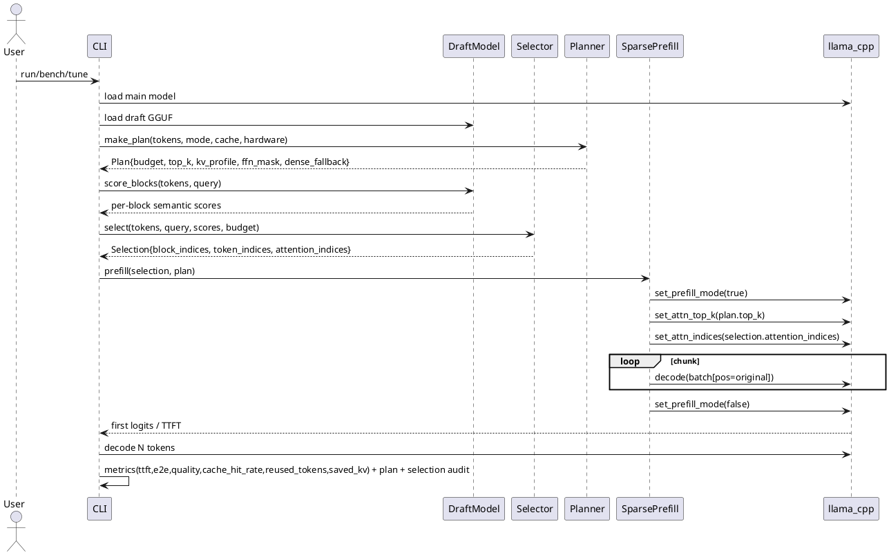
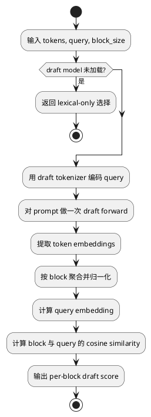
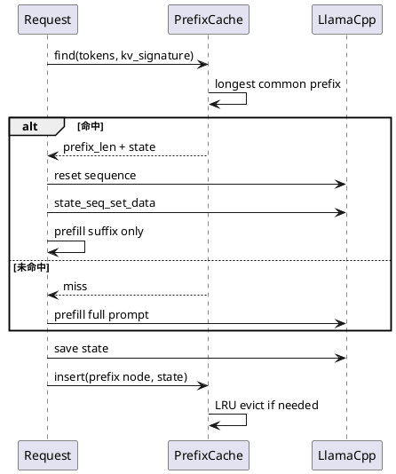
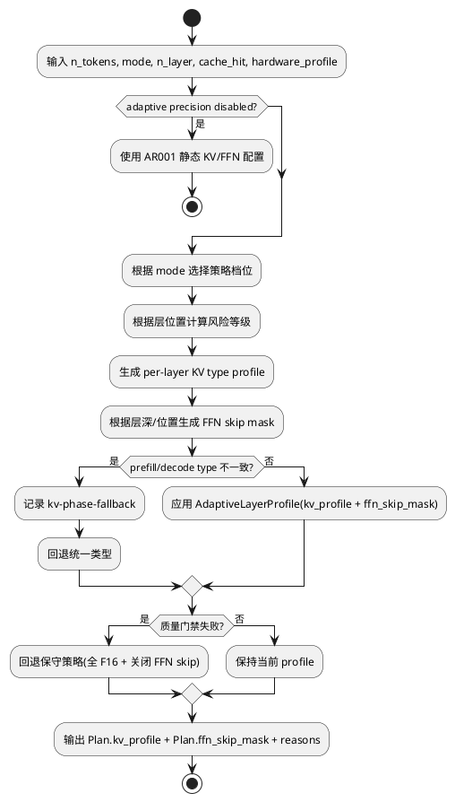
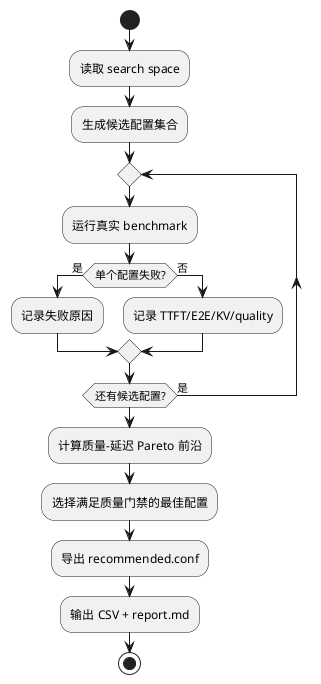
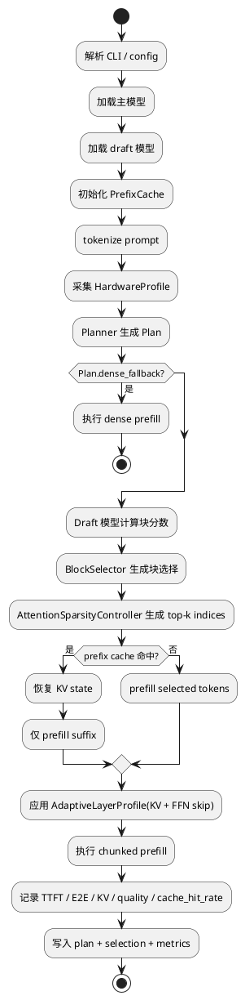
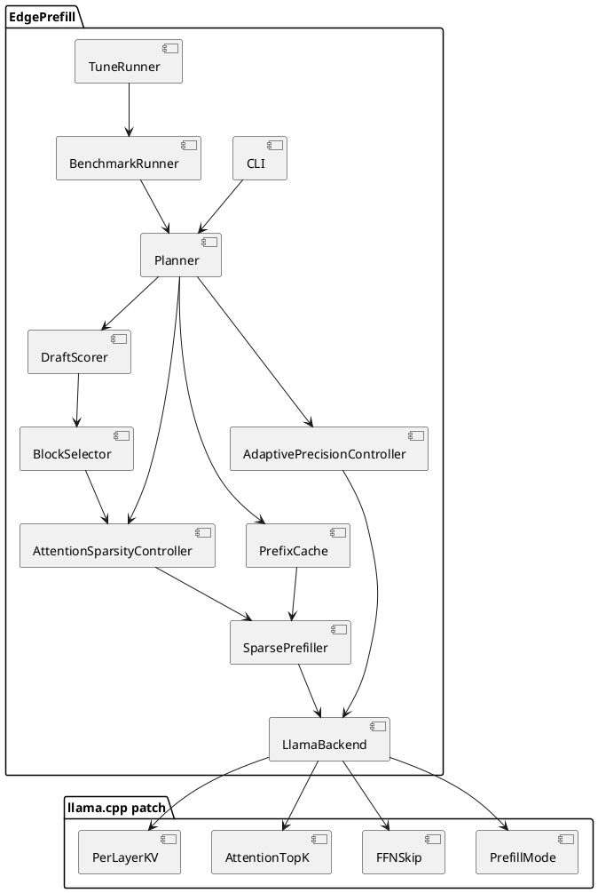

# 1 AR概述

| 组件名称 | edge-prefill（EdgePrefill） |
| --- | --- |
| AR系统流水号 | AR002 |
| AR描述 | 在 AR001 基线上实现深度稀疏 Prefill 与自适应复用创新：引入 draft 模型语义信号、attention 级全局/分层 top-k、按层与相位感知的 KV 精度调度、跨请求/多轮前缀 KV 复用、自动调优与 Pareto 基准，并交付 CPU + CUDA 服务器级可复现实验 |
| 关联 srs.md | ./srs.md |
| 日期 | 2026-10-20 |
| 状态 | Draft |

## 1.1 选定方案

本 AR 采用 **方案 B：Draft 辅助 + Attention 级全局/分层 top-k + 自适应精度 + 自动调优**。

方案对比结论：

| 方案 | 结论 | 原因 |
| --- | --- | --- |
| A：仅框架级分层选择 + draft 语义增强 | 不采用 | 不满足 attention 级 top-k 核心创新，2.5x 加速余量不足 |
| B：draft + attention 全局/分层 top-k + 自适应精度 + 自动调优 | **采用** | 覆盖全部核心创新，风险可控，真实可运行，最符合 AR002 目标 |
| C：逐 query 动态 top-k + 双相位 KV 切换 | 后续 AR | 实现风险过高，依赖更深的 graph/kernel 改动，不适合本 AR 交付 |

## 1.2 关键创新点

1. **Draft-guided Hierarchical Sparse Prefill**
   - 第一层：块级多信号选择。
   - 第二层：attention 级全局/分层 top-k。
   - Draft 模型提供真实语义分数，用于块选择与 attention top-k 候选排序。

2. **Cross-request & Multi-turn Prefix KV Reuse**
   - PrefixCache 从线性扫描升级为 Radix 树。
   - 支持同一会话多轮追加与不同请求共享 system prompt。

3. **Layer- and Phase-aware KV Precision & FFN Skip**
   - llama.cpp patch 支持按层 KV 类型。
   - Planner 按层与相位生成精度档位，并根据层深/位置动态决定 FFN 跳过。
   - 首版不跨相位切换已分配 KV 类型；显式跨相位请求返回 `Unsupported` 并回退。

4. **Auto-tuning and Pareto Benchmark**
   - 自动搜索 budget、block size、attention top-k、KV 精度、FFN mask。
   - 输出质量-延迟 Pareto 前沿与推荐配置。

---

# 2 动态行为

## 2.1 分层稀疏 Prefill 主流程



## 2.2 Draft 模型语义打分流程



## 2.3 跨请求/多轮前缀 KV 复用



## 2.4 自适应精度与层调度



## 2.5 自动调优与 Pareto



---

# 3 功能点分解

| 序号 | 功能点名称 | 功能点描述 | 对应 FR |
| --- | --- | --- | --- |
| 1 | Draft 模型语义打分 | 加载小型 GGUF draft 模型，输出块级语义分数 | FR-1 |
| 2 | 分层稀疏选择 | 块级选择 + attention 级全局/分层 top-k 候选 | FR-1 |
| 3 | Attention top-k patch | llama.cpp 支持按层 top-k token/block gather | FR-1 |
| 4 | 稀疏 Prefill 执行 | 位置保持、因果性、dense 回退、审计统计 | FR-1 |
| 5 | Radix PrefixCache | 跨请求与多轮共享前缀的真实 KV state 复用，并输出命中率/节省指标 | FR-2 |
| 6 | 按层 KV 精度 | llama.cpp patch + Planner 生成 per-layer profile | FR-3 |
| 7 | 相位与层深感知调度 | 根据相位/层位置生成保守或激进的 KV 与 FFN 跳过策略 | FR-3 |
| 8 | 自动调优 | 搜索参数空间并输出 Pareto 前沿 | FR-4 |
| 9 | 推荐配置导出 | 输出可复用 conf 与完整实验报告 | FR-4, FR-5 |
| 10 | CPU/CUDA 复现 | setup/download/run/tune 脚本与 README | FR-5 |
| 11 | 质量保障 | dense 等价、无 mock、质量门禁、回归测试 | FR-6 |
| 12 | 架构与接口演进 | 新增接口保持向后兼容、可审计、模块化 | FR-7 |

---

# 4 实现设计

## 4.1 功能实现思路

### 4.1.1 方案对比

| 维度 | 方案 A | 方案 B（采用） | 方案 C |
| --- | --- | --- | --- |
| Attention 级稀疏 | 无 | 全局/分层 top-k | 逐 query top-k |
| Draft 模型 | 可选 | 必须 | 必须 |
| KV 精度 | 全局 | 按层 + 相位策略 | 按层 + 相位切换 |
| PrefixCache | 线性 | Radix | Radix / 分页 |
| 实现风险 | 低 | 中 | 高 |
| 2.5x 达标概率 | 中 | 高 | 不确定 |
| AR002 适配度 | 低 | 高 | 过度激进 |

### 4.1.2 核心设计决策

1. **Attention top-k 首版采用全局/分层策略**
   - 同一 prefill chunk 内，每个层使用同一组 top-k token/block。
   - Draft 模型给出块级排序，框架生成 `attention_indices`。
   - llama.cpp patch 通过 `ggml_get_rows` 聚集 K/V，真实减少 attention 计算宽度。
   - 逐 query top-k 留给后续 AR。

2. **Draft 模型是必需组件**
   - 默认使用与主模型同 tokenizer 家族的小型 GGUF。
   - Draft 模型执行一次轻量 forward，输出块级语义分数。
   - 若 draft 模型缺失或加载失败，回退 lexical-only 并记录 `draft-disabled`，不伪造语义分数。

3. **按层 KV 精度与 FFN 跳过通过最小 patch 实现**
   - llama.cpp 新增 per-layer `type_k/type_v` 数组。
   - `AdaptivePrecisionController` 输出 `AdaptiveLayerProfile`，同时包含：
     - `kv_profile`：每层 `type_k/type_v`
     - `ffn_skip_mask`：按层深/位置动态决定是否跳过 FFN
   - 现有 `ffn_skip.h/cpp` 的静态 mask 路径保留；启用 adaptive 时由
     `AdaptiveLayerProfile.ffn_skip_mask` 覆盖静态配置，未启用时完全回退 AR001 行为。
   - 未配置时保持现有全局行为。
   - Prefill/decode 类型不一致时不做状态转换，返回 `Unsupported` 并回退。
   - FFN 跳过仅作用于 prefill 阶段，且首尾层默认保守。

4. **PrefixCache 使用 Radix 树**
   - 节点表示 token 前缀。
   - 仅在关键边界保存 state snapshot。
   - LRU 淘汰整棵子树或最旧 snapshot。
   - `PrefixCache` 自身线程安全（内部互斥保护节点树），支持多请求并发 `find/insert`；
     llama context 的 state 恢复仍由调用方在各自请求内串行执行。
   - `Metrics` 必须输出命中率、复用 token 数、节省时间与节省内存，供 FR-2 验收。

5. **自动调优必须基于真实推理**
   - 每个候选配置都调用真实 `BenchmarkRunner`。
   - 不使用代理指标、不缓存伪造结果。
   - 输出 Pareto 前沿与满足质量门禁的推荐配置。
   - 推荐配置必须可重新运行且结果与搜索阶段一致。

6. **Planner 根据硬件条件决定 attention 启用策略**
   - `PlannerInput` 新增 `HardwareProfile`（线程数、是否有 CUDA、可用内存、n_ctx）。
   - 硬件不足或质量门禁失败时，Planner 自动降低 `attention_top_k` 或回退 dense。

---

## 4.2 功能实现设计

### 4.2.1 总体流程图



### 4.2.2 流程说明

1. **配置解析**
   - 新增 `draft_model`、`attn_top_k`、`attn_top_k_layers`、`adaptive_kv`、`kv_profile`、`tune` 参数。
   - 所有新参数默认关闭或保持 AR001 行为。
   - AR001 配置文件必须无修改可用。

2. **Plan 生成**
   - `PlannerInput` 新增 `HardwareProfile`（线程数、CUDA、内存、n_ctx）。
   - `Plan` 新增：
     - `attention_top_k`
     - `attention_indices`
     - `kv_profile`
     - `ffn_skip_mask`
     - `draft_enabled`
     - `dense_fallback`
   - `Plan.reasons` 记录启用/禁用原因。

3. **块选择**
   - `BlockSelector` 在 lexical/diversity/position 基础上融合 draft score。
   - 融合公式：`score = w_lex*lexical + w_div*diversity + w_pos*position + w_draft*draft`
     （权重来自 `Config`，默认 `w_lex=0.3, w_div=0.2, w_pos=0.2, w_draft=0.3`）。
   - 输出 `block_indices`、`token_indices`、`attention_indices`。
   - `attention_indices` 是 token 级索引，供 llama.cpp gather 使用。
   - 测试 oracle：必选块必须保留，且输出按融合分数单调递减。

4. **Attention top-k 执行**
   - llama.cpp patch 在 prefill mode 且 `attention_top_k > 0` 时生效。
   - 使用 `ggml_get_rows` 聚集 K/V 对应行。
   - KQ mask 同步裁剪到 gathered 宽度。
   - 关闭 top-k 时完全恢复原路径。

5. **Prefix 复用**
   - `PrefixCache` 用 Radix 树查找最长前缀。
   - 命中后恢复 state，只 prefill suffix。
   - 每轮结束后插入新的 state snapshot。
   - `Metrics` 输出 `cache_hit_rate`、`reused_tokens`、`saved_ttft_ms`、`saved_kv_bytes`。

6. **自适应精度与 FFN 调度**
   - `AdaptivePrecisionController` 根据层位置与相位生成 `AdaptiveLayerProfile`：
     - `kv_profile`：每层 KV 类型
     - `ffn_skip_mask`：按层深/位置动态决定 FFN 跳过
   - llama.cpp patch 按层创建 KV tensor。
   - 质量优先模式自动回退到保守 profile 并清空 FFN skip。

7. **自动调优**
   - `TuneRunner` 枚举配置。
   - 每个配置调用 `BenchmarkRunner`。
   - 计算 Pareto 前沿。
   - 导出 `recommended.conf`。

---

## 4.3 接口描述

### 4.3.1 llama.cpp patch 新增 API

```c
LLAMA_API int32_t llama_set_prefill_attn_top_k(struct llama_context * ctx, int32_t top_k);
LLAMA_API int32_t llama_get_prefill_attn_top_k(const struct llama_context * ctx);
LLAMA_API int32_t llama_set_prefill_attn_indices(
    struct llama_context * ctx,
    const int32_t * indices,
    size_t n);
LLAMA_API int32_t llama_get_prefill_attn_indices_size(const struct llama_context * ctx);
LLAMA_API int32_t llama_set_kv_type_per_layer(
    struct llama_context * ctx,
    const enum ggml_type * type_k,
    const enum ggml_type * type_v,
    size_t n_layer);
```

> 返回值使用与 EdgePrefill `ErrorCode` 一致的 `int32_t`：`0=Ok`，
> `2=InvalidArgument`，`9=Unsupported`。C 层不抛异常、不输出日志，
> 由 C++ `LlamaBackend` 包装转换为 `Status`。

| 接口 | 参数 | 约束 | 返回/效果 | 错误 |
| --- | --- | --- | --- | --- |
| `llama_set_prefill_attn_top_k` | `ctx`, `top_k` | `top_k >= 0`；`0` 关闭 | 返回 `0` 成功；负值返回 `2` | `top_k < 0` 返回 `InvalidArgument` |
| `llama_get_prefill_attn_top_k` | `ctx` | context 已初始化 | 返回当前 top-k；默认 `0`；patch 缺失返回 `9` | patch 缺失返回 `Unsupported` |
| `llama_set_prefill_attn_indices` | `ctx`, `indices`, `n` | `indices` 严格升序、元素 `< KV 长度`、`n > 0` | 返回 `0` 成功；`n=0` 清空并恢复原路径 | 空指针、越界、重复、非升序返回 `InvalidArgument` |
| `llama_get_prefill_attn_indices_size` | `ctx` | context 已初始化 | 返回当前 indices 数量；默认 `0`；patch 缺失返回 `9` | patch 缺失返回 `Unsupported` |
| `llama_set_kv_type_per_layer` | `ctx`, `type_k`, `type_v`, `n_layer` | 数组长度必须等于模型层数；`NULL` 恢复全局类型 | 返回 `0` 成功 | 长度不匹配返回 `InvalidArgument` |

**错误与回退：**
- patch 未编译时，上层返回 `Unsupported`，不影响 dense 路径。
- `top_k <= 0` 表示关闭 attention 稀疏。
- indices 为空、越界、重复或非升序时返回 `InvalidArgument`。
- per-layer 数组长度不匹配时返回 `InvalidArgument`。
- prefill/decode KV 类型不一致时返回 `Unsupported` 并回退统一类型。

### 4.3.2 EdgePrefill 新增接口

```cpp
class LlamaDraftScorer : public DraftScorer {
public:
    Status load_model(const std::string& path);
    Status score(const std::vector<llama_token>& tokens,
                 const std::string& query,
                 std::vector<double>* per_token_scores) override;
};

struct AttentionSparsityOptions {
    uint32_t block_size = 32;
    uint32_t top_k_blocks = 0;
    bool per_layer = false;
    std::vector<uint32_t> layer_top_k;
};

class AttentionSparsityController {
public:
    static Status build(const Selection& selection,
                        const AttentionSparsityOptions& opts,
                        std::vector<int32_t>* attention_indices,
                        std::string* reason);
};

enum class KvPrecision {
    F16,
    Q8_0,
    Q4_0,
};

struct KvLayerProfile {
    KvPrecision type_k = KvPrecision::F16;
    KvPrecision type_v = KvPrecision::F16;
};

enum class Mode {
    Quality,     // 对应 CLI `--kv-profile safe`
    Balanced,    // 对应 CLI `--kv-profile balanced`
    Aggressive,  // 对应 CLI `--kv-profile aggressive`
};

class PrefixCache {
public:
    std::optional<CacheHit> find(const std::vector<llama_token>& tokens,
                                 const KvSignature& signature);
    Status insert(const std::vector<llama_token>& prefix,
                  const KvSignature& signature,
                  std::vector<uint8_t> state);
    CacheStats stats() const;
};

struct AdaptiveLayerProfile {
    std::vector<KvLayerProfile> kv_profile;
    std::vector<bool> ffn_skip_mask;
};

class AdaptivePrecisionController {
public:
    static Status build(const PlannerInput& in,
                        Mode mode,
                        AdaptiveLayerProfile* profile,
                        std::string* reason);
};

struct TuneSearchSpace {
    std::vector<double> budgets;
    std::vector<uint32_t> block_sizes;
    std::vector<uint32_t> attention_top_ks;
    std::vector<KvPrecision> kv_types;
    std::vector<uint64_t> ffn_masks;
    std::vector<uint32_t> chunk_sizes;
};

class TuneRunner {
public:
    Status run(const std::string& model,
               const std::string& draft_model,
               const std::string& data_dir,
               const TuneSearchSpace& space,
               const std::string& out_dir,
               std::string* recommended_config_path);
};
```

| 接口 | 参数/前置条件 | 返回/效果 | 错误 |
| --- | --- | --- | --- |
| `LlamaDraftScorer::load_model` | `path` 必须指向可读 GGUF | 加载 draft 模型并初始化 tokenizer | 文件缺失/损坏返回 `ModelLoad` |
| `LlamaDraftScorer::score` | `tokens` 非空且已 tokenize；`query` 非空 | 输出与 `tokens` 等长的有限分数 | 空输入返回 `InvalidArgument`；模型未加载返回 `Unsupported` |
| `AttentionSparsityController::build` | `selection` 已包含合法 token 索引 | 输出严格升序 `attention_indices` | 越界/重复/空输入返回 `InvalidArgument` |
| `AdaptivePrecisionController::build` | `in.n_layer > 0`；mode 合法 | 输出 `AdaptiveLayerProfile`，同时决定 KV 类型与 FFN 跳过 | 非法层数/模式返回 `InvalidArgument` |
| `TuneRunner::run` | model、draft_model、data_dir、out_dir 均可访问 | 搜索配置并输出 Pareto 与 `recommended.conf` | 目录不可写返回 `Io`；模型缺失返回 `ModelLoad`；数据集缺失返回 `Io` |

### 4.3.3 CLI 新增参数

| 参数 | 说明 | 默认值 | 非法值处理 |
| --- | --- | --- | --- |
| `--draft-model` | draft GGUF 路径 | 空 | 路径不存在返回 `ModelLoad` |
| `--attn-top-k` | 全局 attention top-k | 0 | 负数或非数字返回 `InvalidArgument` |
| `--attn-top-k-layers` | 每层 top-k，逗号分隔 | 空 | 元素数不等于层数或含非法值返回 `InvalidArgument` |
| `--adaptive-kv` | 启用按层自适应 KV | false | 仅接受 true/false |
| `--kv-profile` | 预定义精度档位：safe(=Quality)/balanced/aggressive | balanced | 非法档位返回 `InvalidArgument` |
| `--tune` | 启动自动调优 | false | 仅接受 true/false |
| `--sweep-file` | 搜索空间配置 | 空 | 文件不存在返回 `Io`；解析失败返回 `InvalidArgument` |
| `--recommended-conf` | 推荐配置输出路径 | 空 | 目录不可写返回 `Io` |

### 4.3.4 Metrics 新增字段

| 字段 | 类型 | 说明 |
| --- | --- | --- |
| `cache_hit_rate` | `double` | PrefixCache 命中率，`[0,1]` |
| `reused_tokens` | `uint64_t` | 复用的 token 数 |
| `saved_ttft_ms` | `double` | 相比全量 prefill 节省的 TTFT |
| `saved_kv_bytes` | `uint64_t` | 相比全量 prefill 节省的 KV 内存 |
| `attention_top_k` | `uint32_t` | 当前 attention top-k |
| `per_layer_attn_stats` | `vector<LayerAttnStats>` | 每层稀疏统计：`layer_idx`、`top_k`、`selected_tokens`、`skipped_tokens` |
| `kv_profile` | `string` | 当前 KV profile 名称 |
| `draft_enabled` | `bool` | draft 模型是否启用 |

---

## 4.4 代码设计

### 4.4.1 新增/修改文件

| 文件 | 变更类型 | 说明 |
| --- | --- | --- |
| `patches/llama-prefill-attn-top-k.patch` | 新增 | attention gather + per-layer KV patch |
| `include/edge_prefill/selector.h` | 修改 | `Selection` 新增 attention 字段，`DraftScorer` 拆分 |
| `src/selector.cpp` | 修改 | 块选择融合 draft score，输出 `attention_indices` |
| `tests/test_selector.cpp` | 修改 | draft 融合、排序单调性、必选块保留测试 |
| `include/edge_prefill/draft_scorer.h` | 新增 | 独立 draft 语义打分接口 |
| `src/draft_scorer.cpp` | 新增 | draft GGUF 加载与块级语义分数 |
| `include/edge_prefill/attention_sparsity.h` | 新增 | attention top-k 索引生成 |
| `src/attention_sparsity.cpp` | 新增 | top-k block/token 选择与审计 |
| `include/edge_prefill/adaptive_precision.h` | 新增 | 按层 + 相位 KV profile 与 FFN skip mask |
| `src/adaptive_precision.cpp` | 新增 | profile 生成与回退 |
| `include/edge_prefill/tune.h` | 新增 | 自动调优接口 |
| `src/tune.cpp` | 新增 | 搜索、Pareto、推荐配置导出 |
| `include/edge_prefill/prefix_cache.h` | 修改 | Radix 树结构、线程安全、命中统计 |
| `src/prefix_cache.cpp` | 修改 | Radix 查找/插入/LRU/命中率 |
| `include/edge_prefill/config.h` | 修改 | 新增配置字段与 Plan 字段 |
| `src/config.cpp` | 修改 | 解析新增参数 |
| `include/edge_prefill/planner.h` | 修改 | 输出 attention/KV/FFN profile、硬件感知 |
| `src/planner.cpp` | 修改 | 集成 draft、top-k、precision、FFN skip |
| `include/edge_prefill/backend.h` | 修改 | 暴露新 patch API |
| `src/backend.cpp` | 修改 | 调用 attention top-k 与 per-layer KV |
| `src/sparse_prefill.cpp` | 修改 | 传递 attention indices 与 FFN mask |
| `src/benchmark.cpp` | 修改 | 支持 tune、repeats/warmup、新指标 |
| `include/edge_prefill/metrics.h` | 修改 | 新增 `per_layer_attn_stats` 与 cache 指标字段 |
| `src/metrics.cpp` | 修改 | 输出 cache_hit_rate、reused_tokens、saved_ttft、saved_kv、per-layer 统计 |
| `include/edge_prefill/ffn_skip.h` | 修改 | 与 `AdaptiveLayerProfile.ffn_skip_mask` 衔接，保留 AR001 静态 mask 路径 |
| `src/ffn_skip.cpp` | 修改 | 支持从 `AdaptiveLayerProfile` 生成 mask，未启用时回退静态配置 |
| `src/main.cpp` | 修改 | 新增 CLI 参数 |
| `CMakeLists.txt` | 修改 | 新增源文件与测试目标 |
| `tests/test_draft_scorer.cpp` | 新增 | draft 打分与空输入测试 |
| `tests/test_attention_sparsity.cpp` | 新增 | top-k 索引与边界测试 |
| `tests/test_adaptive_precision.cpp` | 新增 | KV profile 与 FFN skip 测试 |
| `tests/test_tune.cpp` | 新增 | 搜索、Pareto、推荐配置重跑一致性测试 |
| `tests/test_prefix_cache.cpp` | 修改 | Radix、LRU、线程安全测试 |
| `scripts/setup.sh` | 新增 | 干净 Ubuntu CPU/CUDA 环境搭建 |
| `scripts/download_models.sh` | 新增 | 主模型与 draft 模型下载 |
| `scripts/run_bench.sh` | 新增 | 一键运行 dense/optimized 基准 |
| `scripts/run_tune.sh` | 新增 | 一键自动调优并输出推荐配置 |
| `README.md` | 修改 | 快速开始、构建、复现实验说明 |
| `docs/architecture.md` | 新增 | 分层稀疏与自适应复用架构说明 |
| `docs/experiments.md` | 新增 | CPU/CUDA 实验步骤与波动范围 |
| `docs/research.md` | 新增 | 相关工作对比与创新点分析 |

### 4.4.2 模块关系



---

## 4.5 边界条件矩阵

| 类别 | 场景 | 期望行为 |
| --- | --- | --- |
| 正常 | prompt 长度 > `min_dense_tokens` 且 budget ∈ (0,1) | 启用稀疏 prefill |
| 正常 | prefix 命中且 suffix 非空 | 恢复 state，仅 prefill suffix |
| 正常 | `layer_top_k` 长度等于 n_layer | 按层生效 |
| 正常 | `top_k` = token 总数 | 等价 dense，不报错 |
| 边界 | prompt 长度 = `min_dense_tokens` | Planner 必须给出明确的启用/禁用结论 |
| 边界 | prompt 长度 < `min_dense_tokens` | 回退 dense，`reasons` 记录 `prompt-too-short` |
| 边界 | 前缀长度 = 可配置复用阈值 | 允许复用，记录命中 |
| 边界 | 前缀长度 < 阈值 | 不复用，避免恢复开销超过收益 |
| 边界 | `top_k` = 0 | 关闭 attention 稀疏 |
| 边界 | `top_k` = 1 | 仅保留最高分 token，质量门禁失败则回退 |
| 边界 | 空 prompt / 空 query | 返回 `InvalidArgument` |
| 边界 | 单 token prompt | 回退 dense，避免稀疏开销 |
| 边界 | `layer_top_k` 长度 ≠ n_layer | 返回 `InvalidArgument` |
| 边界 | cache 容量达到上限 | LRU 淘汰最旧叶子 snapshot |
| 异常 | indices 越界 / 重复 / 非升序 | 返回 `InvalidArgument` |
| 异常 | prefill/decode KV 类型不一致 | 返回 `Unsupported` 并回退 |
| 异常 | draft 模型加载失败 | 回退 lexical-only，记录 `draft-disabled` |
| 异常 | state 恢复失败 | 清空序列并全量重算，记录 `Cache` |
| 异常 | CUDA 不可用 | 自动回退 CPU，构建与运行不受影响 |

## 4.6 错误处理设计

| 错误 | 触发条件 | 处理方式 | 错误码 |
| --- | --- | --- | --- |
| patch 缺失 | llama.cpp 未打 attention/per-layer patch | 上层返回错误并回退原路径 | `Unsupported` |
| draft 模型缺失 | `--draft-model` 路径不存在或加载失败 | 回退 lexical-only，`Plan.reasons` 记录 `draft-disabled` | `ModelLoad` |
| attention indices 非法 | 空、越界、重复、非升序 | 拒绝执行 prefill | `InvalidArgument` |
| per-layer KV 长度不匹配 | 数组长度 ≠ n_layer | 拒绝执行 | `InvalidArgument` |
| KV 相位不一致 | prefill/decode 类型不同 | 回退统一类型，`reasons` 记录 `kv-phase-fallback` | `Unsupported` |
| state 恢复失败 | cache blob 校验失败或 context 恢复报错 | 清空序列、全量重算、记录 warning | `Cache` |
| tune 单配置失败 | benchmark 返回非 Ok | 记录失败配置与原因，继续搜索 | `Internal` / `Io` |
| 数据集缺失 | data_dir 无 index.tsv | 提示生成/下载命令 | `Io` |
| CUDA 不可用 | 运行环境无 GPU 或驱动不可用 | 自动回退 CPU，不阻塞 CPU 路径 | `Unsupported` |
| 质量门禁失败 | 综合质量 < 97% | Planner 自动回退保守策略并记录 | `Internal` |

## 4.7 决策记录

| 编号 | 决策 | 理由 |
| --- | --- | --- |
| D1 | 采用方案 B：draft + 全局/分层 top-k + 自适应精度 + 自动调优 | 覆盖核心创新且风险可控 |
| D2 | attention top-k 首版不逐 query | 逐 query 需更深 graph/kernel 改动，留待后续 AR |
| D3 | FFN skip 与 KV 精度统一由 AdaptiveLayerProfile 管理 | 避免两套层调度逻辑不一致 |
| D4 | PrefixCache 使用 Radix 树且线程安全 | 支持跨请求共享与多轮复用 |
| D5 | 自动调优必须调用真实 BenchmarkRunner | 满足无 mock 硬约束 |
| D6 | CPU 干净构建 + smoke test 为强制验收 | 保证可复现性 |

# 5 重构设计

## 5.1 Selector 重构

- 将 `DraftScorer` 从 `selector.h` 拆到独立头文件。
- `Selection` 新增 `attention_indices` 与 `attention_top_k`。
- 块选择与 attention top-k 解耦，便于独立测试与后续逐 query 扩展。

## 5.2 PrefixCache 重构

- 内部结构从 `std::list<Entry>` 改为 Radix 树。
- 每个 Radix 节点保存：
  - token range
  - optional state snapshot
  - last_used
  - child map
- `find` 返回最长可复用前缀。
- `insert` 在关键边界创建 snapshot。
- LRU 淘汰优先移除叶子节点，并维护容量上限。
- `PrefixCache` 内部使用互斥锁保护节点树，`find/insert/stats` 均线程安全；
  llama context 的 state 恢复仍由调用方在各自请求内串行执行。
- 新增 `CacheStats`，输出 `cache_hit_rate`、`reused_tokens`、`saved_ttft_ms`、`saved_kv_bytes`。

## 5.3 Planner 重构

- `Plan` 新增 attention、precision、FFN skip、draft、dense_fallback 字段。
- `PlannerInput` 新增 `HardwareProfile`，用于决定 attention top-k 是否启用及上限。
- Planner 变成组合式策略生成器：
  1. 判断 dense fallback（prompt 长度、硬件、质量门禁）。
  2. 生成 block budget。
  3. 生成 attention top-k。
  4. 生成 KV profile 与 FFN skip mask（`AdaptiveLayerProfile`）。
  5. 输出 reasons 与 passes。
- 质量门禁失败时自动回退保守策略：降低 top-k、关闭 FFN skip、回退 F16。

---

# 6 测试设计

## 6.0 覆盖率目标

- 新增模块 `draft_scorer`、`attention_sparsity`、`adaptive_precision`、`prefix_cache`、`tune`：
  - 语句覆盖率 ≥ **85%**
  - 分支覆盖率 ≥ **80%**
- §3 每个功能点至少 **2** 个测试用例（正常 + 边界/异常）。
- §4.3 每个新增/修改接口至少 **3** 个测试用例（正常、边界、错误）。
- srs.md 每条 Given/When/Then 验收标准在 §6.6 追溯矩阵中至少对应 **1** 个用例。
- 无模型环境下真实模型用例必须显式 `SKIP`，不得失败或伪造通过。

## 6.1 单元测试

| 用例 | 覆盖点 |
| --- | --- |
| `draft_scorer_load_and_score` | 真实 draft GGUF 加载、tokenize、块分数非空且有限 |
| `draft_scorer_missing_model_fallback` | draft 缺失时返回 `draft-disabled`，不伪造分数 |
| `draft_scorer_empty_query_or_tokens` | 空 query / 空 tokens 返回 `InvalidArgument` |
| `block_selector_draft_fusion` | 融合分数 `w_lex*lex + w_div*div + w_pos*pos + w_draft*draft` 排序正确，必选块保留 |
| `attention_sparsity_indices_sorted` | 输出 indices 严格升序且在 token 范围内 |
| `attention_sparsity_disabled` | top_k=0 时 indices 为空，不改变原路径 |
| `attention_sparsity_disabled_equivalence` | 关闭 attention 后与未启用 patch 的同配置路径逐 token 相同，logits diff < 1e-5 |
| `dense_full_equivalence` | budget=1.0 且全部优化关闭时与 dense logits diff < 1e-5 |
| `attention_sparsity_budget` | top_k 不超过配置上限，必选 block 保留 |
| `attention_sparsity_per_layer_stats` | per-layer 模式下输出每层 `layer_idx/top_k/selected_tokens/skipped_tokens` |
| `attention_sparsity_all_tokens` | top_k = token 总数时等价 dense |
| `adaptive_precision_safe_mode` | quality 模式生成全 F16 profile 且 FFN skip 全关 |
| `adaptive_precision_balanced_mode` | 中间层可量化，首尾层保守，FFN skip 按层深生效 |
| `adaptive_precision_invalid_layer` | 非法层数返回 `InvalidArgument` |
| `adaptive_disabled_static_equivalence` | 关闭 adaptive 时 Plan 与 AR001 静态 KV/FFN 配置完全一致 |
| `planner_dense_fallback` | prompt 过短/硬件不足/质量门禁失败时 `dense_fallback=true` |
| `planner_prompt_length_boundary` | prompt 长度等于/小于 `min_dense_tokens` 时给出明确启用/禁用结论 |
| `planner_hardware_disable_attention` | HardwareProfile 不满足时 attention top_k=0 |
| `prefix_cache_radix_longest_prefix` | 多请求共享前缀返回最长命中 |
| `prefix_cache_multi_turn` | 同一会话追加轮次可复用 |
| `prefix_cache_signature_mismatch` | 模型/KV 类型不匹配时不复用 |
| `prefix_cache_lru_eviction` | 容量达上限时淘汰最旧叶子 snapshot |
| `prefix_cache_threshold_boundary` | 前缀长度等于/低于复用阈值时正确决定是否复用 |
| `prefix_cache_metrics` | `cache_hit_rate/reused_tokens/saved_ttft_ms/saved_kv_bytes` 正确输出 |
| `prefix_cache_thread_safety` | 并发 find/insert 在 TSAN 下无数据竞争，且命中率/容量不变式保持 |
| `tune_pareto_front` | 给定样本集输出正确非支配配置 |
| `tune_export_config` | 推荐配置可序列化并重新解析 |
| `tune_unreachable_report` | 无配置满足门禁时输出明确不可达原因报告 |
| `tune_rerun_consistency` | 推荐配置重新运行结果与搜索阶段一致 |

## 6.2 接口测试

| 接口 | 测试点 |
| --- | --- |
| `llama_set_prefill_attn_top_k` | 0 关闭、1 最小有效值、正值生效、负值返回 `InvalidArgument`、最大值等价 dense |
| `llama_get_prefill_attn_top_k` | 默认返回 0、set 后返回相同值、patch 缺失返回 `Unsupported` |
| `llama_set_prefill_attn_indices` | NULL 指针、空数组（n=0 清空）、升序、越界、重复索引、非升序 |
| `llama_get_prefill_attn_indices_size` | 默认返回 0、set 后返回 n、清空后返回 0、patch 缺失返回 `Unsupported` |
| `llama_set_kv_type_per_layer` | 长度匹配、长度不匹配、NULL 恢复、非法 ggml_type |
| `LlamaDraftScorer::score` | 正常输入、空 query、空 tokens、模型未加载 |
| `AttentionSparsityController::build` | 正常、空 selection、越界、top_k=0 |
| `AdaptivePrecisionController::build` | safe/balanced/aggressive、n_layer=0、非法 mode |
| `TuneRunner::run` | 正常、out_dir 不可写、model 缺失、data_dir 缺失 |
| `Plan::to_json` | 新字段完整输出且可解析 |
| CLI `--attn-top-k` | 参数解析、默认关闭、负数报错、非数字报错、`INT32_MAX` 等价 dense 或显式拒绝 |
| CLI `--attn-top-k-layers` | 合法逗号列表、元素数不等于层数、非法字符报错 |
| CLI `--draft-model` | 路径存在、路径不存在返回 `ModelLoad` |
| CLI `--adaptive-kv` | true/false 解析、非法值报错 |
| CLI `--kv-profile` | safe/balanced/aggressive 生效、非法档位报错 |
| CLI `--tune` | true/false 解析、非法值报错 |
| CLI `--sweep-file` | 文件存在、文件不存在返回 `Io`、解析失败返回 `InvalidArgument` |
| CLI `--recommended-conf` | 可写路径、不可写路径返回 `Io` |
| CLI 非法参数组合 | 不兼容组合返回 `InvalidArgument` 与可诊断信息 |

## 6.3 业务场景测试

| 场景 | 验证内容 |
| --- | --- |
| 8K NIAH | TTFT ≥2.5x，质量保持率 ≥97% |
| 8K QA | draft 修复块选择，质量保持率 ≥97% |
| 8K PPL | logprob 质量不低于门限 |
| 4K prompt | TTFT ≥1.8x |
| 共享 system prompt | 二次请求 TTFT ≥5x，prefill token 数减少 ≥90% |
| 多轮对话 | 逐 token 输出与无缓存一致 |
| KV 内存与质量 | 自适应精度下 KV 内存相对 dense f16 下降 ≥30%，质量保持率 ≥97% |
| CUDA 服务器 | GPU offload 下主实验可复现 |
| CPU 干净构建 | 干净 Ubuntu 上一键构建 + smoke test 全部通过 |
| 一键复现 | `scripts/run_bench.sh` 可复现实验，指标落在声明的波动范围内，且贪心输出逐 token 相同 |
| 自动调优 | 输出 Pareto 前沿与推荐配置 |
| 推荐配置重跑 | 使用 recommended.conf 重新运行，结果与搜索阶段一致 |
| 无模型环境 | 未设置 `EDGE_PREFILL_TEST_MODEL` 时真实模型用例显式 SKIP |
| 真实模型完整测试 | 设置模型变量后全部测试通过，无 mock 路径 |
| AR001 配置兼容 | 使用 AR001 配置文件运行，语义不变，仅允许新增 warning |
| warning 行为 | 产生 warning 时退出码与 Plan 语义不变 |

## 6.4 异常场景测试

| 异常 | 期望行为 |
| --- | --- |
| llama patch 缺失 | 返回 `Unsupported`，回退原路径 |
| draft 模型路径错误 | 返回 `ModelLoad`，回退 lexical-only |
| attention indices 越界/重复/非升序 | 返回 `InvalidArgument`，不执行 prefill |
| per-layer KV 长度不匹配 | 返回 `InvalidArgument` |
| prefill/decode KV 类型不一致 | 返回 `Unsupported` 并回退统一类型 |
| PrefixCache state 恢复失败 | 返回 `Cache`，清空序列并全量重算 |
| tune 单个配置失败 | 记录失败配置与原因，继续搜索，整体不失败 |
| 数据集缺失 | 返回 `Io`，提示生成/下载命令 |
| CUDA 不可用 | 检测失败后自动回退 CPU，返回 `Unsupported` 但进程继续 |
| 质量门禁失败 | Planner 自动回退保守策略并记录 warning |
| sweep 文件解析失败 | 返回 `InvalidArgument`，不启动搜索 |
| out_dir 不可写 | 返回 `Io`，终止 tune |

## 6.5 质量门禁

- `budget=1.0`、`attn_top_k=0`、`skip_ffn=0` 时 logits max abs diff < 1e-5。
- 所有新增接口返回 `Status`，不抛异常。
- 所有实验输出包含原始 CSV、环境信息与命令。
- 无 mock、无硬编码结果、无伪造计时。

## 6.6 srs 验收标准追溯矩阵

| srs 验收标准 | 对应用例 |
| --- | --- |
| FR-1 AC1 | `8K NIAH`（TTFT ≥2.5x，质量 ≥97%） |
| FR-1 AC2 | `attention_sparsity_disabled_equivalence`（与未启用 attention patch 的同配置路径逐 token 相同，logits diff <1e-5） |
| FR-1 AC3 | `dense_full_equivalence`（budget=1.0 全关，logits diff <1e-5） |
| FR-2 AC1 | `共享 system prompt`（TTFT ≥5x 且 prefill token ↓≥90%） |
| FR-2 AC2 | `多轮对话` |
| FR-2 AC3 | `prefix_cache_signature_mismatch`、`prefix_cache_thread_safety` |
| FR-2 期望行为5 | `prefix_cache_metrics`（命中率/复用 token/节省时间与内存） |
| FR-3 AC1 | `KV 内存与质量`（内存 ↓≥30%，质量 ≥97%） |
| FR-3 AC2 | `adaptive_precision_safe_mode`（质量优先，不启用低于 97% 的激进策略） |
| FR-3 AC3 | `adaptive_disabled_static_equivalence`（关闭自适应后与 AR001 静态配置一致） |
| FR-4 AC1 | `自动调优`、`tune_unreachable_report`（满足门禁或明确报告不可达原因） |
| FR-4 AC2 | `推荐配置重跑`、`tune_rerun_consistency` |
| FR-5 AC1 | `CPU 干净构建` |
| FR-5 AC2 | `CUDA 服务器` |
| FR-5 AC3 | `一键复现` |
| FR-6 AC1 | `无模型环境`（真实模型用例显式 SKIP） |
| FR-6 AC2 | `8K NIAH`、`8K QA`、`8K PPL`、`真实模型完整测试` |
| FR-6 AC3 | `dense_full_equivalence`（budget=1.0 全关，logits diff <1e-5） |
| FR-7 AC1 | `warning 行为`（warning 不改变退出码/计划语义） |
| FR-7 AC2 | `AR001 配置兼容`、CLI 未启用参数不影响既有路径 |
| FR-7 AC3 | CLI 非法参数组合用例（返回明确错误码与可诊断信息） |

> **基线澄清（FR-1 AC2）**：srs.md 已显式定义对比基线为
> **同一配置下未启用 attention patch 的执行路径**（可为块级稀疏或 dense），
> 本设计的 `attention_sparsity_disabled_equivalence` 用例按该口径验收。
