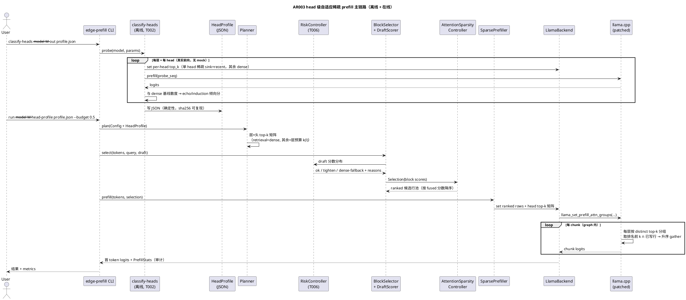
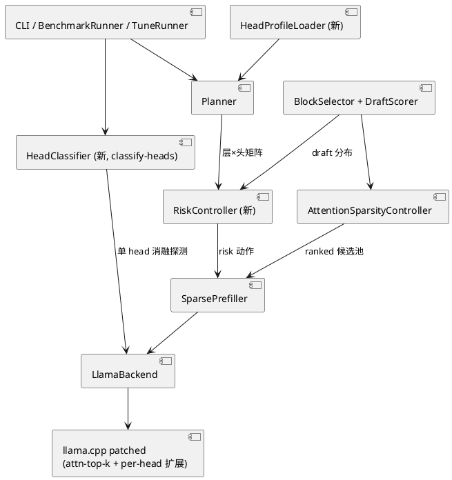

# 1 AR概述

| 组件名称 | edge-prefill / EdgePrefill |
| --- | --- |
| AR系统流水号 | AR003 |
| AR描述 | Head 级自适应稀疏 Prefill：在 AR002 的 draft 语义打分 + 块级选择 + attention 全局 top-k gather 之上，引入（1）层×头 top-k 矩阵 gather patch（retrieval head 稠密、非检索 head 稀疏）；（2）消融式离线 head 分类器（真实模型灵敏度探测 → JSON profile）；（3）层-头二维自适应规划（draft 深层信号融合）；（4）在线质量风险控制器（ok/tighten/dense-fallback 三级回退）；并吸收 AR002 未交付的 Radix 前缀缓存、KV 分页快照、按层 KV 精度、自动调优 Pareto、CPU/CUDA 复现框架、实验矩阵、Gitee ≤40KB 批次同步工具。目标：8K TTFT ≥3.5×、4K ≥2.5×、质量保持 ≥97%，显著强于 AR002 已实现的 2.33–2.43×。 |

# 2 动态行为

## 交互时序图



# 3 功能点分解

| 序号 | 功能点名称 | 功能点描述 | 追溯 |
| --- | --- | --- | --- |
| 1 | head profile 数据结构与加载 | `HeadProfile` 结构、JSON 解析、模型结构校验（n_layer×n_head）、`--head-profile`/`--head-adaptive`/`--head-retrieval-threshold` CLI 与 Config 字段 | FR-2 前置 / FR-3 |
| 2 | 消融式 head 分类器 | `classify-heads` 子命令：固定种子探测序列，单 head 施加 sink+recent 稀疏、其余稠密，真实前向 logits 散度 → 每层每头 retrieval 倾向分 → JSON | FR-2 |
| 3 | per-head gather patch | llama.cpp：`llama_set_prefill_attn_ranked_rows` + `llama_set_prefill_attn_head_top_k`（层×头矩阵，-1=dense）；graph 每层按 distinct top-k 值分组（≤4），组内取排名前 k、过滤未写行、升序 gather；旧标量 API 原样保留 | FR-1 |
| 4 | per-head 执行路径 | backend 包装 + Unsupported 回退全局标量路径；SparsePrefiller 传 ranked 行池与矩阵；PrefillStats/ChunkStats per-head 审计 | FR-1 |
| 5 | 层-头二维自适应规划 | planner 由 profile + 层预算生成矩阵；AttentionSparsityController 输出 ranked 候选池；`--head-adaptive off` 时与 AR002 逐字段一致 | FR-3 |
| 6 | 在线质量风险控制器 | draft 分布区分度/覆盖率/锚完整率 → ok/tighten/dense-fallback；审计与 `risk_level` 列 | FR-4 |
| 7 | Radix 前缀缓存 | 最长前缀命中、真实 state 复用、LRU、签名校验（吸收 AR002 T005，沿用 AR002 design §对应节） | FR-5 |
| 8 | KV 分页快照 | 序列化、恢复失败回退（吸收 AR002 T006） | FR-5 |
| 9 | 按层 KV 精度 | `llama_set_kv_type_per_layer` patch、首尾层保守、相位不一致 Unsupported（吸收 AR002 T007） | FR-6 |
| 10 | 自动调优 Pareto | 真实 BenchmarkRunner 搜索 budget/top-k/head-adaptive/KV/chunk → 前沿 + recommended.conf（吸收 AR002 T008，搜索空间加 head-adaptive 维度） | FR-7 |
| 11 | CPU/CUDA 环境与复现框架 | GGML_CUDA 构建、setup/download/run 脚本、README/docs、`scripts/sync_gitee.sh` ≤40KB 批次（吸收 AR002 T009/T010） | FR-8 |
| 12 | 质量回归与实验矩阵 | dense 等价、无 mock 硬门禁、消融用例、PPL 综合指标、8K/4K × CPU/CUDA × {dense, AR002, AR003} 矩阵（吸收 AR002 T011/T012/T013） | FR-9/FR-10 |
| 13 | 研究文档、Review、ST、Gitee tag | docs/research.md SOTA 对比、合规审查、ST 验收、阶段性同步 + release tag（吸收 AR002 T014–T017） | FR-11/FR-12 |

# 4 实现设计

## 4.1 功能实现思路

**核心洞察（来自 SOTA 分析）：** 全局 top-k 对所有 head 一视同仁，但 attention head
的功能分化极大——retrieval/induction head 必须全量 KV 才能保住长程 recall
（RazorAttention），而多数 head 在 sink+recent+少量语义锚点下输出几乎不变。
把"每 head 都付全量 gather 成本"改为"retrieval head 稠密直通、其余 head 只 gather
排名靠前的少量行"，在质量不降的前提下把稀疏 head 的 attention 计算再降一个量级，
这是从 2.4× 到 ≥3.5× 的主要来源。配套地，head 分类必须真实（消融式探测用我们
自己的 per-head patch 做单 head 灵敏度测量，不引入 attention dump 大补丁），
规划必须可回退（profile 缺失/非法 → AR002 全局路径逐字段一致）。

**模块关系：**



## 4.2 功能实现设计

### 4.2.1 流程图

```plantuml
@startuml
title FR-1/FR-3 per-head 稀疏执行（graph 内 per-chunk 视角）

start
:chunk 执行前，edge_prefill 已设置
ranked_rows（按 fused 分数降序的候选行）
+ head_top_k 矩阵（n_layer×n_head，-1=dense）;
if (prefill_mode 且 ranked_rows 非空 且矩阵非空) then (yes)
  :layer_l: 收集本层 distinct top-k 值
（-1 除外，组数 > 4 → 整层回退 dense）;
  if (本层存在稀疏组) then (yes)
    splithead: fork
      partition "dense 组（top_k=-1）" as D
      partition "稀疏组 g（top_k=k_g）" as S
        :取 ranked_rows 前 k_g 个（截断到池长）;
        :过滤 row < live n_kv（本 chunk 已写行）;
        if (过滤后为空) then (yes)
          :该组本 chunk 走已写行稠密注意力
（因果安全，同 AR002 空前缀规则）;
        else (no)
          :升序排序 → ggml_get_rows gather
K/V/KQ mask（复用 T002 机制）;
        endif
      end partition
      partition "dense 组" as D
        :原始 K/V/mask 直通，无 gather 开销;
      end partition
    end fork
    :沿 head 维 concat 各组输出 → 本层 attention 输出;
  else (no)
    :整层 dense（retrieval 层常见）;
  endif
else (no)
  :AR002 标量路径（top_k=0/空 indices）
或完全 dense;
endif
:softmax + FFN（FFN skip 另由 mask 控制）;
:下一 chunk（graph 因 attn 输入变化而重建，
can_reuse 检查矩阵一致）;
stop
@enduml
```

```plantuml
@startuml
title FR-2 classify-heads 消融探测 + FR-4 风险控制

start
:classify-heads:
固定种子生成探测序列 S = [A₁..A_m]×r
（m=32, r=8, 词表内随机 token，参数可配）;
:跑一次全 dense 基线，保存逐位置 logits B;
repeat
  :head h（layer l, head idx j）:
矩阵全 -1，仅 (l,j)=k_probe（8），
ranked_rows = sink(4)+recent(8) 行;
  :真实前向 S → logits L_h;
  :echo(l,j) = 重复副本内"复制位"（与前一副本同位置的
 token）top-1 翻转率;
  :induction(l,j) = 副本首 token 的 induction 位（由上一
 序列结尾预测下一序列首 token）top-1 翻转率;
  :score(l,j) = max(echo, induction)（副指标 KL）;
repeat while (还有未测 head?) is (yes)
-> no;
:class = score > τ ? retrieval : normal
（τ 默认 0.10，可配）；JSON 双分数 echo_score/induction_score 均落盘
:写 head_profile.json
（model_sha、probe_params、每层每头
score/class，确定性输出）;

#FR-4 风险控制（在线，规划阶段）
:draft 打分完成后：
sep = (top 均值 - bottom 均值)/max(std,ε)
cov = selected_tokens/total_tokens
anchor = mandatory 锚完整率;
if (sep < τ_sep 或 cov < τ_cov 或 anchor < 1) then (yes)
  if (可加密：k(l)×2 ≤ 池长) then (yes)
    :risk=tighten：全部稀疏层预算×2
（上限池长），reasons 记录
"risk-tighten sep=… cov=…";
  else (no)
    :risk=dense-fallback：
本请求禁用稀疏，reasons 记录
"risk-dense …";
  endif
else (no)
  :risk=ok，预算不变;
endif
:Plan.reasons + metrics.risk_level 落盘;
stop
@enduml
```

### 4.2.2 流程说明

1. **ranked 行池语义**：`Selection.block_indices` 按块 fused 分数降序已是排名序；
   `AttentionSparsityController::build_ranked_rows` 把块序展开为行序（块内位置升序），
   再经 位置→KV行号 映射（复用 T004 的 `lower_bound` 于 active_positions），得到
   `ranked_rows`。mandatory 锚（sink/recent/coverage/best-lex）置于池首且永不因
   截断丢失——planner 分配 per-head k 时锚块按"必选"标记排在 rank 0 区。
2. **graph 内 per-chunk 安全**：graph 知道 live `n_kv`；组内过滤 `row < n_kv`
   替代 AR002 在 edge_prefill 侧的 `chunk_indices` 前缀截断。空前缀 → 该组本
   chunk 对已写行稠密注意力（因果安全）。这把 per-chunk per-group 的 N 次外层
   调用收敛为一次 API 设置，消除 chunk 间状态错位风险。
3. **dense 组零开销**：top_k=-1 的 head 走原始 K/V/mask 路径，不 gather——
   retrieval head 的"全量 KV"不是"gather 全量行"（那是纯开销），而是直通。
4. **旧路径保留**：标量 `llama_set_prefill_attn_top_k/indices`（AR002）不动；
   head 矩阵 API 非空时优先生效。edge_prefill 探测 patch 缺失（符号为 NULL）→
   `Unsupported` → 回退标量路径 + `per-head-unsupported` 审计。
5. **风险控制器位置**：在 selector 完成 draft 打分后、planner 产出最终矩阵前；
   tighten 只放大稀疏层预算，不改变 dense/sparse 分类（分类来自离线 profile，
   在线不重算）；dense-fallback 请求整体退 dense，保证最坏情况质量。
   tighten 的加密条件为 `k(l)×2 ≤ 池长`（×2 后恰等池长仍走 Tighten；超出则
   DenseFallback）。
6. **层-头单调性语义**：draft 分数是层间信号（深层边界 hidden state 权重提升，
   Twig 洞察），故 per-head 矩阵的单调性落实为**层间单调**——层 l 的信号强度
   s(l) 越高，该层 normal head 的 k(l) 越大（k(l) 随 s(l) 非降，上限为全局
   `--attn-top-k` 换算的行预算）；层内 normal head 共享 k(l)（head 维度的
   差异化由 dense/sparse 分类承载）；retrieval head（-1）不受预算约束。
7. **head 分类器即 patch 消费者**：探测本身用 FR-1 的矩阵 API（单 head 稀疏、
   其余 -1），天然构成 FR-1 的真实模型用例；无 attention dump、无合成分数。
8. **吸收任务设计沿用**：FR-5–FR-12 的设计直接沿用 AR002 design.md（门控第 3 轮
   PASS 版本），本 AR 增量仅为：(a) TuneRunner 搜索空间新增
   `head_adaptive ∈ {on,off}` 与 `head_profile`；(b) BenchmarkConfig/metrics 新增
   `risk_level`、`head_adaptive`、`retrieval_heads` 列；(c) 复现脚本新增
   `sync_gitee.sh`（carrier ≤40KB 分批 + raw receive-pack，禁用
   `Expect: 100-continue`，模式已在本会话验证）。

## 4.3 接口描述

### 4.3.1 llama.cpp patch 新增 C API（include/llama.h，int32 错误码 0/2/9）

| 接口 | 签名 | 语义与校验 |
| --- | --- | --- |
| 设置 ranked 候选行池 | `int32_t llama_set_prefill_attn_ranked_rows(llama_context*, const int32_t* rows, size_t n)` | n==0 清空恢复原路径；rows 须在 [0, n_ctx) 且可重复排名序（不要求升序）；NULL 指针→2 |
| 查询池大小 | `int32_t llama_get_prefill_attn_ranked_rows_size(const llama_context*)` | 返回当前池长 |
| 设置层×头 top-k 矩阵 | `int32_t llama_set_prefill_attn_head_top_k(llama_context*, const int32_t* top_k, size_t n)` | n 必须等于 n_layer×n_head（加载模型后校验，否则 2）；元素 ≥1 或 ==-1（dense）；矩阵非空要求 ranked 池非空（否则 2）；设置成功后标量 top-k 路径被本矩阵覆盖 |
| 查询矩阵长度 | `int32_t llama_get_prefill_attn_head_top_k_size(const llama_context*)` | 返回 n_layer×n_head 或 0 |
| 清空矩阵 | 同上接口 n==0 | 恢复 AR002 标量路径 |

**graph 行为（llama-graph.cpp `build_attn`）**：prefill_mode 且矩阵非空且池非空时，
逐层收集 distinct 值（-1 除外）；组数 >4 → 该层整体 dense（安全降级，不改其他层）；
每组：池前 k_g 截断 → 过滤 `< live n_kv` → 升序排序 → 复用 T002 permute/get_rows/
cont 机制 gather（K/V/KQ mask 三件套）→ 组输出沿 head 维 concat；dense 组直通。
`can_reuse` 增加矩阵与池的一致性比较。flash attention 下矩阵路径直接禁用
（同 T002 限制，走 dense，stderr 不再重复告警——审计由 edge_prefill 记录）。

### 4.3.2 edge_prefill 公共接口（include/edge_prefill/）

命名映射：srs 的 `Plan.per_head_top_k` 即本表 `Plan.per_head_matrix_serialized`
（层×头矩阵按行序列化后的审计快照）；执行侧同一矩阵经
`sparse_prefill::Options.head_matrix` 传入，三处命名指同一数据。

| 接口 | 变更 | 说明 |
| --- | --- | --- |
| `head_profile.h`（新增） | `struct HeadProfileEntry { int32_t layer; int32_t head; double echo_score; double induction_score; bool retrieval; }`、`struct HeadProfile { std::string model_sha; int32_t n_layer; int32_t n_head; ProbeParams probe; std::vector<HeadProfileEntry> heads; }`、`Status load_head_profile(path, HeadProfile*)`、`Status validate_head_profile(const HeadProfile&, int32_t n_layer, int32_t n_head)` | JSON 手写解析（仓库无 nlohmann，沿用 config.cpp 风格）；结构不匹配 → InvalidArgument，不静默使用 |
| `config.h` | `Config.head_profile_path`、`bool head_adaptive = false`、`double head_retrieval_threshold = 0.10`、`bool risk_guard = true`、`double risk_sep_threshold = 0.5`、`double risk_cov_threshold = 0.35`；`Plan.head_adaptive`、`Plan.risk_level`（枚举字符串）、`Plan.per_head_matrix_serialized`（审计用） | CLI：`--head-profile <path>`、`--head-adaptive on\|off`、`--head-retrieval-threshold <f>`、`--risk-guard on\|off` |
| `backend.h` | `Status set_attn_ranked_rows(const std::vector<int32_t>&)`、`Status set_attn_head_top_k(const std::vector<int32_t>&)`、`int32_t attn_head_top_k_size() const`、`bool attn_per_head_supported() const` | patch 符号探测（dlsym 不可用则编译期宏 + 运行时 NULL 检查，沿用 T002 模式）；缺失 → `Unsupported` |
| `attention_sparsity.h` | `static Status build_ranked_rows(const Selection&, const AttentionSparsityOptions&, std::vector<int32_t>* ranked_rows, std::string* reason)`（锚块置首）、`static Status per_head_matrix(const HeadProfile*, uint32_t default_layer_top_k, const std::vector<uint32_t>& layer_top_k, int32_t n_layer, int32_t n_head, std::vector<int32_t>* matrix)` | 旧 `build/validate/chunk_indices` 原样保留（标量回退路径与既有测试依赖） |
| `risk_controller.h`（新增） | `struct RiskSignals { double separation; double coverage; double anchor_ratio; }`、`enum class RiskAction { Ok, Tighten, DenseFallback }`、`struct RiskDecision { RiskAction action; double scale; std::string reason; }`、`class RiskController { static Status evaluate(const RiskSignals&, const RiskOptions&, RiskDecision*); }` | 纯函数可单测；evaluate 失败按 Tighten 保守处理 |
| `sparse_prefill.h` | `Options.enable_head_adaptive`、`Options.head_matrix`（空=标量路径）、`Options.ranked_rows`；`PrefillStats` 增 `head_sparse_groups`（每层稀疏组数直方图）、`head_dense_heads`（dense head 总数） | 执行前校验：矩阵非空但池空 → InvalidArgument |
| `head_classifier.h`（新增） | `struct HeadProbeParams { uint32_t block_len=32; uint32_t repeats=8; uint32_t sink=4; uint32_t recent=8; uint32_t probe_k=8; uint64_t seed=42; }`、`class HeadClassifier { Status classify(LlamaBackend*, const HeadProbeParams&, const std::string& model_sha, HeadProfile* out); }` | 真实前向；n_ctx 不足 → InvalidArgument 带建议参数 |
| `benchmark.h` / `metrics.h` | `BenchmarkConfig.head_adaptive/head_profile_path/risk_guard`；`Sample.risk_level/head_adaptive/retrieval_heads`（CSV/report 列） | 追加列不破坏旧列顺序 |
| `main.cpp` | 子命令 `classify-heads`；`run/bench` 透传新参数；`plan` 输出矩阵摘要 | 未知参数=2 不变 |

**兼容性**：所有新字段默认关闭（`head_adaptive=false`、`risk_guard` 默认 true 但
仅 sparse 模式激活且默认阈值不触发时零影响——`risk_guard=false` 时决策器旁路）。
budget=1.0 + 全部关闭 → dense 等价 <1e-5（既有门禁用例扩展断言）。

### 4.3.3 classify-heads CLI 契约

```
edge-prefill classify-heads --model M [--draft-model D] --output profile.json
  [--probe-block-len 32] [--probe-repeats 8] [--probe-k 8]
  [--retrieval-threshold 0.10] [--threads N] [--n-ctx 4096]
退出码：0 成功；3 ModelLoad；4 Tokenize；5 ContextInit（4/5 继承通用 CLI 契约，探测序列内部生成、无独立触发场景）；2 参数非法（含探测长度>n_ctx）；11 Io（--output 不可写）
输出：head_profile.json（确定性：同模型+同参数逐字节一致）
耗时预算：qwen2.5-1.5b（28 层×14 头=392 head + 1 基线）× 256 token 前向 ≈ CPU 数十秒
```

## 4.4 代码设计

```text
include/edge_prefill/          （新增 head_profile.h / head_classifier.h / risk_controller.h；
                                 修改 config.h / backend.h / sparse_prefill.h / benchmark.h / metrics.h / attention_sparsity.h / planner.h / selector.h）
src/                           （对应 .cpp；planner.cpp 矩阵规划；attention_sparsity.cpp 扩展；
                                 config.cpp / backend.cpp / sparse_prefill.cpp / benchmark.cpp / metrics.cpp / main.cpp / selector.cpp）
patches/llama-prefill-attn-top-k.patch   （扩展：ranked_rows + head_top_k 矩阵 + graph 分组 gather）
tests/test_head_profile.cpp    （解析/校验/矩阵生成，纯逻辑）
tests/test_head_classifier.cpp （真实模型探测：确定性、profile 结构、n_ctx 不足）
tests/test_risk_controller.cpp （纯函数：三级动作、阈值边界、evaluate 失败保守）
tests/test_sparse_attn_exec.cpp（扩展：per-head 路径等价/审计/回退用例）
tests/test_prefix_cache.cpp、test_precision.cpp（扩展：签名不匹配/长度不匹配用例）
scripts/sync_gitee.sh          （新：≤40KB carrier + raw receive-pack 同步工具）
```

**分层要点**：HeadClassifier/RiskController 不依赖 llama.cpp 内部结构，仅通过
`LlamaBackend` 公共接口操作（消融探测用矩阵 API），保证可单测、可替换；
per-head 分组 gather 完全内聚在 llama.cpp patch 层，edge_prefill 只传"排名池 +
矩阵"两个张量语义，层间解耦与 AR002 一致。

**吸收任务（功能点 7–13）受影响文件**（设计沿用 AR002 design.md 第 3 轮 PASS
版文件清单，此处汇总索引）：
`include/edge_prefill/prefix_cache.h` + `src/prefix_cache.cpp`（Radix 树改造）、
`include/edge_prefill/precision.h` + `src/precision.cpp`（按层 profile）、
`include/edge_prefill/tune.h`（新增）+ `src/tune.cpp`（Pareto 搜索，搜索空间
增 `head_adaptive` 维度）、`include/edge_prefill/benchmark.h` + `src/benchmark.cpp`
（CUDA/hardware profile 透传）、`src/main.cpp`（tune/classify-heads 子命令）、
`patches/llama-prefill-kv-per-layer.patch`（新增）、`scripts/setup.sh`、
`scripts/download_data.sh`、`scripts/run_experiments.sh`、`scripts/sync_gitee.sh`、
`README.md`、`docs/architecture.md`、`docs/experiments.md`、`docs/research.md`。

## 4.5 边界条件矩阵

| 场景类型 | 条件 | 预期行为 | 测试追溯 |
| --- | --- | --- | --- |
| 正常 | 合法池 + 矩阵、稀疏层/dense 层混合 | 分组 gather 正确、logits 有限 | §6.2/6.3 |
| 边界 | ranked 池 n == n_ctx（全量池，最大值） | 合法；各组截断到 k 后 gather，dense 组直通 | §6.2 |
| 边界 | 矩阵元素最小合法值 k=1（每层仅 1 行） | 合法；该组 gather 单行 | §6.2 |
| 边界 | 全部 head = -1（全 retrieval） | 等价 dense（<1e-5），无 gather | §6.2 |
| 边界 | 全部 head 稀疏且同值 | 等价 AR002 标量语义（单组） | §6.2 |
| 边界 | 某层 distinct 值恰 = 4 | 正常分组；=5 触发该层降级 | §6.4 |
| 边界 | tighten 分界：k(l)×2 恰等于池长 | 走 Tighten（可加密条件为 ×2 ≤ 池长）；再高一级触发 DenseFallback | §6.1 |
| 边界 | 探测序列长度恰等于 n_ctx | 合法执行 | §6.2 |
| 异常 | 矩阵长度 ≠ n_layer×n_head | 返回 2，模型状态不变 | §6.1/6.2 |
| 异常 | 矩阵元素 0 / <-1 / 池行越界 | 返回 2 | §6.1/6.2 |
| 异常 | 矩阵非空而池为空 | 返回 2（半写防护：设置前校验） | §6.1 |
| 异常 | 首 chunk 池行全部 ≥ live n_kv（空前缀） | 该组本 chunk 对已写行稠密注意力（因果安全） | §6.4 |
| 异常 | 跨 chunk 修改矩阵 | graph `can_reuse` 失配 → 重建，结果正确 | §6.4 |
| 异常 | flash attention 开启 | 矩阵路径禁用 + 审计，等价 dense | §6.4 |
| 异常 | profile n_layer/n_head 与模型不符 | InvalidArgument，不使用错误 profile | §6.1 |
| 异常 | RiskController::evaluate 内部错误 | 按 Tighten 保守处理 | §6.1 |

## 4.6 错误处理表

| 错误 | 触发条件 | 处理方式 | 错误码 |
| --- | --- | --- | --- |
| 非法参数（C API） | NULL 指针、矩阵长度错、元素 0/<-1/越界、池行越界、矩阵非空池空 | 拒绝设置，模型状态不变 | 2 |
| patch 缺失 | 运行时符号探测失败 | 回退 AR002 标量路径 + `per-head-unsupported` 审计 | 9（转换为 Status::Unsupported） |
| profile 不匹配 | n_layer/n_head 与加载模型不符 | 拒绝加载，规划退回无 profile 语义 | 2（InvalidArgument） |
| profile 文件不可读 | 路径不存在/权限不足/坏 JSON | 拒绝加载，CLI 报错退出 | 11（Io） |
| 探测序列超限 | probe 长度 > n_ctx | 拒绝并在错误信息给出建议参数（降低 repeats/block_len） | 2 |
| 模型加载失败（classify-heads） | 路径错误/坏 GGUF | 子命令退出 | 3（ModelLoad） |
| 输出不可写 | --output 路径无法创建 | 子命令退出 | 11（Io） |
| 组数超限 | 某层 distinct top-k 值 > 4 | 该层安全降级 dense，其他层照常，审计记录 | 不报错（安全降级） |
| 风险评估失败 | RiskSignals 含 NaN/Inf 或内部断言 | 按 Tighten 保守加密 | 不报错（保守动作） |
| 前缀恢复失败 | snapshot 损坏/签名不符 | 丢弃缓存重算（吸收 AR002 设计） | 不报错（回退） |

# 5 重构设计

- `AttentionSparsityController` 保持既有三个静态方法不动（标量路径与既有测试依赖），
  新增 `build_ranked_rows`/`per_head_matrix` 两个静态方法——非重构而是扩展，不触发
  既有任务重置。
- AR002 `attn_top_k_layers`（标量 per-layer）被矩阵语义自然包含（层内全 head 同值），
  保留入口做兼容映射：`head_adaptive=false` 时 planner 不生成矩阵，走原标量路径。

# 6 测试设计

## 6.1 单元测试（UT，无模型可跑）

| 覆盖点 | 用例 | 追溯 |
| --- | --- | --- |
| HeadProfile 解析 | 合法 JSON 全字段；缺字段/坏类型 → InvalidArgument 带字段名；n_layer/n_head 与模型不符 → InvalidArgument | FR-3 异常 |
| per_head_matrix 生成 | retrieval head → -1 且不受预算约束；normal head → 层预算 k(l)；层预算空 → 全局 k；profile 为空指针 + head_adaptive=on → 全 normal 语义矩阵 | FR-3 AC1 |
| 层-头单调性与上限 | 构造层信号 s(l) 递增序列 → k(l) 非降（层间单调，§4.2.2-6）；任一层 normal k(l) ≤ 全局 `--attn-top-k` 行预算上限；s(l) 相同两层 → k(l) 相等 | FR-3 AC1 |
| build_ranked_rows | 锚块（sink/recent/coverage/best-lex）位于池首 rank 区；块内行升序；与 token_indices 交集语义；dense selection → 空池 | FR-3/FR-1 |
| RiskController.evaluate | sep≥τ 且 cov≥τ 且 anchor=1 → Ok；sep<τ 且可加密 → Tighten×2；池长不足 → DenseFallback；anchor<1 → DenseFallback；**精确边界：k(l)×2 == 池长 → Tighten，k(l)×2 == 池长+1 → DenseFallback**；evaluate 内部错误 → Tighten；`--risk-guard off` 旁路 → 决策恒 Ok 且 Plan 逐字段等于无控制器 | FR-4 全部 AC + §4.5 |
| 矩阵校验 | 长度≠n_layer×n_head → 2；元素 0 或 <-1 → 2；矩阵非空+池空 → 2 | FR-1 AC2 |
| 确定性 | 同输入两次 classify 规划输出逐字节一致（复用 plan dump） | FR-2 |

## 6.2 接口测试（真实模型为主，无模型显式 SKIP）

| 接口 | 用例 | 追溯 |
| --- | --- | --- |
| `llama_set_prefill_attn_ranked_rows` | NULL 指针→2；n==0 清空恢复；越界行→2；重复行合法（排名序） | FR-1 AC2 |
| `llama_set_prefill_attn_ranked_rows` 最大边界 | n == n_ctx 全量池 → 设置成功，各组截断到 k 后 gather，结果与 dense <1e-5（k=池长时） | FR-1 / §4.5 |
| `llama_set_prefill_attn_head_top_k` | 长度错误→2；元素 0/<-1→2；合法矩阵设置后查询一致 | FR-1 AC2 |
| `llama_set_prefill_attn_head_top_k` 最小值 | 元素 k=1 合法；矩阵非空 + 空池 → 2 | FR-1 AC2 / §4.5 |
| `llama_set_prefill_attn_head_top_k` n==0 清空 | 矩阵生效后调用 n==0 → 恢复 AR002 标量路径，logits 与标量路径 <1e-5（FR-1 AC4 直接承接）；`llama_get_prefill_attn_ranked_rows_size` 设置前后查询一致 | FR-1 AC4 |
| backend 包装错误码转换 | 非法参数（C API 返回 2）→ Status::InvalidArgument；patch 缺失 → Unsupported；合法设置成功 | FR-1 AC3 |
| retrieval head 等价 | 先设池、再设全 -1 矩阵（设置顺序：池先于矩阵满足校验）→ 与 dense logits diff <1e-5；单层全 -1 其余稀疏 → 整体 <1e-5 | FR-1 AC1/AC4 |
| 单组退化等价 | 全部 head 稀疏且同值 k → 与 AR002 标量路径同 k 结果一致（逐 token argmax 相同） | §4.5 |
| classify-heads CLI | 成功输出 profile 且 sha256 两次一致；--probe-repeats 超出 n_ctx → 退出码 2 + 建议信息；探测序列长度恰 == n_ctx → 合法执行；--output 不可写 → Io；--model 路径错误 → 退出码 3 | FR-2 AC1/AC2 + §4.5 |
| CLI 新参数非法值 | `--head-adaptive`/`--risk-guard` 非 on/off → 2；`--head-retrieval-threshold` 负数/非数值 → 2；`--head-profile` 指向不存在/不可读文件 → Io 且不崩溃 | §4.5/§4.6 |
| risk 集成 | 真实模型 + 构造退化 query（draft 区分度低）→ reasons 含 `risk-tighten`/`risk-dense` 与数值；正常 query → risk_level=ok | FR-4 AC1/AC2 |

## 6.3 业务场景测试

| 场景 | 用例 | 追溯 |
| --- | --- | --- |
| 8K QA/NIAH 全链路 | head-adaptive on vs off vs dense 三方对比：TTFT ≥3.5×、`retrieval_heads` 审计列 == profile 中 retrieval head 计数、`PrefillStats.head_sparse_groups` 每层 ≤4 且非稀疏层为 0、`head_dense_heads` == profile retrieval 计数 | FR-10 AC1 |
| 4K 全链路 | 同上矩阵在 4K 数据集：TTFT ≥2.5× | FR-10 AC2 |
| 质量综合指标 | 每个主实验配置输出 0.4×NIAH + 0.4×QA + 0.2×PPL 综合保持率 ≥97%（report.md 汇总行） | FR-9 / FR-10 |
| 共享前缀二次请求（8K） | Radix 命中 → 复用 token 数正确、TTFT ≥5×、缓存指标入 CSV | FR-5 AC1 |
| 前缀签名不匹配 | 修改 model_key/n_ctx/type 后 find → 不命中、不崩溃、正常重算 | FR-5 AC2 |
| 多轮追加 | 第三轮前缀命中且 logits 与 dense 重算一致（<1e-5） | FR-5 |
| 按层 KV 精度 | Q8_0 中间层 + F16 首尾层：KV 字节降 ≥30%、质量 ≥97%；per-layer 数组长度 ≠ n_layer → 返回 2 且状态不变 | FR-6 AC1/AC2 |
| tune | 小搜索空间真实搜索：前沿点可追溯 raw.csv；全候选失败 → 不可达报告 | FR-7 |
| benchmark repeats | risk_level/head_adaptive 列随 repeats 中位数样本落盘 | FR-4/FR-8 |
| 干净克隆构建（ST 前置） | 干净克隆 + `scripts/setup.sh` → 构建通过、ctest 全过、`run_experiments.sh` 退出码 0 并产出 raw.csv/report.md（WSL CPU 路径；CUDA 路径在服务器执行并记录） | FR-8 AC1 |
| sync_gitee 同步 | 增量提交 → `scripts/sync_gitee.sh` 执行后 `git ls-remote` master sha == 本地、临时分支零残留 | FR-8 AC2 |
| README 配置表 | README 审阅断言：含模型名/量化/SHA256/线程/n_ctx/预算矩阵全部配置项（脚本级检查或 ST 评审） | FR-8 AC3 |

## 6.4 异常场景测试

| 异常 | 用例 | 追溯 |
| --- | --- | --- |
| patch 未应用 | 启用 head-adaptive → `Unsupported` 回退标量路径，`per-head-unsupported` 审计，结果正确 | FR-1 AC3 |
| 矩阵与模型不匹配 | n_layer 变化的 profile → 拒绝且模型状态不变（半写防护：设置前校验） | FR-3 异常 |
| graph 组数超限 | 构造 distinct 值 =5 矩阵 → 该层安全降级 dense；对照 distinct 恰 =4 → 正常分组执行，logits 有限 | FR-1 边界 / §4.5 |
| 首 chunk 空前缀 | 池行全部 ≥ 首 chunk 的 live n_kv → 该组本 chunk 对已写行稠密注意力，输出与 dense-on-written 语义等价（logits 有限且后续 chunk 恢复 gather 后 argmax 确定性） | FR-1 / §4.2.1 图 1 分支 |
| 跨 chunk 矩阵一致性 | chunk 间矩阵不变 → graph 复用；chunk 间修改矩阵 → `can_reuse` 失配重建且最终 logits 正确 | §4.2.1 图 1 分支 |
| flash attention 开启 | 矩阵路径禁用 + 审计，dense 等价 | FR-1 限制 |
| 恢复失败的前缀 | 损坏 snapshot → 丢弃重算，结果正确 | FR-5 AC3 |
| 相位 KV 不一致 | prefill Q8/decode F16 → Unsupported + `kv-phase-fallback` + 统一类型 | FR-6 AC3 |
| 无模型环境 | 全部真实模型用例显式 SKIP 且套件 PASS；无伪造通过 | FR-9 |
| 全开关关闭回归 | 与 AR002 行为一致（既有 58 用例零回归 + 新列默认值）；显式 dump 关闭态 Plan 与 AR002 全局路径逐字段一致 | FR-9 AC1 / FR-3 AC3 |

## 6.5 ST 阶段验收项（功能点 13 / FR-11/FR-12 承接）

以下验收在 T016（Review）与 T017（ST）阶段执行，判据在此预注册：

| 验收项 | 判据 | 追溯 |
| --- | --- | --- |
| docs/research.md | 覆盖 ≥5 个 SOTA 项目，每项含"核心思想→参考价值→采纳/不采纳理由"三段式 | FR-11 AC1 |
| 创新点数字佐证 | 每个创新点有 raw.csv + report.md + env.json 对应数字 | FR-11 AC2 |
| Review 合规 | Status/RAII/命名/-Werror/测试覆盖复核记录 | FR-12 AC1 |
| ST 端到端 | 真实模型主验收（≥3.5×/≥2.5×/≥97%）实测通过并归档 | FR-12 AC2 |
| 阶段性同步 | T006/T012/T014 后同步点：远端==本地 sha、零临时分支 | FR-12 AC3 |
| release tag | tag 指向 ST 通过 commit 且远端可见 | FR-12 AC4 |

**覆盖率目标**：srs §3 每条 Given/When/Then 至少 1 个追溯用例（§6.1–6.5 已逐条
标注）；新增公共接口参数边界（空/零/最大/最小/非法）全覆盖（§4.5 边界矩阵逐行
对应 §6 用例）；流程图每个分支（§4.2.1 两图共 7 个判断分支：graph 激活条件、
层稀疏组存在、组内过滤为空、可加密判断、风险触发、head 遍历结束、矩阵一致性
重建）至少 1 个用例。

# 7 决策记录

| # | 决策 | 备选 | 理由 |
| --- | --- | --- | --- |
| 1 | per-head = 层×头 top-k 矩阵 + ranked 池 + graph 内按值分组（≤4 组） | 位图双组；KQ mask 乘法 | mask 乘法无算力节省（违背 ≥3.5× 目标）；位图丢失层-头二维语义；矩阵方案一次 API 覆盖 FR-1+FR-3 且 per-chunk 逻辑内聚 graph |
| 2 | head 分类 = 消融式灵敏度探测（复用 FR-1 patch） | attention dump patch；KV 统计代理 | dump 补丁重、违背最小 patch；代理信号弱；消融直接度量"该 head 能否容忍 sink+recent-only"，即我们要回答的问题本身 |
| 3 | graph 组数上限 4，超限整层降级 dense | 无上限 | 图尺寸有界、可审查；降级路径因果安全 |
| 4 | 风险控制 = 逐请求 tighten/dense-fallback，不跨请求学习 | 跨请求自适应 | 端侧单请求 batch=1（组件详设边界），跨请求状态复杂度高、收益不明；留作后续 AR 扩展点 |
| 5 | `attn_top_k_layers` 保留为兼容映射 | 删除 | 公共接口源码级向后兼容（srs 约束） |
| 6 | 吸收任务沿用 AR002 design（第 3 轮 PASS 版） | 重写 | 范围未变，仅 TuneRunner 搜索空间/metrics 列/sync 脚本三处增量 |
| 7 | FR-1 API 形态采用 ranked 池 + 层×头 top-k 矩阵，取代需求澄清阶段的 `indices_per_head` 草案（srs §3.1 已同步修订） | 每头独立索引数组 | 每头独立数组使 graph 尺寸与校验复杂度爆炸；ranked 池 + 矩阵以 ≤4 组上限获得同等的层-头二维自适应能力，且 per-chunk 安全过滤内聚 graph；srs 与 design 契约一致（design 门控第 1 轮 G2/G14 修复） |
