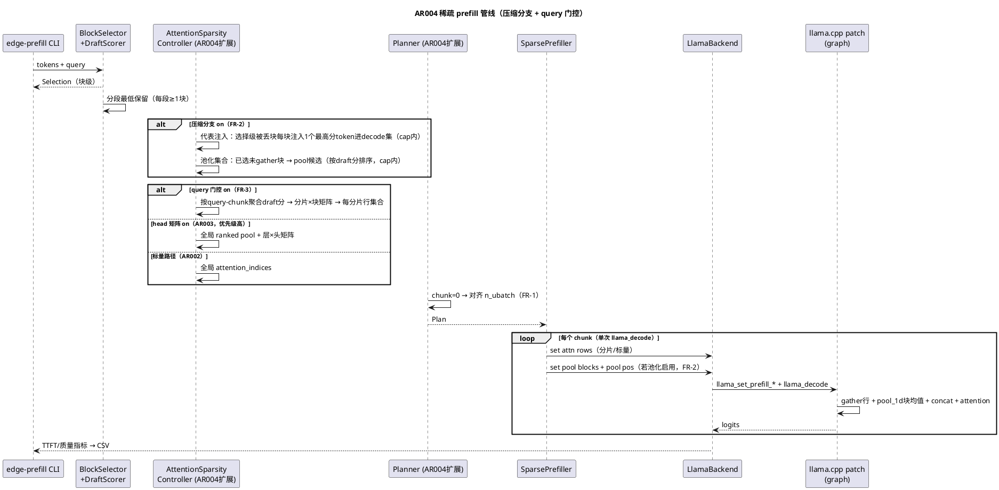
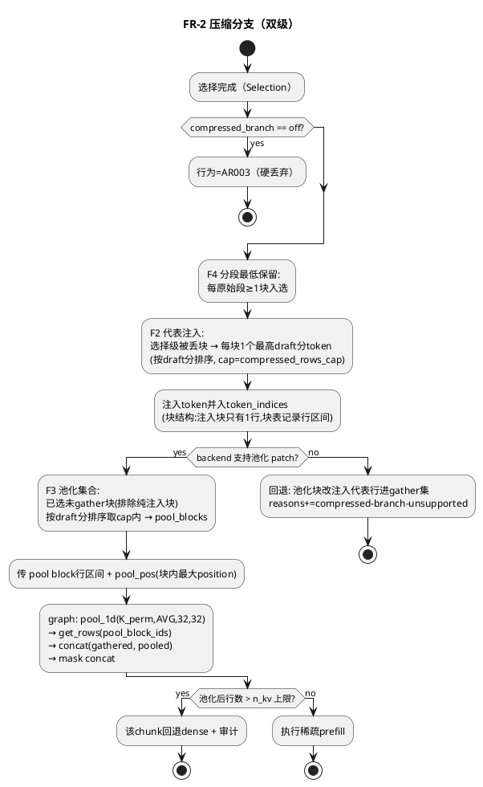
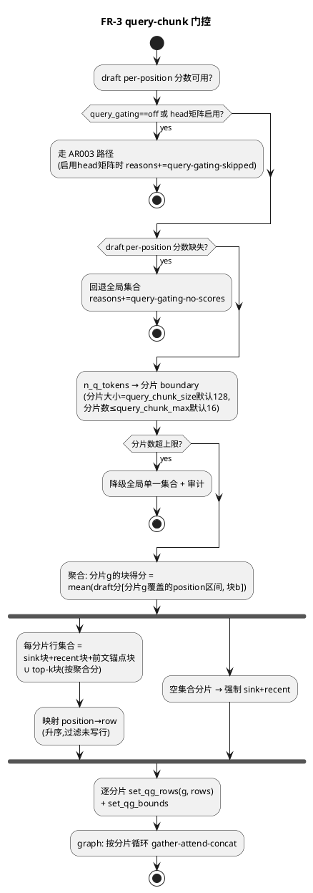
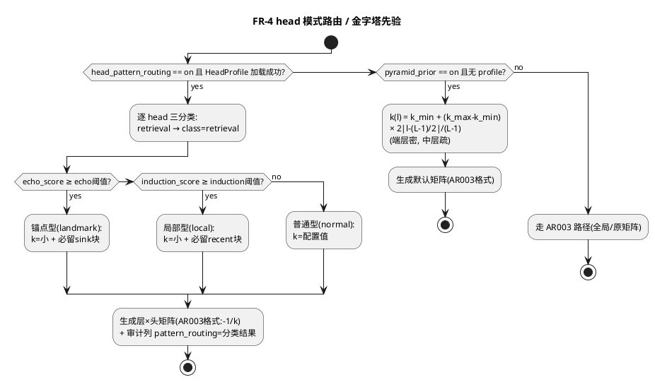

# AR004 详细设计：NSA/MoBA 式分支稀疏架构创新与 Gitee 开放复现

# 1 AR概述

| 组件名称 | edge-prefill（edge_prefill 库 + edge-prefill CLI + llama.cpp patch 层）|
| --- | --- |
| AR系统流水号 | AR004 |
| AR描述 | 在 AR003 基线上交付四项创新：大 chunk 默认调度（FR-1）、NSA 式压缩上下文分支（FR-2）、MoBA 式 query-chunk 门控（FR-3）、MInference 式 head 模式路由与金字塔先验（FR-4）；修复 PPL 质量指标（FR-5）；交付 GPU sparse 路径（FR-6）、Gitee 开放复现工程（FR-7）、主实验矩阵与可解释性图表（FR-8）、研究文档（FR-9）、Review/ST/交付（FR-10）。主验收线：16K TTFT ≥10× dense 且综合质量 q ≥0.9。 |

**关键管线事实（设计的前提，来自代码核实）：**

1. **选择是块粒度的**：`BlockSelector` 选中的块，其全部 `block_size`(32) 个 token 都
   被 decode 进 KV——被选块在 KV 行空间中是**连续的 32 行组**（decode 顺序拼接）。
2. **两个"丢弃"层次**：
   - 选择级丢弃（块不在 `Selection.block_indices`）：token 根本不进 KV；
   - 注意力级丢弃（块被选但不在 attention top-k 的 `attention_indices`）：**行存在于
     KV 但未被 gather**——这是压缩分支的池化对象。
3. attention gather 的行号 = "升序活跃 token 列表中的下标"（position ≠ row，
   sparse_prefill.cpp:203-216 做 position→row 映射）。
4. graph 复用：形状变化触发 re-reserve，代价可摊销；head 矩阵路径已验证
   "分组-gather-concat"图模式（≤4 组/层）。

# 2 动态行为

## 交互时序图

# 3 功能点分解

| 序号 | 功能点名称 | 功能点描述 | 来源 FR |
| --- | --- | --- | --- |
| F1 | 大 chunk 默认调度 | chunk_size=0 语义=对齐 n_ubatch；调度器哨兵修复；backend 单 decode 断言 | FR-1 |
| F2 | 代表注入（选择级压缩） | 选择级被丢块每块注入 1 个最高 draft 分 token 进 decode 集，受 cap 约束 | FR-2 |
| F3 | 池化压缩分支（注意力级） | 已选未 gather 块 pool_1d 块均值行 + 因果 mask + concat；patch 新 C API | FR-2 |
| F4 | 分段最低保留 | 每个原始文本段至少 1 块入选，防整段全丢 | FR-2 |
| F5 | query-chunk 门控规划 | draft per-position 分数 → 分片×块矩阵 → 分片级行集合（必含 sink+recent） | FR-3 |
| F6 | query-chunk 门控 patch | graph 按分片循环 get_rows-attention-concat；分片数上限降级；与 head 矩阵互斥 | FR-3 |
| F7 | head 模式路由 | HeadProfile 三类模式（锚点/局部/检索）→ k+必留模板映射 | FR-4 |
| F8 | 金字塔先验默认矩阵 | k(l) 凸函数（中层最疏），生成 AR003 兼容矩阵 | FR-4 |
| F9 | PPL 质量指标修复 | quality=ppl 语义修复 + dense 交叉验证 + 综合 q 落地 | FR-5 |
| F10 | GPU sparse 路径 | CUDA 构建、patch 路径 GPU 正确性、GPU 对照实验 | FR-6 |
| F11 | Gitee 仓库工程化 | git init、.gitignore、脚本清理归档、README、docs/、下载脚本、sync 脚本 | FR-7 |
| F12 | 主实验矩阵与图表 | 长度×配置×后端矩阵 + 7 张可解释性图 | FR-8 |
| F13 | 研究文档 | docs/research.md 三段式 SOTA 对比 | FR-9 |
| F14 | Review/ST/交付 | 合规审查、端到端验收、归档、release tag | FR-10 |

# 4 实现设计

## 4.1 功能实现思路（方案对比与决策）

### 决策 D1：压缩分支的实现载体（FR-2）

**方案 A：双级压缩（代表注入 + 图内池化）【推荐】**
- 选择级：被丢块注入 1 个最高分 token 进 decode 集（patch-free，行真实存在）；
- 注意力级：已选未 gather 块用 `ggml_pool_1d(AVG, k=32, s=32)` 块均值 +
  `get_rows` 选块——**一个 pool 算子 + 一个 get_rows**，无 P 矩阵、无自定义 kernel。
- 优点：池化对象（已选块 32 行组）在行空间连续，与 pool_1d 语义严格对齐；
  注入级零 patch 风险；两级可独立消融。
- 缺点：池化行位置需显式传入做因果 mask；patch 需新增 2 个 C API。

**方案 B：仅代表注入（采样式压缩，全 patch-free）**
- 被丢块+未 gather 块统一注入 1 代表行进 gather 集合。
- 优点：零 patch 改动。缺点：无池化 gist（NSA 核心机制缺失），
  srs FR-2 "池化为 1 行压缩 KV" 不满足。

**方案 C：P 矩阵 mul_mat 池化**
- 传 [n_pool×n_kv] 均值矩阵，图内一次 mul_mat。
- 优点：通用（支持非均匀块）。缺点：16K 时 32MB 输入拷贝/块；
  本项目块均匀，pool_1d 更简。

**决策：方案 A。** B 作为 A 注入级的子集天然包含（注入级=采样），
pool_1d 满足 srs 池化语义；C 记录为备选不实现。

### 决策 D2：query-chunk 门控的图结构（FR-3）

**方案 A：图内分片循环 gather-concat【推荐】**
- 每分片一组行号输入（独立 1D 输入张量，≤16 个），图按分片循环：
  get_rows → attention（分片查询 × 分片行，标准因果 mask）→ concat。
- 复用 AR003 已验证的"分组-gather-concat"图模式（head 路径同构）。
- 优点：真 MoBA 语义，每分片注意力规模真实缩小；质量与性能双收益。

**方案 B：mask-only（MInference 式）**
- 不 gather，只对全行集合施加 [n_q×n_kv] 分片 mask 输入。
- 优点：patch 最小（换 mask 源）。缺点：注意力计算量不降，
  "gather 总规模不增"退化为"不增不减"，MoBA 叙事弱。

**方案 C：调度级分片（每分片独立 llama_decode，零 patch）**
- 复用现有标量 API 逐分片设置行集。
- 缺点：**牺牲 FR-1 的 2.5x 单 ubatch 收益**（每分片一次 decode 调用），
  与 FR-1 直接冲突。

**决策：方案 A。** 分片行集输入用独立 1D 张量（避免 2D padding +
validity mask 的图复杂度）；分片数 ≤16 上限，超限降级全局集合；
head 矩阵启用时 query 门控跳过（互斥，reasons 记录）。

### 决策 D3：FR-1 chunk 哨兵语义

现状：`ChunkScheduler::plan` 把 chunk_size=0 解释为 `min(512,n_ubatch)`
回退（chunk_scheduler.cpp:13），且 `enable_chunking=false` 也传 0——
**存在"关闭分块仍按 512 分块"的潜在缺陷**。新语义：

| chunk_size 入参 | 行为 |
| --- | --- |
| 0 | 自动 = n_ubatch（FR-1 默认） |
| 1..n_ubatch | 显式值 |
| > n_ubatch | 截断到 n_ubatch + 警告 |
| `n_tokens`（enable_chunking=false 时显式传入） | 单 range |

`enable_chunking=false` 改为传 `n_tokens` 而非 0，消除哨兵歧义。
`Config.chunk_size` 默认 512→**0**；`Plan.chunk_size` 语义同步。

## 4.2 功能实现设计

### 4.2.1 流程图

**压缩分支决策流（FR-2）：**

**query 门控规划流（FR-3）：**

**head 模式路由与金字塔先验决策流（FR-4）：**

### 4.2.2 流程说明

- **行空间不变量**（全设计的基础）：decode 集按"被选块(32行) + 注入块(1行)"
  顺序拼接，块表 `block_row_ranges` 记录每块的 [row_begin,row_end)。
  池化的 pool_1d 只对**满 32 行的被选块**执行；纯注入块（1 行）不池化，
  直接加入 gather 集。
- **因果性**：池化行可见性 = 查询 position > 块内最大 position
  （pool_pos 输入）；分片门控沿用标量路径的 mask get_rows 机制，逐分片因果。
- **FR-1 与 FR-3 协同**：分片是**图内**循环，外层 chunk 仍单次 llama_decode，
  2.5x 收益保留；n_groups 与 n_q 形状挂钩，形状变化触发 re-reserve（llama
  既有机制，代价可摊销）。
- **FR-4 纯规划层**：`build_head_adaptive` 扩展——profile 有三类分数时按
  阈值分类：检索型→-1（稠密）；锚点型（echo 强）→小 k+必留 sink；
  局部型（induction 强）→小 k+必留 recent；普通→k。无 profile 时
  `pyramid_prior` 生成 k(l)=k_min+(k_max-k_min)·(2·|l-（L-1)/2|/(L-1))
  （端层密、中层疏），产出 AR003 兼容矩阵。
- **FR-5**：ppl 任务的 quality 修复为 `q_ppl = min(1, ppl_dense/ppl_sparse)`
  （dense 参考同 run 计算）；与 llama-perplexity 官方值交叉验证量级。
- **FR-6**：CUDA 构建沿用 `/root/llama-src-cuda`（build_cuda.sh 已就绪）；
  正确性验收 = CPU/GPU 同配置 NIAH/QA 逐任务一致（q 差 ≤0.02）。

## 4.3 接口描述

### 4.3.1 patch 层新增 C API（llama.h + llama-context/graph，int32 错误码 0/2/9）

| 签名 | 语义 | 错误 |
| --- | --- | --- |
| `int32_t llama_set_prefill_attn_pool_blocks(ctx, const int32_t* block_row_starts, const int32_t* block_row_sizes, const int32_t* block_max_pos, size_t n)` | 池化块描述：每块行起点/行数(恒32)/块内最大 position；n=0 清空 | 2：空指针与非零 n、行越界(row_start+size>n_kv 预留宽度)、n>1024 |
| `int32_t llama_get_prefill_attn_pool_blocks_size(const ctx)` | 回读池化块数 | - |
| `int32_t llama_set_prefill_qg_count(ctx, int32_t n_groups)` | query 门控分片数；0=关闭（回退标量路径） | 2：n<0、n>16 |
| `int32_t llama_set_prefill_qg_rows(ctx, int32_t group, const int32_t* rows, size_t n)` | 第 group 分片的 KV 行集（升序，<n_kv 预留宽度） | 2：group 越界、rows 非升序/越界、n 超 4096 |
| `int32_t llama_set_prefill_qg_bounds(ctx, const int32_t* q_bounds, size_t n)` | 查询行边界（n=n_groups+1，升序，覆盖 [0,n_q)） | 2：n≠count+1、非升序、首尾不为 0/n_q |
| `int32_t llama_get_prefill_qg_count(const ctx)` | 回读分片数 | - |

图内规则：
- 池化分支仅在 `prefill_mode && 池化块非空 && !flash_attn && 标量/head 门控未启用池化互斥` 时接线；K 路：
  `K_perm → pool_1d(AVG,32,32) → get_rows(pool_block_ids)`；**V 路对称**：
  `V_trans（归一化后）→ pool_1d(AVG,32,32) → get_rows(pool_block_ids)`
  （与 K 同一 block_ids，行数一致后 concat）；mask 路：
  mask 行 get_rows 后与池化行 mask（按 pool_pos 因果）concat。
  注意 pool_1d 要求行数对齐 32，不足整块部分通过只对满块下发
  block_row_starts 保证。
- query 门控启用时分片循环替代标量 gather 循环；每分片独立 mask get_rows。
- 两特性与 flash_attn 互斥：FA 下 set_input 阶段清空相关输入 → 回退原路径，
  `Plan.reasons` 由上层记录。
- patch 缺失（`llama_set_prefill_attn_pool_blocks` 符号不存在）→ backend 返回
  `Unsupported` → 上层回退（FR-2 回退代表注入，FR-3 回退全局集合）。

### 4.3.2 edge_prefill 层接口变更

**Config（config.h）：**

| 字段 | 类型/默认 | 语义 |
| --- | --- | --- |
| `chunk_size` | uint32_t，512→**0** | 0=对齐 n_ubatch（FR-1） |
| `compressed_branch` | enum `{off, sample, pool}`，默认 **`pool`** | off=AR003 硬丢弃；sample=仅代表注入；pool=注入+池化；CLI `on`≡`pool` 别名；patch 缺失自动回退 sample（EX-1），故默认 pool 安全 |
| `compressed_rows_cap` | uint32_t，默认 256 | 注入行数与池化行数各自上限 |
| `segment_min_blocks` | uint32_t，默认 1 | 分段最低保留（FR-4 语义：每段≥N 块） |
| `query_gating` | bool，默认 false | FR-3 总开关 |
| `query_chunk_size` | uint32_t，默认 128 | 分片 token 数 |
| `query_chunk_max` | uint32_t，默认 16 | 分片数上限 |
| `head_pattern_routing` | bool，默认 false | FR-4 路由开关 |
| `pyramid_prior` | bool，默认 true | 无 profile 时金字塔默认矩阵 |
| `pyramid_k_min/pyramid_k_max` | uint32_t，默认 48/128 | 金字塔上下限（行数） |

**Selection（selector.h）新增：**
`std::vector<std::pair<uint32_t,uint32_t>> block_row_ranges;`（块→[row_begin,row_end)），
`std::vector<int32_t> injected_rows;`（代表注入行，池化排除集）。
SelectionOptions 新增 `segment_min_blocks`。

**AttentionSparsityController（attention_sparsity.h）新增静态方法（均返回
`Status`，非法输入返回 `InvalidArgument` 并带具体 violated-rule 消息，
成功时通过出参返回集合）：**

| 方法 | 职责 | 错误 |
| --- | --- | --- |
| `Status build_compressed(const Selection&, const CompressedOptions&, std::vector<int32_t>* injected_rows, std::vector<PoolBlock>* pool_blocks, std::string* reason)` | FR-2：注入行 + 池化块集合（含 cap、排序、排除注入块） | Selection 为空 dense→InvalidArgument |
| `Status build_query_gated(const Selection&, const std::vector<double>& per_pos_scores, const QueryGatingOptions&, std::vector<std::vector<int32_t>>* group_rows, std::vector<int32_t>* q_bounds, std::string* reason)` | FR-3：分片行集合 + 查询边界（含 sink/recent 必留、空片强制、上限降级） | 分数长度≠total_tokens→InvalidArgument；降级/回退返回 Ok + reason 记录 |
| `Status build_pattern_matrix(const HeadProfile&, const PatternRoutingOptions&, std::vector<int32_t>* matrix, std::string* reason)` | FR-4：三模式分类 → 层×头矩阵 | 矩阵长度≠n_layer×n_head 由 backend 校验（InvalidArgument） |
| `Status build_pyramid_matrix(uint32_t n_layer, uint32_t n_head, const PyramidOptions&, std::vector<int32_t>* matrix)` | FR-4：金字塔先验矩阵 | k_min>k_max→InvalidArgument |

`PoolBlock{int32_t row_start; int32_t row_size; int32_t max_pos;}`，
`QueryGatingOptions{query_chunk_size, query_chunk_max, top_k_per_group}`。

**SparsePrefiller::Options 新增：** `compressed_mode`、`pool_blocks`（下发
backend）、`query_gating`、`group_rows/q_bounds`（下发 backend）。

**LlamaBackend 新增包装（返回 `Status`，patch 符号缺失→`Unsupported`，
参数非法透传 C API 错误码映射为 `InvalidArgument`，与 `set_attn_indices`
同模式；失败时上下文零半写——回读接口验证）：**

| 方法 | 语义 |
| --- | --- |
| `Status set_attn_pool_blocks(const std::vector<PoolBlock>& blocks)` | 调 `llama_set_prefill_attn_pool_blocks`（start/size/pos 三数组临时展开） |
| `Status set_qg_count(int32_t n_groups)` / `Status set_qg_rows(int32_t group, const std::vector<int32_t>& rows)` / `Status set_qg_bounds(const std::vector<int32_t>& bounds)` | 对应 4.3.1 三个 qg API；下发前本地校验升序/范围，避免半写 |

**CLI（main.cpp）新增 flag：** `--compressed-branch off|sample|pool`、
`--compressed-rows-cap N`、`--segment-min-blocks N`、`--query-gating on|off`、
`--query-chunk-size N`、`--query-chunk-max N`、`--head-pattern-routing on|off`、
`--pyramid-prior on|off`；未知 flag=退出码 2。

**Metrics：** Sample 新增 `compressed_injected_rows/compressed_pool_rows/
query_gating/on_time_qg_groups/pattern_routing` 审计列。

### 4.3.3 复现与仓库脚本（FR-7）

| 脚本 | 职责 |
| --- | --- |
| `scripts/download_model.sh` | ModelScope→hf-mirror 依次尝试下载 qwen2.5-1.5b-instruct-q4_k_m.gguf，成功即 sha256sum -c 校验（期望值写 README 与脚本内），全败输出手动指引 |
| `scripts/download_data.sh` | 数据集生成（gen_niah/gen_qa/gen_ppl 脚本封装，固定种子） |
| `scripts/setup.sh` | 依赖检查 + FetchContent 拉取固定 commit llama.cpp + patch + 构建（CPU/CUDA 参数化） |
| `scripts/run_experiments.sh` | 一键头条配置（16K 主验收 + 代表性消融），输出 raw.csv/report.md |
| `scripts/sync_gitee.sh` | Windows git + gitee remote 增量同步；凭据从环境变量读，不落库 |
| `scripts/diagnostics/` | diag_*/equiv_*/recheck_* 归档（移入，README 注明非主流程） |

## 4.4 代码设计

**受影响文件清单：**

| 文件 | 变更 |
| --- | --- |
| `patches/llama-prefill-attn-top-k.patch` | +池化分支（pool_1d+get_rows+concat+mask concat+2 API）+query 门控（分片循环+4 API） |
| `include/edge_prefill/config.h` | Config/Plan 字段（4.3.2） |
| `src/config.cpp` | 解析/校验/默认值 |
| `include/edge_prefill/selector.h`、`src/selector.cpp` | Selection 扩展 + 分段最低保留 |
| `include/edge_prefill/attention_sparsity.h`、`src/attention_sparsity.cpp` | 4 个新 build 方法 + 校验 |
| `src/chunk_scheduler.cpp` | 哨兵语义（D3） |
| `include/edge_prefill/sparse_prefill.h`、`src/sparse_prefill.cpp` | Options 扩展 + 下发池化/门控 + 单 decode 防线 |
| `include/edge_prefill/backend.h`、`src/backend.cpp` | 新 API 包装 + Unsupported 回退 |
| `include/edge_prefill/planner.h`、`src/planner.cpp` | FR-4 矩阵生成接线 + Plan 字段 |
| `src/main.cpp` | CLI flag + 审计 |
| `src/metrics.cpp`、`include/edge_prefill/metrics.h` | 新审计列 + ppl quality 修复 |
| `src/benchmark.cpp` | ppl 任务修复（FR-5） |
| `include/edge_prefill/head_profile.h`、`src/head_profile.cpp` | pattern 分类辅助（如需） |
| `tests/*` | 见 §6 |
| `scripts/`、`docs/`、`README.md`、`.gitignore` | FR-7 |

**模块边界**：全部创新收敛在"规划层（selector/attention_sparsity/planner）+
patch 执行层"；backend/planner 既有公共接口签名不破坏，新增字段带默认值，
全开关关闭时与 AR003 逐字段一致（回归硬门禁）。

# 5 重构设计

1. **ChunkScheduler 哨兵重构**（D3）：`enable_chunking=false` 传 `n_tokens`
   消除"关分块仍 512 分块"潜在缺陷；`ChunkScheduler::plan` 签名不变。
2. **诊断脚本归档**：`scripts/diag_*`、`equiv_*`、`recheck_*` 移入
   `scripts/diagnostics/`（保留诊断记录价值，主流程清爽）。
3. **orchestrator 交接**：phase4 完成后 phase5（GPU sparse）自动接续；
   AR004 新实验脚本复用 phase2/4 的数据集与汇总工具，不重复造轮子。

# 6 测试设计

> 真实模型用例在 `EDGE_PREFILL_TEST_MODEL` 缺失时显式 SKIP；无模型用例
> 覆盖全部纯逻辑。**全量 UT 目标：新增/修改模块行覆盖 ≥85%。**

## 6.1 单元测试（UT）

| 用例 ID | 覆盖功能点 | 断言要点 |
| --- | --- | --- |
| UT-C1 | F1 | plan(n,0,n_ubatch) → range 数=ceil(n/n_ubatch)；plan(n, n+100, ub) 截断+警告；plan(n, n, ub) 单 range |
| UT-C2 | F1 | enable_chunking=false → 单 range（哨兵修复回归） |
| UT-C3 | F4 | 3 段构造丢 2 段场景 → 每段≥segment_min_blocks 块入选 |
| UT-C4 | F2 | 注入：cap=0 → 无注入；cap=被丢块数 → 每被丢块恰 1 行且为该块最高 draft 分 token；行并入后 token_indices 升序 |
| UT-C5 | F2 | block_row_ranges：被选块 32 行连续、注入块 1 行、顺序=decode 序 |
| UT-C6 | F3 | 池化集合：排除纯注入块；cap 截断按 draft 分降序；max_pos=块内最大 position |
| UT-C7 | F5 | 分片聚合：构造 per-pos 分数使分片 A 偏好块 1、分片 B 偏好块 2 → group_rows 差异符合预期；每片必含 sink+recent |
| UT-C8 | F5 | 分片数超 query_chunk_max → 降级全局集合 + reason |
| UT-C9 | F5 | draft 分数空 → 回退全局 + reason=query-gating-no-scores |
| UT-C10 | F7 | 构造 profile（echo 高/induction 高/retrieval/普通）→ 矩阵值=k 模板映射；阈值边界 |
| UT-C11 | F8 | 金字塔：L=28 → 中层 k=k_min、端层=k_max、单调；与 AR003 矩阵格式兼容（-1/k） |
| UT-C12 | F9 | ppl quality：mock 不可用——真实模型 SKIP；逻辑层断言 q_ppl=min(1,dense/sparse) 公式与 CSV 列存在 |
| UT-C13 | F1 | 大 chunk + 全稀疏关（真实模型）→ logits 与 dense diff <1e-5 |
| UT-C14 | 回归 | 全新开关默认值下 Plan/Selection 与 AR003 逐字段一致 |
| UT-C15 | F1 | 原崩溃配置回归：scalar gather 路径 + 大 chunk（4K+ k 配置）单 llama_decode 无二次拆分（断言 chunk_stats 每外层 chunk 仅 1 条内部记录） |
| UT-C16 | F2/F3 | budget=1.0 + 分支开（真实模型）：无被丢块→注入/池化集合为空→分支空转，logits 与 dense diff <1e-5 |
| UT-C17 | F9 | ppl 修复回归：同数据下 NIAH/QA 任务 quality 与修复前二进制逐值一致（quality 语义未被 ppl 改动波及） |
| UT-C18 | F7 | 路由审计：pattern_routing 开启后 CSV 审计列含每 head 分类结果（retrieval/landmark/local/normal） |

## 6.2 接口测试（对照 4.3.1/4.3.2 逐参数）

| 用例 ID | 接口 | 边界/异常 |
| --- | --- | --- |
| IT-P1 | `llama_set_prefill_attn_pool_blocks` | 正常下发（真实模型）；n=0 清空；空指针+n>0→2；row_start+size>n_kv→2；n=1025→2；patch 缺失→9 |
| IT-P2 | `llama_get_prefill_attn_pool_blocks_size` | 设置后回读一致；清空后=0 |
| IT-Q1 | `llama_set_prefill_qg_count` | 0 关闭回退标量；n=16 边界通过；n=17→2；n=-1→2 |
| IT-Q2 | `llama_set_prefill_qg_rows` | 正常升序行集；group 越界→2；非升序→2；行≥n_kv→2；n=4097→2 |
| IT-Q3 | `llama_set_prefill_qg_bounds` | n≠count+1→2；非升序→2；首≠0 或尾≠n_q→2 |
| IT-Q4 | `llama_get_prefill_qg_count` | 设置后回读一致；清空(0)后=0 |
| IT-CFG1 | Config 解析 | 各新 flag 合法值/非法值（退出码 2 与错误串）；chunk_size=0 默认生效；pyramid_k_min>k_max→2；segment_min_blocks=0（合法，等同关闭）与超块总数（截断+警告）边界 |
| IT-BE1 | backend 包装 | 池化/门控 API 在 Unsupported 时 Status=Unsupported 且上下文状态不变（半写检测：回读 size=0） |

## 6.3 业务场景测试（真实模型，`EDGE_PREFILL_TEST_MODEL` 指向 1.5B GGUF）

| 用例 ID | 场景 | 通过判据 |
| --- | --- | --- |
| BS-1 | 4K k62 大 chunk vs 512 chunk | TTFT 降 ≥2x（21.2s vs 52.5s 回归化）且答案正确 |
| BS-2 | 8K attn-24 pool 分支 on/off | q 提升（目标 ≥0.75）；TTFT 增幅 ≤15% |
| BS-3 | 8K attn-24 sample 分支 on/off | q 提升可测（注入级消融） |
| BS-4 | 16K 多针 query-gating on/off | q 提升 ≥5pp 或记录不可达分析 |
| BS-5 | 16K 全开（chunk0+pool+gating+pyramid） | **TTFT ≥10× dense 且 q ≥0.9（主验收）** |
| BS-6 | 无 profile pyramid vs 均匀矩阵 | q 不低于均匀；TTFT ≤均匀×1.05 |
| BS-7 | GPU sparse 16K vs GPU dense-FA | 加速 ≥1.3x 或诚实分析；CPU/GPU q 差 ≤0.02 |
| BS-8 | 干净克隆复现（新目录） | 模型下载校验过 → ctest 全过 → run_experiments.sh 退出 0，TTFT 落仓库值 0.5x–2x；**仓库卫生**：`git status` 无构建产物/模型/凭据泄漏 |
| BS-9 | 32K 档 CPU 完整路径 | 数据集 /tmp/deep/len32k；至少 {dense, 全开} 两配置完成且质量/TTFT 入 CSV（FR-8 GWT-3） |
| BS-10 | 门控等价性（真实模型） | gating 开 + 全分片同一行集（=标量集合）→ logits 与标量路径 diff <1e-5（F6 图内分片循环语义正确性） |
| BS-11 | 池化等价性（真实模型） | pool 模式 + compressed_rows_cap=0（无被丢块可池化）→ 与 sample 模式 logits 一致（F3 图内池化接线正确性） |

## 6.4 异常场景测试

| 用例 ID | 异常 | 期望 |
| --- | --- | --- |
| EX-1 | patch 缺失（旧 llama 库） | 池化→回退代表注入；门控→回退全局；reasons 含 `compressed-branch-unsupported`/`query-gating-unsupported`；不崩溃 |
| EX-2 | flash_attn 开启 | 池化/门控输入被清空→原路径；reasons 记录；无半写 |
| EX-3 | 池化行数超 n_kv 预留 | 该 chunk 回退 dense + 审计 `pool-overflow-dense` |
| EX-4 | 分片行集合空 | 该分片强制 sink+recent，非空执行 |
| EX-5 | draft 模型加载失败（门控开） | 回退全局集合，lexical 路径不受影响 |
| EX-6 | head 矩阵与 query-gating 同开 | 矩阵优先，reasons+=`query-gating-skipped` |
| EX-7 | 注入行使 token 数超 n_ctx | 截断注入（cap 收紧）+ 警告，不越界 |
| EX-8 | ppl 数据损坏/空 | 明确 Io/InvalidArgument，不输出伪造 quality |
| EX-9 | 网络全败（download_model.sh） | 非零退出 + 手动指引文本 |

## 6.5 srs 验收标准追溯矩阵（G14）

| srs 验收（FR-条） | 对应用例 |
| --- | --- |
| FR-1 GWT×3 | UT-C1/C2/C13、**UT-C15（原崩溃配置回归）**、BS-1 |
| FR-2 GWT×4 | UT-C3/C4/C6、IT-P1、**UT-C16（budget=1.0 空转等价）**、BS-2/BS-3、**BS-11**、UT-C14（关闭回归） |
| FR-3 GWT×3 | UT-C7/C8/C9、IT-Q1/Q2/Q3/Q4、BS-4、**BS-10（图内语义等价）**、EX-6 |
| FR-4 GWT×3 | UT-C10/**C18（审计列）**/C11、BS-6、UT-C14 |
| FR-5 GWT×3 | UT-C12、**UT-C17（跨任务回归）**、EX-8、BS-2 q 口径 |
| FR-6 GWT×3 | BS-7 |
| FR-7 GWT×3 | BS-8（含仓库卫生）、EX-9、IT-CFG1（README 审阅属 T013 验收清单） |
| FR-8 GWT×3 | BS-5 + **BS-9（32K CPU）** + 图表生成脚本断言（CSV 路径存在） |
| FR-9 GWT×2 | F13 由 T016 任务验收清单承接：docs/research.md 审阅（每创新点引用 raw.csv/图，覆盖 ≥6 SOTA） |
| FR-10 GWT×3 | F14 由 T017/T018 流程门禁承接（review 复核、ST 实测、tag 校验） |
