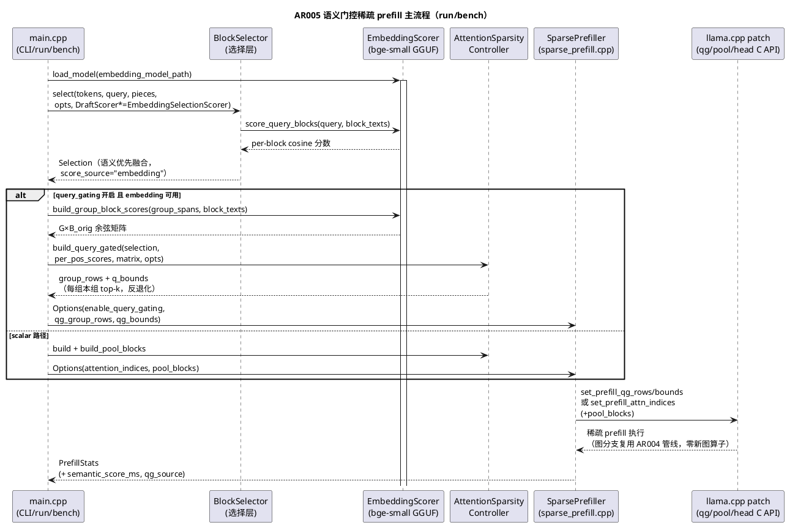
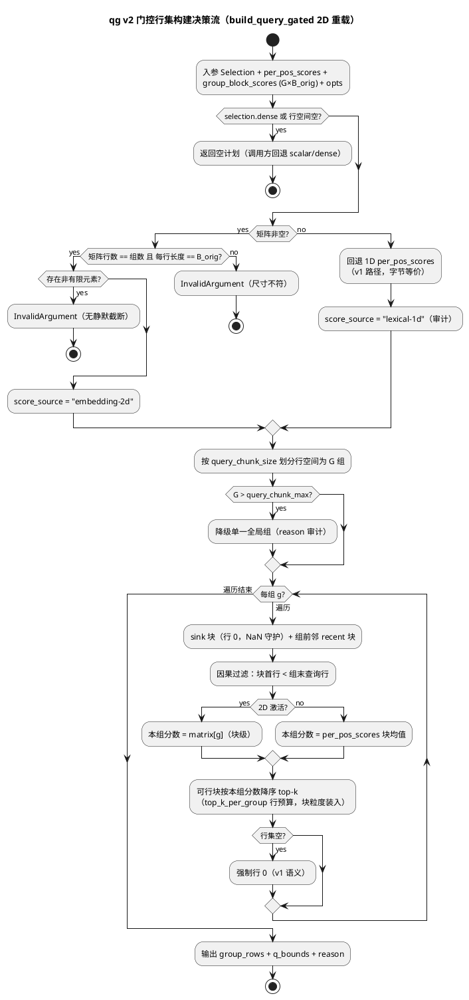
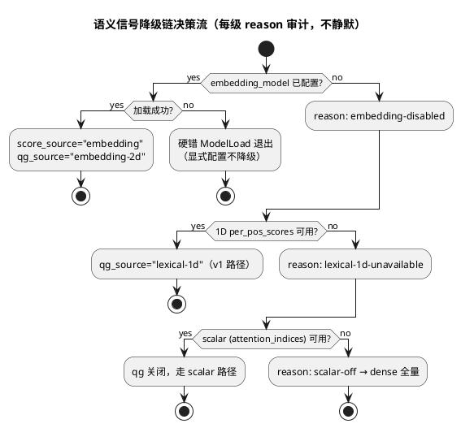

# 1 AR概述

| 组件名称 | EdgePrefill（edge-prefill）|
| --- | --- |
| AR系统流水号 | AR005 |
| AR描述 | 免训练语义门控稀疏 prefill 与服务器级一键复现：以小型双向检索嵌入模型（bge-small GGUF）为语义引擎，贯通"块选择（Quest/LLMLingua 思想）→ 组×块门控（MoBA 免训练化）→ head 任务内校准（MInference 动态化）"三层信号源；配套 repro.sh 一键复现套件、实验注册表、期望结果表与服务器规模化指南。修复 AR004 五项实测局限（L1–L5），全部创新免训练、无 mock、净记账。 |

**选定方案：** 方案 A（独立块编码嵌入引擎）。方案 B（causal draft 隐状态）文档化为备选（本 AR 不加配置面，后续 AR 需要时再引入），方案 C（Quest 式 K min-max 页摘要）文档化为后续方向。

**方案对比（权衡分析）：**

| 维度 | A 嵌入引擎（bge-small） | B causal draft 隐状态（0.5B） | C Quest K min-max 页摘要 |
| --- | --- | --- | --- |
| 语义质量对齐 | 检索对比学习目标与 NIAH 任务直接对齐 | 隐状态几何与检索目标间接相关，draft 与主模型能力差距引入噪声 | 保真最高（页级 min-max 严格界） |
| 32K CPU 开销 | O(块数)×33M ≈1-3s（<6%，净值可承受） | 0.5B 自身 O(n²) attention 30-120s，吃掉净加速 | O(n) 低 |
| patch 改动 | **零**（纯规划层） | 零（但需暴露块边界隐状态 hook） | 深度手术（KV 页摘要需侵入图构建） |
| 实现风险 | 低（独立底座 + DraftScorer 多态适配） | 中（隐状态抽取 API 复杂） | 高 |
| 处置 | ✅ 选定 | 文档化备选 | 后续 AR |

# 2 动态行为

## 交互时序图



**关键性质：** qg v2 不新增任何图算子/C API——仅 `build_query_gated` 的行集计算信号源从 1D 换为 2D，patch 管线逐字节复用（回归风险最小化）。

# 3 功能点分解

| 序号 | 功能点名称 | 功能点描述 | 溯源 |
| --- | --- | --- | --- |
| FP1 | EmbeddingScorer 嵌入引擎 | bge-small GGUF 加载；多文本独立编码（并行序列）；cosine 工具 | FR-1/FR-5 |
| FP2 | 组×块语义矩阵 | 原始提示块文本 × 组文本跨度的 G×B_orig 余弦矩阵构建 | FR-1 |
| FP3 | qg v2 门控消费 | build_query_gated 2D 重载：每组本组分数因果 top-k；1D 回退字节等价 | FR-2 |
| FP4 | 语义优先选择 | EmbeddingSelectionScorer 适配器（DraftScorer 多态）；权重工程化；needle 守护 | FR-3 |
| FP5 | 任务内 head 校准 | classify-heads --calibration-file：真实任务 token 替代随机探针 | FR-4 |
| FP6 | draft/嵌入模型复现集成 | download_model.sh --draft/--embed；主模型自任 draft 兜底；净 TTFT 记账 | FR-5 |
| FP7 | 实验矩阵与验收 | CPU 复合网格 + GPU 回归 + multineedle qg v2，全量入库 | FR-6 |
| FP8 | repro.sh 一键套件 | 环境探测/下载/构建/套件/图表/期望对照；LTO/native 开关 | FR-7 |
| FP9 | 注册表与期望表 | benchmarks/matrix/*.conf 全格点 + docs/expected-results.md 容差 + 7B 指南 | FR-8 |
| FP10 | 研究文档与交付 | research.md v2 三段式 + review/ST/归档/tag/Gitee | FR-9 |

# 4 实现设计

## 4.1 功能实现思路

**信号源架构（方案 A 核心）：** 现有三层稀疏（选择/gating/head）共享同一信号源缺陷——词法 1D。AR005 引入一个廉价的语义底座：33M 双向检索嵌入模型按"文本片段 → 向量"独立编码，任意两层消费同一向量的不同组合方式：

- 选择层（FP4）：cos(问题向量, 块向量) → 替代词法 idf 主导分（Quest 的 query-aware 块选择思想的 embedding 实现）；
- 门控层（FP2/FP3）：cos(组文本向量, 块向量) 矩阵 → 免训练 MoBA router（router 权重=检索模型的对比学习权重，非训练线性层）；
- head 层（FP5）：探针 token 源从随机 vocab 采样换为真实任务文本（MInference "按 prompt 动态分析"的任务内化）。

**成本模型：** B 个块 × ~60 encoder token × 33M 参数；32K 提示 ≈ 1000 块 ≈ 60K encoder token，CPU 16 核 <3s，占稀疏 prefill（~50s）<6%，满足"净 speedup"记账与 ≤20% 假设。组矩阵复用已编码的块向量，仅新增 G 次组编码（G≤16）。**应急路径：** 若 FR-6 网格实测编码开销超 20% 假设上限，启用块级 stride 子采样（隔块编码、邻块分数插值）并如实记录精度影响——该路径仅在实测超限时触发补充设计，默认不实现。

**兼容策略：** DraftScorer 是 BlockSelector 的既有多态接口——FP4 以适配器实现该接口，选择器零改动；FP3 以重载+空矩阵回退实现，v1 路径字节等价；FP5 仅换探针 token 源，profile 格式不变。三层均可独立关闭，默认关闭时与 AR004 输出字节等价（NFR 红线）。

## 4.2 功能实现设计

### 4.2.1 流程图



### 4.2.2 流程说明

1. **矩阵索引约定（关键契约）：** `group_block_scores[g][b]` 的 b 是**原始提示块**序号（块 b = 原始位置 [b·32, (b+1)·32)，与 Selection.block_indices 同一Blocking），不是行空间块。行集装入时按 v1 既有映射取块内已选行。组文本 = 组内行对应 token 位置的**原始连续跨度**（含未选 token 的文本，保留真实上下文语义）。
2. **反退化保证：** 2D 矩阵每行独立排序——组 A 与组 B 的 top 块天然可不同（v1 因 1D 同源分数必然相同）。单测以构造矩阵断言两组行集差异。
3. **降级链：** embedding 模型缺失 → qg 回退 v1（1D）；1D 亦不可用 → qg 关闭走 scalar；scalar 关闭 → dense。每级回退 reason 审计，不静默。选择层同理：EmbeddingSelectionScorer 的 score() 失败（编码错误）复用既有 draft-disabled→lexical 回退路径与 reason 审计（选择器零改动，契约继承组件详设）。


4. **探针校准（FP5）：** `make_probe_tokens` 增加校准源：从校准文本取前 `block_len` 个真实 token 为重复段 S，重复 `repeats` 次构成探针序列（echo/induction 机制不变，token 分布换为任务真实分布）；retrieval 分数以校准文本中的问题段为条件。输出 profile.json 字段与格式不变。
5. **净 TTFT 记账：** EmbeddingScorer 编码耗时计入 `semantic_score_ms`（Sample 列 + env.json），speedup = dense TTFT / (semantic_score + 稀疏 prefill 全链)，CSV 与 report 同列对照。

## 4.3 接口描述

### 4.3.1 新增头文件 `include/edge_prefill/embedding_scorer.h`

```cpp
class EmbeddingScorer {
public:
    Status load_model(const std::string& path, int32_t n_threads = 0);
    // 独立编码多段文本；texts 为空/含空串/未加载 → InvalidArgument；
    // 单段超 512 token 截断并审计 warning（不静默）。embeddings 行序==texts。
    Status encode(const std::vector<std::string>& texts,
                  std::vector<std::vector<double>>* embeddings);
    // FR-1: G×B_orig 余弦矩阵（复用块向量缓存，仅编码组文本）
    Status score_group_block(const std::vector<std::string>& group_texts,
                             const std::vector<std::string>& block_texts,
                             std::vector<std::vector<double>>* matrix);
    // FR-3: 问题→块分数（选择层与 1D per_pos 广播共用）
    Status score_query_blocks(const std::string& query,
                              const std::vector<std::string>& block_texts,
                              std::vector<double>* block_scores);
    bool loaded() const;  size_t dim() const;  uint32_t n_parallel() const;
};
```

| 参数/返回 | 语义 | 错误码 |
| --- | --- | --- |
| load_model(path) | GGUF 加载；池化=GGUF 自带池化头（bge=CLS，通用=MEAN），无池化头（causal decoder）→Unsupported；n_ctx=512×n_parallel(8) | ModelLoad / OutOfMemory / InvalidArgument(空路径) |
| encode(...) | 并行序列批编码（llama_batch 多 seq） | InvalidArgument / Unsupported(非嵌入模型) / Internal(嵌入全零) |
| score_group_block(...) | G×B 余弦，全部有限 | InvalidArgument(空输入) / Internal(非有限) |

### 4.3.2 适配器 `EmbeddingSelectionScorer : public DraftScorer`

```cpp
// BlockSelector 零改动：以既有 DraftScorer 多态接入。
// score()：块文本=token_pieces 按原始块拼接；query 编码 + 块编码 →
// per-token 分数 = 块分数按位置广播。draft_score_ms 计时由调用方包裹。
class EmbeddingSelectionScorer : public DraftScorer {
public:
    EmbeddingSelectionScorer(const EmbeddingScorer* scorer,
                              const std::vector<std::string>* token_pieces,
                              uint32_t block_size);
    Status score(const std::vector<llama_token>& tokens,
                 const std::string& query,
                 std::vector<double>* per_token_scores) override;
};
```

| 参数/返回 | 语义 | 错误码 |
| --- | --- | --- |
| 构造(scorer, token_pieces, block_size) | scorer 为空指针 / token_pieces 为空 / block_size=0 | InvalidArgument（构造期校验，调用方 Status 检查；对象不可用状态 loaded()==false） |
| score(tokens, query, out) | query 编码 + 块文本拼接编码 → 块分数按位置广播为 per-token 分数 | InvalidArgument（query 空 / tokens 空 / 内部引擎未加载）；Internal（嵌入非有限）；Ok（out 尺寸==tokens，块内恒等） |
| 计时 | draft_score_ms 语义复用：由调用方包裹（选择层既有计时列） | — |

### 4.3.3 AttentionSparsityController 扩展（`attention_sparsity.h`）

```cpp
// FR-2: qg v2 重载。group_block_scores 空 → 内部走 v1（字节等价）。
// 矩阵行数!=组数 或 列数!=n_prompt_blocks 或 含非有限值 → InvalidArgument。
static Status build_query_gated(const Selection& selection,
                                const std::vector<double>& per_pos_scores,
                                const std::vector<std::vector<double>>& group_block_scores,
                                uint32_t n_prompt_blocks,
                                const QueryGatingOptions& opts,
                                std::vector<std::vector<int32_t>>* group_rows,
                                std::vector<int32_t>* q_bounds,
                                std::string* reason);

// FR-1: 组跨度（token 位置）→ 组文本 → 矩阵的规划辅助。
// 组跨度由 v1 同一划分规则推导（行空间 chunk → token_indices 映射），
// 保证与 build_query_gated 组划分一致性。
static Status build_group_spans(const Selection& selection,
                                 const QueryGatingOptions& opts,
                                 std::vector<std::pair<uint32_t,uint32_t>>* spans,
                                 std::string* reason);
```

| 参数/返回 | 语义 | 错误码 |
| --- | --- | --- |
| build_group_spans(selection, opts, spans, reason) | 组跨度推导（行空间 chunk → token_indices 映射） | 恒 Ok（校验通过）：dense/空行空间 → 空 spans + reason；输出指针为空 → InvalidArgument；正常 → spans 尺寸=组数，与 build_query_gated 组划分一致 |

### 4.3.4 Selection 扩展（`selector.h`）

```cpp
struct Selection {
    ...  // 既有字段不动
    // AR005: G×B_orig 语义矩阵（embedding 引擎激活且 qg 开启时填充）。
    // 空矩阵 = 1D v1 路径。行=组（build_group_spans 顺序），列=原始块。
    std::vector<std::vector<double>> per_group_block_scores;
    // 审计: "lexical" | "draft" | "embedding"
    std::string score_source = "lexical";
};
```

### 4.3.5 Config / CLI（`config.h`、`main.cpp`）

| 键 (conf) | CLI | 默认 | 语义 |
| --- | --- | --- | --- |
| embedding_model | --embedding-model P | 空（关） | bge-small 类嵌入 GGUF 路径；非空即激活语义引擎 |
| selector_w_lexical/diversity/position/draft | --selector-w-lexical F 等 | .45/.15/.20/.20 | 权重覆盖（显式>默认，无 draft/embedding 时行为不变） |
| query_gating | --query-gating（既有） | off | 开启且 embedding 可用 → 自动 2D |
| calibration_file | classify-heads --calibration-file P | 空 | FP5 任务内校准 |

语义优先默认（embedding 激活时且 mode≠Latency，且用户未显式覆盖权重）：lexical .20 / diversity .15 / position .15 / draft .50。

### 4.3.6 审计列与统计

- `benchmark Sample` 新增：`score_source`、`semantic_score_ms`、`qg_source`（"lexical-1d"/"embedding-2d"）；配置 draft 时 `draft_score_ms` 同列审计；raw.csv/env.json 同步落列。
- `PrefillStats` 新增 `semantic_score_ms`（selection 阶段计时由 main 包裹，不复用既有 select 计时以保历史列含义）。

### 4.3.7 repro.sh（顶层）

```
用法: ./repro.sh [--suite smoke|matrix|full] [--skip-build] [--model-dir D]
阶段: env-check(核数/内存/CUDA 探测, 缺依赖即停)
  → fetch(model/data/embedding[/draft 可选], SHA256 校验)
  → build(CPU|CUDA 自动; --lto/--native 可选, 默认关)
  → test(edge_prefill_tests, 真实模型变量注入)
  → suite(smoke: 4K/8K 单配置 <30min; matrix: FP7 全格点; full: matrix+图表)
  → compare(scripts/compare_expected.py 对照 docs/expected-results.md,
    容差: speedup±30%, q±0.15, 超差行打印并 exit 2)
```

### 4.3.8 期望结果表（`docs/expected-results.md` 行格式）

`| 格点 | 命令 | 数据目录 | 期望 speedup | 期望 q | 容差 |` —— 每行含实测命令与 results 目录引用（可追溯红线）。

## 4.4 代码设计

```
include/edge_prefill/embedding_scorer.h      [新增] FP1 接口
src/embedding_scorer.cpp                     [新增] FP1 实现（多 seq 并行编码）
src/semantic_gate.cpp  + include/.../semantic_gate.h
                                              [新增] FP2 组跨度/矩阵规划辅助
                                              + FP4 EmbeddingSelectionScorer 适配器实现
                                              （build_group_spans 放 attention_sparsity
                                               或此文件，实现期定，接口不变）
src/attention_sparsity.cpp                   [修改] FP3 2D 重载 + 1D 等价回归
src/selector.h / selector.cpp                [修改] FP4 Selection 字段
src/main.cpp                                 [修改] FP3/FP4/FP5/FP6 接线
                                             （EmbeddingScorer 加载、适配器注入、
                                              矩阵构建、classify-heads 校准、
                                              净 TTFT 计时）
src/benchmark.cpp                            [修改] FP6 审计列
src/config.cpp                               [修改] 新 conf 键
src/head_classifier.cpp                      [修改] FP5 校准探针源
scripts/download_model.sh                    [修改] FP6 --draft/--embed
scripts/compare_expected.py                  [新增] FP8 对照器
benchmarks/matrix/*.conf                     [新增] FP9 注册表
repro.sh                                     [新增] FP8 顶层套件
docs/expected-results.md / research.md(v2) / README | [新增/修改] FP9/FP10
CMakeLists.txt                               [修改] LTO/native 开关
tests/test_embedding_scorer.cpp              [新增] FP1 单测+真模型
tests/test_attention_sparsity.cpp            [修改] FP3 反退化/回退/非法
tests/test_selector.cpp                      [修改] FP4 广播/回退
tests/test_head_classifier.cpp               [修改] FP5 校准
tests/test_sparse_attn_exec.cpp              [修改] 端到端真模型 qg v2
```

**模块边界：** EmbeddingScorer 不依赖 selector/attention_sparsity（独立底座）；semantic_gate 依赖 EmbeddingScorer + Selection（组合层）；patch 层零改动。MVP 对齐：FP1→FP4→FP3 构成最小可验纵切（单测+真模型端到端即可证 L1/L3 修复），FP5/FP7/FP8/FP9 独立叠加。

# 5 重构设计

无既有接口破坏性重构。两处轻量调整：
1. `make_probe_tokens` 增加 `ProbeSource{Random, CalibrationText}` 参数（默认 Random，既有调用点零变化）；
2. benchmark CSV 列追加（既有列顺序与语义不变，历史对照工具兼容）。

# 6 测试设计

## 6.1 单元测试（UT）

| 覆盖点 | 用例 | 断言要点 |
| --- | --- | --- |
| FP1 几何/校验 | encode 空输入/空串/未加载/超长截断审计 | InvalidArgument；截断 warning 非静默 |
| FP1 余弦性质 | encode 两段相同文本 | cos=1（±1e-6）；正交近似 0 |
| FP1 嵌入全零→Internal | 构造零嵌入输出路径（编码结果全零检测） | Internal 错误传播，无半写状态（OOM→Internal 同代码路径，评审环境 OOM 由 6.4 豁免） |
| FP2 跨度推导 | build_group_spans 常规/降级/空行空间 | 与 v1 组划分逐组一致（一致性守护） |
| FP3 反退化 | 构造矩阵：组 A top=块 2，组 B top=块 5 | 两组行集不同（v1 无法通过） |
| FP3 回退等价 | 空矩阵 + 1D 分数 | 输出与 v1 逐行一致（AR004 快照对照） |
| FP3 非法 | 行数/列数错、非有限元素 | InvalidArgument |
| FP3 因果/预算 | 组末行前块才可行；top_k 行预算 | 与 v1 语义一致（2D 仅换分数源） |
| FP3 行集空分支 | 构造某组因果过滤后无可行块（组 0 仅 sink，全零分数） | 该组行集必含行 0（v1 语义断言，非空） |
| 降级链审计 | 依次屏蔽 embedding / 1D 分数 / scalar | reasons 逐级出现 "embedding-disabled"→"lexical-1d-unavailable"→"scalar-off"（→dense）；qg_source 回退值为 "lexical-1d"；各级行为与 AR004 既有路径一致（116 用例回归引用） |
| FP4 广播 | 块分数 → per-token | 块内恒等、跨块随分数 |
| FP4 权重默认 | embedding 激活无显式覆盖 | 语义优先权重生效；无 embedding 时默认权重不变 |
| FP5 探针源 | 校准文本 token 化 | 确定性（同输入同 profile）；Random 源字节等价回归 |
| FP8 对照器 | 期望表超差/达标行 | exit 2 / 0；超差行清单打印 |
| FP9 格点完整性 | 遍历 benchmarks/matrix/*.conf 与 FR-6 格点定义比对 | conf 注册数=格点数（budget×attn×pool×qg×长度全组合），参数无缺漏 |
| FP9 期望表行格式 | 解析 docs/expected-results.md 每行 | 含命令/数据目录/期望 speedup/期望 q/容差五字段；缺字段行明确报错行号 |
| FP9 7B 模板格式 | 解析服务器规模化指南 7B 配置模板 | 键合法（与 Config 键一致）、路径占位符正确、格式校验通过 |

## 6.2 接口测试

| 接口 | 参数边界 | 返回/错误码 |
| --- | --- | --- |
| load_model | 空 path / 不存在 / 非嵌入 GGUF / 正常 | InvalidArgument / ModelLoad / Unsupported / success（OutOfMemory 难以注入，评审环境豁免：代码路径与 encode OOM→Internal 同管道，由 6.1『FP1 嵌入全零→Internal』覆盖错误传播逻辑） |
| encode | texts 空 / 单段空串 / >512 token 段 / n_parallel 上限 | InvalidArgument / 截断+审计 / success |
| score_group_block | 未加载（loaded()==false） / G=1 / G>16（降级上游已处理） / B=1 / 空组文本 | InvalidArgument / 矩阵形状 G×B、全有限 |
| score_query_blocks | 未加载（loaded()==false） / 空 query / 空 block_texts | InvalidArgument |
| build_query_gated(2D) | 矩阵空(回退) / 尺寸错 / 非有限 / dense selection | 等价 v1 / InvalidArgument / 空计划 |
| build_group_spans | 空指针输出 / 行空间<组大小（单组） / dense / 空 | InvalidArgument / 单组 / 空+reason |
| score() 适配器 | 构造 scorer 空指针 / pieces 缺失 / block_size=0 / query 空 | InvalidArgument（构造期）/ InvalidArgument（score 期） |
| --calibration-file | 不存在 / 空文件 / 过短（< block_len token，非空） / 超长 | Io / InvalidArgument / 短段重复机制行为断言（截断至可用长度+审计） / 截断审计 |

## 6.3 业务场景测试（全部真实模型，EDGE_PREFILL_TEST_MODEL 注入，缺失即显式 SKIP）

| 场景 | 步骤 | 判据 |
| --- | --- | --- |
| S1 needle 排名守护（FR-1） | 4K niah + bge 真模型，score_group_block 8 组 | 问题组×needle 块分数在全体块前 10%；矩阵 8×125 全有限 |
| S2 qg v2 反退化端到端（FR-2） | 8K mn 提示 + 真模型 + embedding + qg | qg_groups 审计=激活组数；qg_source="embedding-2d"；生成有限确定 logits |
| S3 语义选择源头修复（FR-3） | 32K niah budget 0.15 + embedding | needle 块 ∈ Selection.block_indices（真模型断言） |
| S4 无引擎字节等价（NFR） | 同输入两跑：无 embedding / AR004 基线二进制 | 逐 token logits 等价 |
| S5 校准 profile（FR-4） | 真模型 classify-heads --calibration-file | profile 格式校验通过；三分数有限；硬判据二选一：① 与 Random 源 profile 可区分（至少一个 head 三分数差异超容差）② 不可区分时根因分析三要素齐备（量化目标 + 不放宽声明 + 根因记录），二者必居其一 |
| S6 净记账（FR-5） | bench 单配置（含 --draft-model 主模型兜底冒烟） | raw.csv 含 semantic_score_ms/score_source/qg_source 列；配置 draft 时含 draft_score_ms 列；--draft-model 指向主模型路径可正常运行（兜底可用） |
| S7 smoke 套件（FR-7） | WSL2 干净树 ./repro.sh smoke | 端到端退出码 0；产物齐全；总时长 <30min（16 核参考，计时断言）；README 快速开始以 repro.sh 为第一入口（文档检查） |
| S8 matrix 无人值守（FR-7/FP8） | ./repro.sh matrix 跑 FR-6 全格点 | 无人值守完成；产出 matrix.csv + 图；任一格点失败非零退出且错误定位 |
| S9 校准质量实测（FR-4 验收） | 16K 任务前 4K + 问题做校准 → profile → head 路径 mn 三任务 | 平均 q≥0.2；不可达时根因三要素齐备（量化目标+不放宽声明+根因记录），ST 阶段执行 |
| S10 GPU 回归守护（FR-6/FP7） | 16K GPU 矩阵（attn24+pool 等主验收配置） | speedup≥10× 且 q≥0.9（对照 AR004 12.78× 基线不回退） |
| S11 注册表与期望表核对（FR-8/FP9） | matrix 套件产物对照注册表与期望表 | conf 覆盖全格点；期望表每行含"实测命令+数据目录"引用；compare_expected.py 全行达标 exit 0 |
| S12 ST 验收核对（FR-6/FR-9/FP10） | ST 阶段全量验收 | FR-6 每格点达标（32K ≥10×/q≥0.9、16K ≥6.5×/q≥0.9、mn 8K ≥0.66、4K/8K ≥0.9、16K GPU ≥10×/q≥0.9）或根因三要素齐备（量化目标+不放宽声明+根因记录），不得放宽；全部数字可溯源到 raw.csv/env.json；无"声称无证据"条目；tag ar005-v1.0 远端可见；交付物清单（lib+CLI+头文件+脚本+文档+结果）逐项核对 |
| S13 模型下载校验（FR-5/FP6） | 干净环境 ./scripts/download_model.sh --draft 与 --embed | 0.5B draft 与 bge-small 均拉取成功且 SHA256 校验通过；校验失败非零退出（st 阶段执行，下载通道真实网络） |

## 6.4 异常场景测试

| 异常 | 注入 | 期望 |
| --- | --- | --- |
| embedding 模型路径无效 | 错误路径 | 启动失败、错误码 ModelLoad、不降级假跑（配置显式即硬错） |
| qg 开启但 embedding 缺失 | 只配 query_gating | 回退 v1 1D，reason="lexical-1d" 审计（可运行） |
| 编码中途 OOM | 超大块数 + 小内存（评审环境模拟跳过，代码路径由 6.1『FP1 嵌入全零→Internal』单测覆盖） | Internal 错误传播，无半写状态 |
| 校准文件损坏 | 乱码文本 | token 化空 → InvalidArgument，不产出伪 profile |
| 期望表缺失/格式错 | compare_expected.py | 明确错误行号退出，不静默通过 |
| repro.sh 中途失败 | 断网/磁盘满 | set -euo pipefail 即停，错误定位信息 |
| 矩阵含 NaN | 构造输入 | InvalidArgument（无静默截断） |

**覆盖率目标：** 新增/修改源文件行覆盖 ≥80%（lcov，评审时抽查）；每个 FP 至少 1 个真模型用例（无模型环境显式 SKIP 并计数）。

**srs 验收追溯：** FR-1→S1+6.1 余弦性质；FR-2→S2+6.1 反退化/行集空/降级链；FR-3→S3+S4；FR-4→S5+S9；FR-5→S6+S13；FR-6→FP7 实验矩阵（S10 GPU 回归守护 + ST 阶段 S12 数字核对与达标断言）；FR-7→S7+S8；FR-8→6.1 对照器/格点完整性/期望表行格式/7B 模板 + S11；FR-9→S12（FP10 交付物清单核对）。
