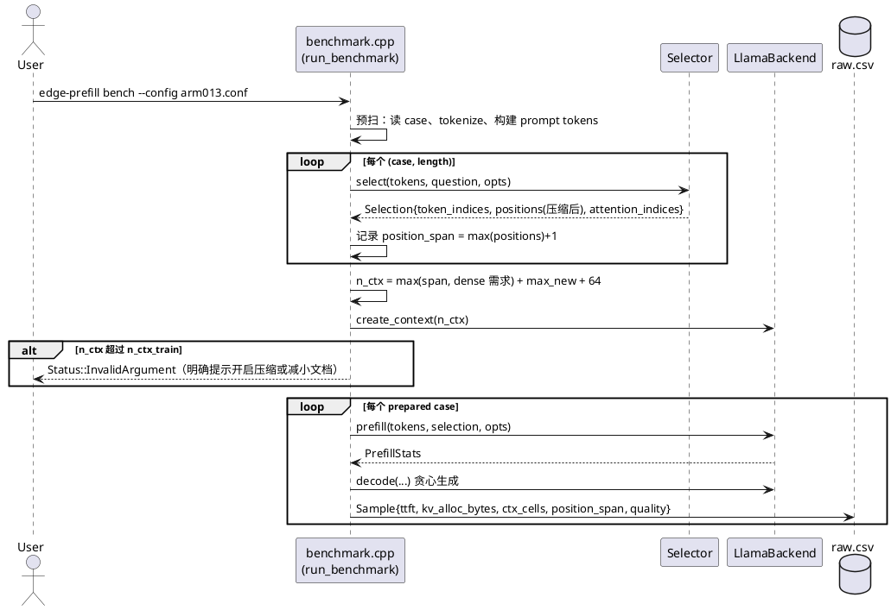
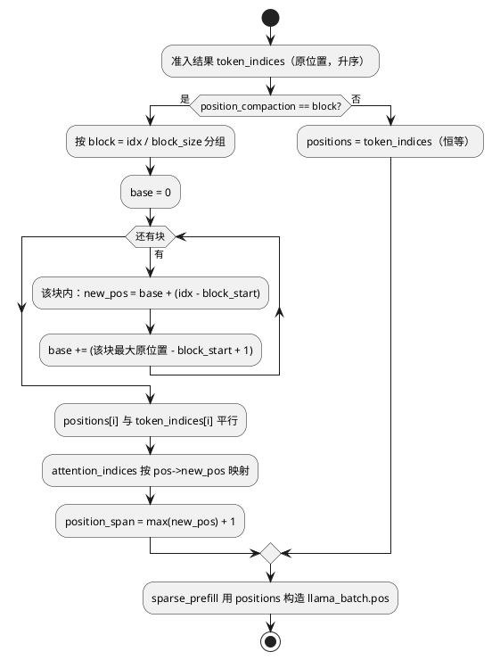
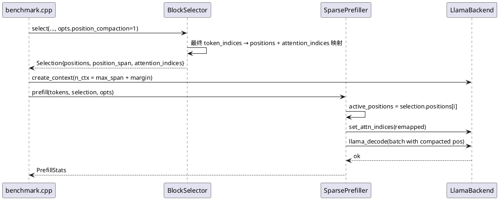

# 1 AR概述

| 组件名称 | EdgePrefill（端侧稀疏 prefill 规划与执行） |
| --- | --- |
| AR系统流水号 | AR013 |
| AR描述 | 紧凑上下文稀疏 prefill：KV 按实际准入量分配、块级位置压缩、超训练长度文档承载 |

需求阶段实测：`benchmark.cpp:278` 硬写 `ctx_opts.n_ctx = 0`，llama.cpp 取 `n_ctx_train=32768`，
4K 文档（准入 146 token）分配 **896 MiB** KV，实际只写入 3.5 MB。本 AR 让上下文规模跟随
准入量，并用块级位置压缩把"文档长度"从 KV 尺寸里解耦。

# 2 动态行为

## 2.1 bench 两阶段：先精确测量位置跨度，再申请上下文



## 2.2 位置压缩与下游重映射



# 3 功能点分解

| 序号 | 功能点名称 | 功能点描述 | 对应需求 |
| --- | --- | --- | --- |
| 1 | 资源审计 | `ctx_cells`/`kv_alloc_bytes`/`kv_used_bytes`/`rss_mb`/`position_span` 进 Selection→Sample→raw.csv/dump | FR-1 |
| 2 | 按需上下文 | bench 预扫精确求位置跨度，`n_ctx` 真实生效；显式不足时报错 | FR-1 |
| 3 | 块级位置压缩 | `position_compaction=block`，块内偏移保留、块间空隙消除 | FR-2 |
| 4 | 下游一致性 | gather 索引、chunk 边界、prefix_len、dump 全部用压缩位置 | FR-2 |
| 5 | 超训练长度 | 64K 真实 NIAH 在 32K 训练模型上跑通；dense 显式失败 | FR-3 |
| 6 | 组合闸门 | 质量不降 / TTFT 不增 / KV 分配大降 / 注入劣化 FAIL | FR-4 |

# 4 实现设计

## 4.1 功能实现思路

三层解耦：

1. **度量先行**（T001）：先把"分配了多少 / 用了多少"变成 CSV 里的真实数字，
   否则后面的优化无法自证。分配量按模型几何计算
   （`n_ctx × (K+V) × n_layer × head_dim × dtype`，与日志 `CPU KV buffer size` 逐项对齐），
   用量取既有 `llama_state_seq_get_size(ctx, 0)`，另记 `/proc/self/status` 的 `VmRSS`
   作为独立旁证。

   > 执行修正（2026-10-29）：原设计用 `llama_state_get_size(ctx)` 当分配量，实测它只返回
   *已写入*状态（4K 时恒定 4.3 MiB，与 n_ctx 无关），不能反映分配。
2. **按需分配**（T002，实现时按下方"执行修正"落地）：bench 从"先建 32K 上下文再跑"改为
   "起始 256 格 + 每个 case 按实际写入跨度 `ensure_context` 增长"。

   > 执行修正（2026-10-29）：原设计的"两阶段预扫"需要复制 planner/模式/预算的全部逻辑，
   > 成本与出错面都高于按需扩容；改为 `ensure_context` 单调增长，重建次数被跨度单调性限制
   > （实测每轮 ≤3 次），且重建不计入 TTFT。
3. **位置压缩**（T003/T004）：只在选择器的**最终** token 集合上做（含 AR011 span 与
   AR012 句子补齐、超限安全网之后），因此不与任何既有准入逻辑耦合；
   `token_indices`/`block_indices` 语义不变（仍是原位置/原块号），新增平行的 `positions`，
   下游只改"喂给 llama 的位置"。

## 4.2 功能实现设计

### 4.2.1 流程图

```plantuml
@startuml
start
:读取 conf / CLI;
:预扫阶段（无模型推理）;
  note right
  对每个 (case,length)：
    tokenize → select()
    缓存 tokens/pieces/Selection
  记录 max_span、max_full_len
  end note
if (position_compaction == block) then (是)
  :n_ctx = max_span + max_new + 64;
else
  :n_ctx = max_full_len + max_new + 64;
endif
if (n_ctx > n_ctx_train) then (是)
  :返回 InvalidArgument（提示开启压缩）;
  stop
endif
:create_context(n_ctx);
:记录 kv_alloc_bytes = llama_state_get_size(ctx);
loop 每个 prepared case
  :prefill（positions 已压缩）;
  :decode 贪心生成;
  :写 Sample（含资源审计）;
end
:写 raw.csv / report;
stop
@enduml
```

### 4.2.2 流程说明

- **预扫**：不改推理语义，只把"tokenize + select"从主循环提到前面；选择器是确定性函数，
  缓存不改变结果（单测断言：预扫+主循环 与 逐 case 现算 的 `token_indices` 逐位一致）。
- **n_ctx**：`position_span` 来自压缩后位置；dense 臂若在本轮需要测量，则一并考虑其全长，
  但若全长 > `n_ctx_train` 则不纳入（dense 会在 per-case 校验处显式失败，符合 FR-3）。
- **压缩失败降级**：若压缩后位置非严格递增（理论上不会），选择器返回 `Status` 错误；
  bench 记录 `compaction_reason=fallback` 并回退恒等位置，不静默产出错误数据。
- **prefix cache**：`prefix_len > 0` 时禁用压缩（前缀复用要求位置与原文档一致），
  并在审计里写 `compaction_reason=prefix-cache`。

## 4.3 接口描述

新增/变更的接口（均为组件内部 API，`Status` 返回，不加异常）：

```cpp
// include/edge_prefill/selector.h
struct Selection {
    ...
    // AR013: 与 token_indices 平行的压缩后位置（空 = 恒等，AR012 及之前行为）。
    std::vector<uint32_t> positions;
    // AR013 审计：位置跨度 = max(positions)+1；压缩节省 = prompt_tokens - position_span。
    uint32_t position_span = 0;
    std::string compaction_reason;   // "" | "block" | "prefix-cache" | "fallback"
};

struct SelectionOptions {
    ...
    int position_compaction = 0;     // 0 = off（库默认，AR012 行为），1 = block
};

// include/edge_prefill/metrics.h
struct Sample {
    ...
    uint32_t ctx_cells = 0;          // 申请的上下文格数（n_ctx）
    uint64_t kv_alloc_bytes = 0;     // llama_state_get_size（全上下文）
    uint64_t kv_used_bytes = 0;      // llama_state_seq_get_size（已写入）
    uint64_t rss_mb = 0;             // 进程 VmRSS（独立旁证）
    uint32_t position_span = 0;      // 压缩后位置跨度
    std::string compaction_reason;
};

// conf / CLI
// position_compaction = 0|1   /  --position-compaction off|block
// --n-ctx N 显式覆盖（不足即报错，不静默截断）
```

时序（跨模块）：



## 4.4 代码设计

```
include/edge_prefill/selector.h     Selection.positions/position_span/compaction_reason
                                    SelectionOptions.position_compaction
include/edge_prefill/metrics.h      Sample 资源审计字段
include/edge_prefill/benchmark.h    （如需）prepared case 结构

src/selector.cpp                    compact_positions_block(): 分组→累计偏移→映射
src/sparse_prefill.cpp              active_positions 改取 selection.positions；
                                    gather 索引按压缩位置映射（既有 lower_bound 逻辑不变）
src/benchmark.cpp                   两阶段预扫；n_ctx 精确申请；资源审计写入；
                                    compaction 与 prefix cache 的互斥处理
src/backend.cpp                     kv_alloc_bytes()/rss_mb() 轻量查询；n_ctx 显式设置
src/config.cpp, src/main.cpp        position_compaction 解析、--n-ctx 生效
src/metrics.cpp                     CSV 新列（末尾追加，保持既有列序）
```

模块化要点：压缩只发生在"选择器收尾"一处，`sparse_prefill` 只认 `positions`，
`attention_sparsity`/`chunk_scheduler` **零改动**（它们看到的位置已经是压缩后的）。
这样后续若引入 token 级或线性压缩，只需换 `compact_positions_*` 的实现。

# 5 重构设计（可选）

`benchmark.cpp` 的 350 行 case 循环抽成 "prepare（tokenize+select）→ execute（prefill+decode+记账）"，
不改变既有行为与列序；这是本 AR 唯一的结构性重构，收益是 n_ctx 可精确申请且 tokenize 不重复。

# 6 测试设计

## 6.1 单元测试（UT）

- `compact_positions_block`：严格递增；块内相邻 token 位置差与原文档一致；
  块间无空隙（`position_span == 保留 token 数`）；
- 恒等路径（`position_compaction=0`）：`positions == token_indices`，与 AR012 逐位一致；
- `attention_indices` 映射后仍是 `positions` 的子集且升序；
- 幂等：对已压缩的位置再压缩不变；
- 显式 `n_ctx` 不足 → `Status::InvalidArgument`（不静默截断）；
- 资源审计：`kv_alloc_bytes >= kv_used_bytes`，`ctx_cells == n_ctx`。

## 6.2 接口测试

- conf/CLI 两种入口设置 `position_compaction`，行为一致；
- `Selection::to_json()` 增加 `positions`/`position_span`/`compaction_reason` 后，
  `analyze_dump.py` 仍能解析旧 dump（向后兼容）。

## 6.3 业务场景测试

- 7 数据集 × {AR012, AR013}：质量、token、TTFT、`kv_alloc_bytes` 全表；
- 64K NIAH（4 例）：AR013 跑通并给质量；dense 显式失败；
- GPU（CUDA）一致性：selection/positions 与 CPU 完全相同（选择在主机侧）。

## 6.4 异常场景测试

- `--n-ctx` 小于所需：报错退出，非零码；
- 64K + 关闭压缩：明确报错（上下文不足），不崩溃不 OOM；
- `prefix_len > 0` 且开启压缩：自动禁用压缩并审计 `prefix-cache`；
- 空 selection（无证据）：`positions` 为空，prefill 走既有空路径，不越界。
