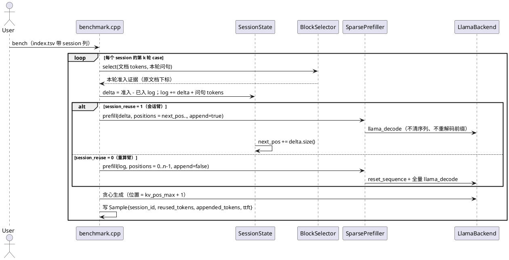
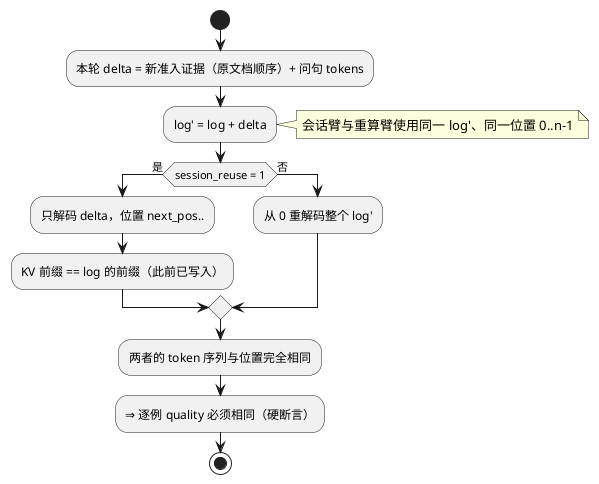
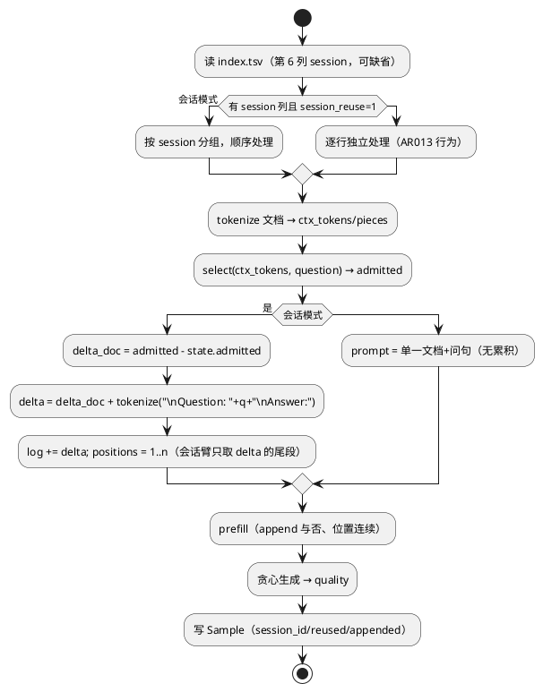

# 1 AR概述

| 组件名称 | EdgePrefill（端侧稀疏 prefill 规划与执行） |
| --- | --- |
| AR系统流水号 | AR014 |
| AR描述 | 会话级 KV 复用：append-only 上下文 + 增量准入，多轮每轮成本与该轮新增证据成正比 |

# 2 动态行为

## 2.1 会话顺序执行（同一 session 共享一个 llama sequence）



## 2.2 质量等价的不变量



# 3 功能点分解

| 序号 | 功能点名称 | 功能点描述 | 对应需求 |
| --- | --- | --- | --- |
| 1 | 会话状态 | append-only log、已入 log 的文档下标、位置游标、单次重置 | FR-1 |
| 2 | 追加解码 | `SparsePrefiller::Options.append`：跳过 `reset_sequence`，位置续写 | FR-1 |
| 3 | 增量准入 | bench 计算 delta（新证据 + 问句），维护 log；两臂共用 log | FR-1/FR-2 |
| 4 | 质量等价 | 两臂同 token 同位置，逐例 quality 相同 | FR-2 |
| 5 | 延迟收益 | 每轮 TTFT 与 delta 成正比；第 5 轮 ≤0.5× | FR-3 |
| 6 | 回归保护 | 无 session 列 / 关闭复用 ⇒ 与 AR013 逐位一致 | FR-3 |
| 7 | 闸门 | 质量等价 + 多轮延迟 + 单轮回归 + 两种注入 | FR-4 |

# 4 实现设计

## 4.1 功能实现思路

- **复用必须"严格同前缀"**：会话内容只追加不重排，因此第 k 轮的 log 是第 k+1 轮 log 的前缀，
  已写入的 KV 天然可复用，不需要 CacheBlend 式的重算修正。
- **两臂由同一份 log 驱动**：重算臂每轮从 0 prefill 当前 log，会话臂只 prefill delta；
  两者的 token 序列和位置完全一致，质量必须逐例相同——这是可验证的硬不变量，而不是"应该差不多"。
- **不碰选择器**：增量 = 本轮准入 ∩ 未入 log，选择逻辑完全沿用 AR012/AR013，
  因此本 AR 不可能改变单轮准入质量（回归风险隔离）。

## 4.2 功能实现设计

### 4.2.1 流程图



### 4.2.2 流程说明

- **delta 顺序**：新增证据保持原文档顺序；问句放在最后，保证最后一个 token 是问句尾部
  （首 token logits 才对应答案）。
- **位置**：会话臂 `positions[i] = next_pos + i`；重算臂 `positions[i] = i`。由于两臂 log 相同，
  第 k 轮会话臂的位置区间 `[0, |log|)` 与重算臂完全重合。
- **生成**：沿用 AR013 的 `stats.kv_pos_max + 1` 续写，两臂一致。
- **降级**：同一 session 的 `context_path` 变化 → 报错；`append` 失败 → 重建会话并记录 `session_reset_reason`。

## 4.3 接口描述

```cpp
// include/edge_prefill/session.h（新增）
struct SessionState {
    std::string id;
    std::string context_path;        // 复用前的文档一致性校验
    std::vector<llama_token> log;    // append-only
    std::vector<uint32_t> admitted;  // 已入 log 的原文档 token 下标（升序）
    uint32_t next_pos = 0;           // 下一个可写位置
    uint32_t turns = 0;
    uint32_t resets = 0;
    std::string reset_reason;
};

class SessionStore {                 // 进程内会话表（按 id）
public:
    Status begin(const std::string& id, const std::string& context_path,
                 SessionState** out);      // 首次创建 / 复用；上下文不一致即报错
    void reset(SessionState* s, std::string reason);
    size_t size() const;
};

// include/edge_prefill/sparse_prefill.h
struct Options {
    ...
    bool append = false;             // AR014: 不清序列，位置由调用方给出
};

// include/edge_prefill/metrics.h
struct Sample {
    ...
    std::string session_id;
    uint32_t reused_tokens = 0;      // 本轮未重算的 token（log 前缀长度）
    uint32_t appended_tokens = 0;    // 本轮新写入的 token
    std::string session_reset_reason;
};
```

conf / CLI：`session_reuse = 0|1`、`--session-reuse on|off`、`session_ctx_max = N`
（`--session-ctx-max N`，默认 4096，0 = 不限）。

## 4.4 代码设计

```
include/edge_prefill/session.h      SessionState / SessionStore（纯数据结构，可无模型单测）
src/session.cpp                     会话创建/复用/重置；上下文一致性校验
include/edge_prefill/sparse_prefill.h  Options.append
src/sparse_prefill.cpp              append 时跳过 reset_sequence；位置由 selection.positions 给出
src/benchmark.cpp                   index 第 6 列解析、会话分组、delta 计算、两臂执行、审计
src/config.cpp, src/main.cpp        session_reuse 解析与 CLI
src/metrics.cpp                     CSV 追加 session_id/reused_tokens/appended_tokens/session_reset_reason
```

# 5 重构设计（可选）

`benchmark.cpp` 的"每行一次 prefill"抽成 `run_turn(row, session_or_null, mode)`，
会话与非会话共用同一生成/记账路径，避免两套代码漂移。

# 6 测试设计

## 6.1 单元测试（UT）

- `SessionStore::begin`：首次创建、复用、`context_path` 不一致报错；
- log 追加：已入 log 的下标不重复追加（幂等）；`next_pos` 与 `log.size()` 一致；
- `reset` 清零 log/admitted/next_pos 并记录原因；
- `Options.append` 关闭时与既有行为一致（不改变 dense/budget 语义）。

## 6.2 接口测试

- `index.tsv` 有/无第 6 列都能解析；无列时输出与 AR013 逐位一致；
- CSV 新增 4 列后，旧分析脚本（按列名读）仍可用。

## 6.3 业务场景测试

- `deep/multiturn` 8 会话 × 5 轮：两臂逐例 quality 相同；逐轮 TTFT 与 `appended_tokens` 相关；
- 8 个单轮数据集（session 关闭）：与 AR013 逐位一致；
- CUDA：会话臂在两轮后 selection/positions/quality 与 CPU 一致。

## 6.4 异常场景测试

- 同一 session 中途换文档 → 明确报错，不跨文档复用；
- `session_reuse=1` 但数据集无 session 列 → 退化为逐行独立（记录 warning）；
- 生成长度跨越 `n_ctx` → 走 AR013 的显式报错路径，不越界。

# 7 实现差异（as-built）

开发与实测过程中与上面设计有出入、以及新增的内容，全部记录在此，正文保留设计初衷。

## 7.1 会话尾部：`pending_tail` + chat 模板逐轮组装

设计里"delta = 新证据 + 问句"不够：多轮对话的每一轮都要带上一轮的助手回答和
chat 模板的结束符，否则第 k 轮的 log 不是第 k+1 轮的自然前缀。
实现改为：

- 首轮用完整 `build_prompt`（与单轮路径完全一致，保证回归）；
- 后续轮用 `build_chat_turn` 按模板组装"上一轮回答 + 本轮问句"，并把
  `SessionState::pending_tail`（生成结果 + 模板终止符）放在最前面。

早期版本只追加"新证据 + 问句"，两臂 log 长度立刻分叉，被 `session_log_hash`
审计当场抓出——这也是把 hash 写进 CSV 的直接原因。

## 7.2 一次性定容 `session_ctx_max`（新增，设计阶段没有）

`llama.cpp` 扩容上下文会重建 context，KV 全丢，所以会话"中途不能扩容"，必须在首轮定容：

```
need    = log + max_new + 8
wanted  = turns x (本轮 delta x 1.5 + max_new + 32) + 256     # 仅首轮
wanted  = min(wanted, max(session_ctx_max, need))             # 默认 cap 4096
```

后续轮若 `need` 超过已分配，`ensure_context` 会重建（`context_creations` 变化），
此时本轮**降级为全量重建**（`batch_tokens = log`）并 warn，答案仍正确。

被否决的做法：按"轮数 × 全文档准入量（`doc_tokens × budget`）"预算。
`budget=1.0` 时 5 轮 ≈ 31K 格，CUDA 上 KV 4.6 GB + 图重分配直接把解码卡死（无输出、100% CPU）。

## 7.3 审计列增加到 6 个

设计里 4 个（`session_id`/`reused_tokens`/`appended_tokens`/`session_reset_reason`），
实现增加 `session_log_tokens`、`session_log_hash`。后者是"两臂输入完全相同"的硬证据：
hash = token 序列 + 位置。

## 7.4 FR-2 的判据从"逐例相同"改成"可证明不变量 + 统计界"

实测 40 轮中 39 轮 f1 逐位相同、hash 相同；1 例（`mt-03-t4`）hash 相同但 f1 从 0.200 变 0.800。
根因是整段分块 prefill 与增量 decode 在 ggml 里走不同 tiling，K/V 末位比特不同，greedy 放大。
该差异两次独立运行可复现，方向对复用臂有利。

因此闸门改为：

| 检查 | 判据 |
|---|---|
| assembly | 每轮两臂 log 长度相同；hash 相同（翻转的级联除外） |
| quality（逐例） | 单轮下降 ≤0.25 |
| quality-agg | 均值不降（−0.005 容差）且翻转轮 ≤5% |

这是把"浮点不满足结合律"当作已知事实来设计闸门，而不是放宽成一个模糊阈值。

## 7.5 单测落地

`tests/test_session.cpp` 6 例：创建幂等、跨文档报错、空参数报错、`reset` 保留 id/清零 log、
null 安全、`all()` 顺序。append 路径本身需要模型，故放在真机集成与矩阵里验证。

## 7.6 实测结论

多轮第 2–5 轮 TTFT 0.36×/0.29×/0.17×/0.17×，首轮 1.09×（无可复用内容）；
单轮数据集与 AR013 逐位一致；闸门 84 项 PASS，两种注入必 FAIL。详见
`benchmarks/results/ar014-session-kv-reuse/REPORT.md`。
