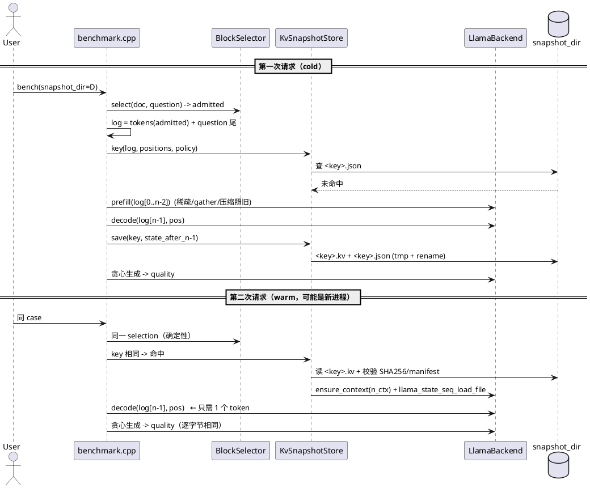
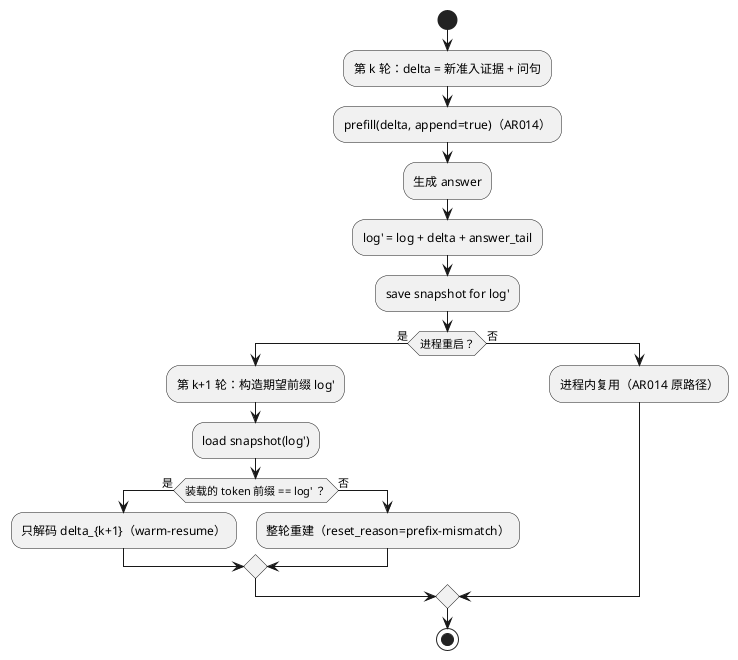
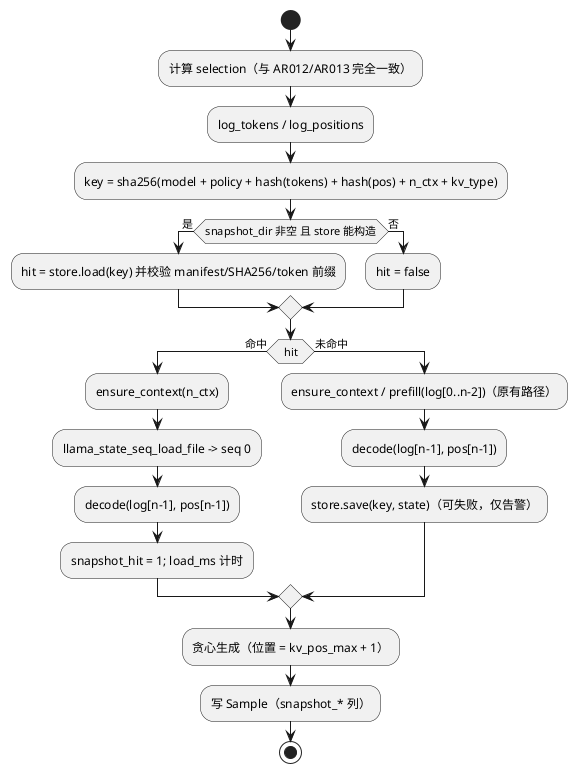

# 1 AR概述

| 组件名称 | EdgePrefill（端侧稀疏 prefill 规划与执行） |
| --- | --- |
| AR系统流水号 | AR015 |
| AR描述 | 持久化 KV 快照（内容寻址）+ 跨进程热启动：把"同一份准入证据"的第二次请求从重算 prefill 变成装载序列状态，质量逐位不变 |

# 2 动态行为

## 2.1 cold → warm 时序（同机两次进程）



## 2.2 会话跨进程续跑（与 AR014 组合）



# 3 功能点分解

| 序号 | 功能点名称 | 功能点描述 | 对应需求 |
| --- | --- | --- | --- |
| 1 | 序列状态读写 | `LlamaBackend::save_sequence_state/load_sequence_state`，封装 llama.cpp 序列状态 API，返回 `Status` | FR-1 |
| 2 | 内容寻址 key | 模型指纹 + 准入策略指纹 + log token 哈希 + 位置哈希 + n_ctx + KV 精度 → SHA256 | FR-1 |
| 3 | 快照仓库 | 原子写（tmp+rename）、manifest(SHA256)、装载校验、体积上限与 LRU 淘汰 | FR-1/FR-5 |
| 4 | bench 接入 | `snapshot_dir`/`snapshot_max_bytes` 配置；cold 落盘、warm 装载；未命中/校验失败回退 | FR-1/FR-3 |
| 5 | 质量等价 | warm 与 cold 生成文本逐字节相同；首 token logits ≤1e-6 | FR-2 |
| 6 | 会话续跑 | 每轮落盘；重启后从上一轮快照续跑；前缀不符则重建 | FR-4 |
| 7 | 审计与闸门 | 5 个 CSV 列 + `ar015_report.py` 五项闸门 + 两种注入 | FR-5 |

# 4 实现设计

## 4.1 功能实现思路

**为什么是"整段 log 快照"而不是别的：**

| 方案 | 思路 | 优点 | 缺点 | 结论 |
| --- | --- | --- | --- | --- |
| A 整段 log 快照（本设计） | 对一条确定的 log（token+位置）保存序列 KV 状态 | 与 llama.cpp 原生能力对齐；装载后只差最后 1 个 token；会话天然可续跑 | 不同 log 之间不能共享 | **采用** |
| B 段级/块级 KV 分页 | 按 32-token 块切分保存，前缀相同的不同 log 可拼装 | 跨问题命中率更高 | llama.cpp 无"部分序列"读写 API；需要改造 prefill 让 KV 按块落盘，块边界与压缩位置耦合；命中率在准入后证据集变化时并不高 | 否决（成本/收益不成立） |
| C 进程内 KV 池 | 只在内存里缓存 | 最快 | 已是 AR014 的覆盖范围；进程退出即失效 | 否决（无增量价值） |

方案 A 的关键设计点：**快照覆盖 `log[0..n-1)`，warm 路径只解码最后一个 token**。
这样 warm 与 cold 的最后一个 token 走同一条 `decode` 路径，首 token logits 天然可比对，
也不会出现"状态里的最后格与 decode 结果不一致"的隐患。

## 4.2 功能实现设计

### 4.2.1 流程图



### 4.2.2 流程说明

- **确定性前提**：selection 只依赖文档 token、问题、配置，因此同 case 两次运行的 log 必然相同；
  key 相同即命中。任何配置变化（预算/结构/句子补齐/KV 精度/上下文格数）都改变 policy 指纹 → 自然未命中。
- **前 n-1 个 token 的 prefill** 仍走 AR013 的稀缺路径（gather + 位置压缩），因此快照里存的就是
  压缩后的 KV，体积 = `kv_used_bytes`。
- **最后一个 token**：cold 路径在保存后 decode；warm 路径装载后 decode 同一 token、同一位置。
- **原子性**：先写 `<key>.kv.tmp` 与 `<key>.json.tmp`，`rename` 覆盖；manifest 里记录 `.kv` 的 SHA256。
- **淘汰**：写入前若目录总量 > `snapshot_max_bytes`（默认 512 MiB），按 mtime 从旧到新删除，
  跳过正在使用的文件。
- **失败处理**：装载失败/校验失败 → `snapshot_state="miss:<reason>"`，走 cold 路径并**覆盖写入**；
  保存失败 → 只告警（`warnings`），不影响结果。
- **会话**：AR014 的每轮结束后用该轮 log 落盘（`save` 在 prefill+生成之后，包含 assistant tail）。

## 4.3 接口描述

```cpp
// include/edge_prefill/kv_snapshot.h（新增）

// 快照 key 的组成要素。任何一个变化都必须改变 key，否则会误用过期 KV。
struct SnapshotKey {
    std::string model_key;        // GGUF sha256 + 结构指纹 + llama.cpp commit
    std::string policy_key;       // 准入策略指纹（见 PolicyFingerprint）
    uint64_t token_hash;          // log token 序列 FNV-1a
    uint64_t position_hash;       // log 位置序列 FNV-1a
    uint32_t n_tokens;
    uint32_t n_ctx;
    std::string kv_type;          // f16/q8_0/...
    std::string hex() const;      // sha256(material)[:32]，同时用作文件名
};

struct SnapshotSaveResult {
    bool ok = false;
    uint64_t bytes = 0;
    double save_ms = 0.0;
    std::string reason;           // 失败原因（ok=false 时非空）
};

struct SnapshotLoadResult {
    bool hit = false;
    uint64_t bytes = 0;
    double load_ms = 0.0;
    std::string state;            // "warm" / "miss:absent" / "miss:manifest" /
                                  // "miss:sha256" / "miss:tokens" / "miss:load"
};

class KvSnapshotStore {
public:
    static Status create(const std::string& dir, uint64_t max_bytes,
                         KvSnapshotStore** out);
    // 保存 `tokens` 对应的当前序列状态（seq 0）。
    SnapshotSaveResult save(const SnapshotKey& key,
                            const std::vector<llama_token>& tokens,
                            LlamaBackend* backend);
    // 装载并校验：manifest 指纹、.kv SHA256、状态内 token 前缀 == expect_prefix。
    SnapshotLoadResult load(const SnapshotKey& key,
                            const std::vector<llama_token>& expect_prefix,
                            LlamaBackend* backend);
};

// include/edge_prefill/backend.h（新增）
Status save_sequence_state(const std::string& path, llama_seq_id seq);
Status load_sequence_state(const std::string& path, llama_seq_id seq,
                           std::vector<llama_token>* tokens_out);
uint64_t sequence_state_bytes(llama_seq_id seq) const;   // = llama_state_seq_get_size

// include/edge_prefill/metrics.h（新增列）
uint32_t snapshot_hit = 0;          // 1 = 本次 prefill 由快照装载替代
uint64_t snapshot_bytes = 0;
double snapshot_load_ms = 0.0;
double snapshot_save_ms = 0.0;
std::string snapshot_state;         // warm / cold / miss:<reason>
std::string snapshot_key;           // 前 16 位，便于人工核对
```

conf / CLI：`snapshot_dir = <path>`、`snapshot_max_bytes = N`、`--snapshot-dir P`、
`--snapshot-max-bytes N`、`--snapshot-verify on|off`（默认 on，装载后校验 SHA256 + token 前缀）。

## 4.4 代码设计

```
include/edge_prefill/kv_snapshot.h    SnapshotKey / SnapshotSaveResult / SnapshotLoadResult / KvSnapshotStore
src/kv_snapshot.cpp                   key 计算、manifest 读写、SHA256、原子写、LRU 淘汰
include/edge_prefill/backend.h        save/load_sequence_state、sequence_state_bytes
src/backend.cpp                       封装 llama_state_seq_save_file / load_file
include/edge_prefill/benchmark.h      snapshot_dir / snapshot_max_bytes / snapshot_verify
src/config.cpp, src/main.cpp          配置与 CLI 解析
src/benchmark.cpp                     稀疏路径接入：key、命中/未命中、审计列、会话落盘
src/metrics.cpp, include/.../metrics.h  5 个审计列
benchmarks/scripts/ar015_matrix.py    cold/warm 两臂（两次独立进程）+ 会话三臂
benchmarks/scripts/ar015_report.py    五项闸门 + 两种注入
tests/test_kv_snapshot.cpp            key/校验/淘汰/LRU 的纯逻辑单测
tests/test_integration.cpp            真机：warm 与 cold 生成逐字节一致
```

**模块化要点：**
- `KvSnapshotStore` 不依赖 bench 逻辑，只依赖 `LlamaBackend` 与文件系统，便于单测；
- key 的 policy 指纹由 `benchmark.cpp` 统一构造（复用已有的 `Config` 字段），
  避免"某个准入开关没进 key"的静默错误 —— 这一点由单测按字段清单逐项断言。

# 5 重构设计（可选）

`benchmark.cpp` 的稀疏路径已经很长（AR013/AR014 各加了一段）。本 AR 把"准备 log → 得到 KV →
生成"抽成 `run_sparse_case(...)` 的三段式，快照只在"准备 log"与"得到 KV"之间插入，
避免再加一层 if-else 嵌套。重构范围限于该函数内部，不改变对外行为（由 AR013/AR014 矩阵回归保证）。

# 6 测试设计

## 6.1 单元测试（UT）

- key 稳定性：同输入两次 key 相同；任一要素（模型/策略/任一准入开关/n_ctx/KV 精度/token/位置）
  变化都必须改变 key（按字段清单逐项断言）；
- manifest 解析与校验：缺失、字段缺项、SHA256 不符 → 命中判定为 false 且原因正确；
- 原子写：写入后无 `.tmp` 残留；重复保存同一 key 覆盖成功；
- LRU 淘汰：目录超上限时按 mtime 删除最旧，且不删当前 key；
- `SnapshotKey.hex()` 长度与十六进制格式。

## 6.2 接口测试

- `save_sequence_state` 在不存在的目录 → `Status` 错误码 `Io`，不崩溃；
- `load_sequence_state` 读损坏文件 → 返回失败，`tokens_out` 不被修改；
- `sequence_state_bytes` 与 `llama_state_seq_get_size` 一致。

## 6.3 业务场景测试

- 8 个单轮数据集：cold 落盘 → 新进程 warm 装载，quality 逐字节一致、TTFT 比值达标；
- `len64k`（AR013 解锁的长文档）：快照 35 MiB 级别，验证装载时间与体积；
- 多轮会话：`重启重算` / `重启续跑` / `进程内复用` 三臂 quality 一致，续跑 TTFT 达标；
- GPU（CUDA，全层卸载）：cold/warm 两臂，验证 ON_DEVICE 状态装载路径。

## 6.4 异常场景测试

- 快照文件被截断/篡改 → 未命中 + 回退重算，结果仍正确；
- 准入策略变更（改 budget）→ key 变化 → 未命中，不会误用旧 KV；
- 目录只读 → 保存失败仅告警，cold 路径结果不受影响；
- 上下文格数变化（n_ctx 不同）→ key 不同 → 未命中；
- 会话前缀不符（例如切换到另一策略）→ 重建并记录 `snapshot_state=miss:tokens`。

# 7 实现差异（as-built）

## 7.1 快照 payload 增加 logits（设计阶段没有）

设计是"快照 = 序列状态；warm 路径重新解码最后一个 token 取得 logits"。实测否决：

- 删格 + 单 token 解码得到的 logits 与"整段 prefill 末位 logits"最大绝对差 **0.79–0.90**
  （批次形状不同 → ggml tiling 不同，不是噪声）；
- 该单 token 解码约 **300 ms**，比整个快照装载（114–198 ms）更贵。

改为 payload = 状态 + 末位 prompt token 的 f32 logits（0.6 MB）。效果：warm 路径零计算、
首 token 逐字节相同、且更快。`LlamaBackend` 侧因此**不需要**新增 `save_sequence_state_file`，
复用现有 `save_state`/`load_state`（`llama_state_seq_get_data`/`set_data`）。

## 7.2 key 用准入 token，而不是整段 prompt

初版用 `tokens`（整段 prompt）做哈希，导致 key 与实际 KV 内容（准入后的稀疏序列）不对应；
改为按 `selection.token_indices` 取出的准入 token 序列计算 `token_hash`/`n_tokens`，
`save/load` 也用同一份序列。

## 7.3 会话路径的 TTFT 口径

装载发生在计时区之前，直接沿用原计时会报 0 ms；命中时把 TTFT 定为 `snapshot_load.load_ms`
（含读文件 + 校验 + `load_state`），与 cold 的 prefill 计时口径对齐。

## 7.4 校验恒开

设计里有 `snapshot_verify` 开关，实现里去掉了：校验（manifest 字段 + 状态/ logits 哈希 +
token 数）成本远小于重算，且关掉它只会制造"静默用错 KV"的风险。CLI 因此只有
`--snapshot-dir` 与 `--snapshot-use`。

## 7.5 多轮快照的 LRU 陷阱

默认 `snapshot_max_bytes = 512 MiB` 是 LRU 策略：40 轮会话（每轮 ~47 MB）会把早轮次淘汰，
导致重启续跑 0 命中。矩阵按会话体量把上限调到 4 GiB；文档明确写"默认值是 LRU 策略"。

## 7.6 未实现的部分

- 段级 KV 分页（跨 log 共享前缀）：llama.cpp 无部分序列读写 API，需改造 prefill 落盘边界，
  成本/收益不成立，未做；
- `LLAMA_STATE_SEQ_FLAGS_ON_DEVICE` 路径：实测 host 缓冲 + H2D 已足够（GPU 装载 94–116 ms，
  与 CPU 同量级），不引入额外分支。
